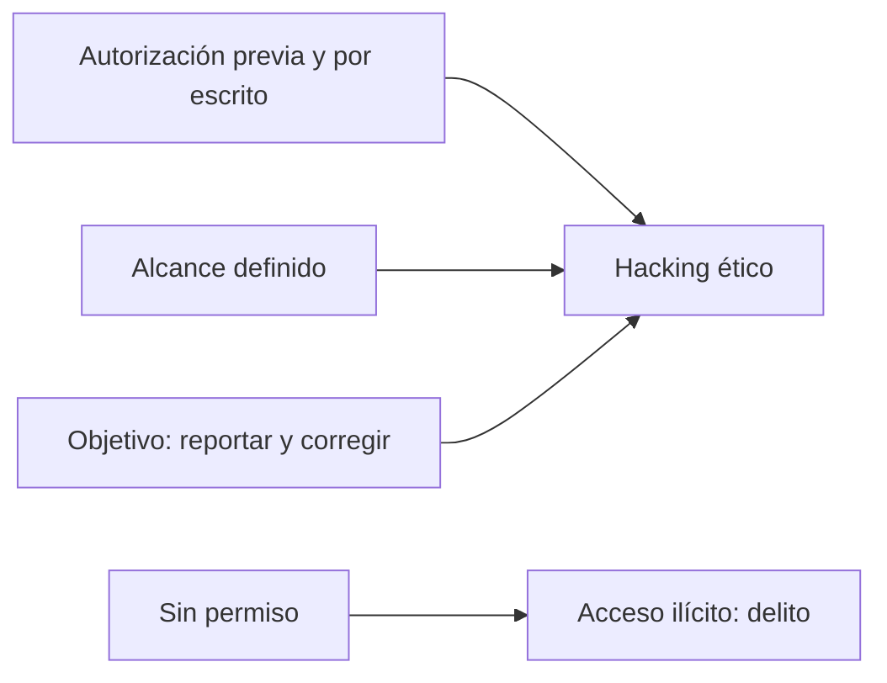

# Qué es el hacking ético

Parte de: [[12-Seguridad/06 Hacking ético/_Índice Hacking ético|Hacking ético]]

> [!info] Cómo avanzar
> `progreso`: **pendiente** → **viendo** (estudiando) → **visto** (contestaste la autoevaluación sin abrir las respuestas) → **dominado** (hiciste el laboratorio o lo aplicaste de verdad).

## Contenido

### Qué es
El hacking ético es la práctica de buscar debilidades en sistemas informáticos **con autorización** y con el objetivo de **ayudar a corregirlas**, no de aprovecharlas. El "hacker ético" usa las mismas técnicas que un atacante, pero con tres diferencias que lo definen: tiene permiso por escrito del dueño del sistema, trabaja dentro de un alcance acordado y reporta sus hallazgos para que se arreglen. Para un desarrollador, pensar como atacante sobre su propia app es una de las mejores formas de construir software más seguro.

### Qué lo distingue del hacking ilegal
La diferencia **no** está en la técnica ni en la intención subjetiva, sino en la **autorización**. Lo que separa una prueba legítima de un delito es:

- **Autorización previa y por escrito** del dueño del sistema ([[Marco legal y autorización por escrito]]).
- **Alcance definido**: qué se prueba, qué no, cómo y cuándo ([[Alcance (scope) de una prueba de seguridad]]).
- **Propósito de reportar**: el fin es entregar hallazgos para corregir, no obtener provecho ([[Cómo escribir un reporte de vulnerabilidad]]).

Un punto que confunde a mucha gente: **tener buenas intenciones no te protege legalmente**. Probar un sistema sin permiso puede ser delito en México aunque no causes daño, no robes datos ni saques provecho; el simple acceso no autorizado a un sistema con medidas de seguridad está tipificado (ver [[Marco legal y autorización por escrito]]). "Solo estaba revisando si era seguro" no es una defensa.

### Dónde practicar legalmente
Aprender a atacar requiere practicar, y hay entornos **diseñados para eso**, donde el permiso ya está dado:

- **Tus propios sistemas**: tu app en local, una máquina virtual tuya.
- **Laboratorios de aprendizaje**: [[PortSwigger Web Security Academy]] (gratuito, basado en navegador), [[OWASP Juice Shop]] y [[OWASP WebGoat]] (apps vulnerables que corres en tu máquina), [[TryHackMe]] y [[Hack The Box]] (plataformas con máquinas de práctica).
- **Programas de bug bounty**: cuando una empresa invita públicamente a buscar fallas, dentro de sus reglas ([[Programas de bug bounty]]).

Nunca practiques contra un sitio real "para ver si funciona" solo porque la técnica la aprendiste en un laboratorio. El laboratorio te da el permiso; el sitio real no.

### Por qué le sirve a un desarrollador
No necesitas volverte pentester para beneficiarte. Entender cómo se explota una [[SQL injection]], un [[XSS - qué es y por qué ocurre|XSS]] o un [[Control de acceso roto e IDOR|IDOR]] te hace escribir código que los previene desde el diseño. Las plataformas anteriores enseñan la vulnerabilidad desde el lado ofensivo, y eso cierra el círculo con la defensa que practicas en el resto de esta área.

### Ejemplo
Un desarrollador de Itzamna.Clio quiere entender el XSS para reforzar su front. En lugar de probar en un sitio ajeno:

1. Hace el módulo de XSS de PortSwigger Academy, que le da un entorno controlado y legal.
2. Levanta OWASP Juice Shop en local con Docker y reproduce un par de retos.
3. Revisa su propio código buscando dónde inserta HTML sin escapar y aplica la [[XSS - codificación de salida según el contexto|codificación de salida]] y la [[XSS - protección por defecto de React y dangerouslySetInnerHTML|protección por defecto de React]].

Todo el aprendizaje ofensivo ocurrió en entornos autorizados; la mejora se aplicó a su propia aplicación.

### Cuándo usarlo y cuándo no
Piensa como atacante **siempre** al diseñar y revisar tu propio software. Realiza pruebas activas solo sobre lo que te pertenece o lo que tienes autorizado por escrito. Ante la duda sobre si algo está permitido, la respuesta por defecto es **no lo hagas** hasta tener la autorización.

### Errores comunes
- **Creer que la intención basta**: sin permiso, es acceso no autorizado.
- **Probar en producción de la empresa** sin autorización explícita, "porque trabajo ahí".
- **Usar técnicas de laboratorio en sitios reales** de terceros.
- **Confundir divulgación con extorsión**: pedir dinero a cambio de no publicar una falla no es hacking ético.
- **No documentar el permiso**: aunque te lo hayan dicho de palabra, necesitas la autorización por escrito.

### Para profundizar
- [OWASP - Web Security Testing Guide](https://owasp.org/www-project-web-security-testing-guide/)
- [PortSwigger Web Security Academy](https://portswigger.net/web-security)
- [EC-Council - Qué es el hacking ético](https://www.eccouncil.org/cybersecurity-exchange/ethical-hacking/what-is-ethical-hacking/)

## Autoevaluación

Contesta primero en voz alta o en papel; luego despliega la respuesta.

> [!question]- ¿Qué distingue al hacking ético del ilegal?
> La **autorización** previa y por escrito del dueño del sistema, un alcance definido, y el objetivo de reportar para corregir, no de aprovecharse.

> [!question]- ¿Dónde puedes practicar legalmente?
> En tus propios sistemas, en laboratorios hechos para eso ([[PortSwigger Web Security Academy]], [[OWASP Juice Shop]] local, [[OWASP WebGoat]]) y en programas de bug bounty respetando sus reglas.

> [!question]- ¿Tener buenas intenciones te protege legalmente?
> No. Probar un sistema sin permiso puede ser delito aunque no causes daño ni robes datos.

