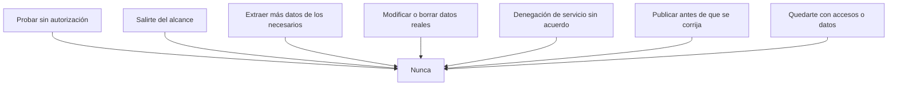

# Qué nunca hacer

Parte de: [[12-Seguridad/06 Hacking ético/_Índice Hacking ético|Hacking ético]]

> [!info] Cómo avanzar
> `progreso`: **pendiente** → **viendo** (estudiando) → **visto** (contestaste la autoevaluación sin abrir las respuestas) → **dominado** (hiciste el laboratorio o lo aplicaste de verdad).

## Contenido

### Qué es
Esta nota reúne las líneas rojas de una prueba de seguridad: acciones que, aunque técnicamente posibles, nunca debes realizar porque son ilegales, dañinas o éticamente inaceptables, incluso dentro de una prueba autorizada. Conocerlas es tan importante como conocer las técnicas: un hallazgo valioso pierde todo su valor (y te mete en problemas) si en el camino cruzaste una de estas líneas.

### La lista de "nunca"

- **Probar sin autorización** por escrito del dueño ([[Marco legal y autorización por escrito]]).
- **Salirte del alcance** acordado, aunque veas algo tentador fuera de él ([[Alcance (scope) de una prueba de seguridad]]).
- **Extraer más datos de los necesarios** para demostrar el hallazgo: con una prueba mínima basta.
- **Modificar o borrar datos reales**: una prueba no debe cambiar el estado del sistema productivo.
- **Denegación de servicio** (saturar, tumbar el servicio) sin acuerdo explícito.
- **Publicar la vulnerabilidad** antes de que se corrija y fuera del proceso acordado ([[Divulgación responsable]]).
- **Quedarte con accesos, copias de datos o puertas traseras** al terminar.

### Por qué no se usan herramientas automáticas agresivas en producción
Los escáneres automáticos "agresivos" (escaneo activo de [[OWASP ZAP]] en modo completo, fuzzers, Intruder a toda velocidad) envían muchísimas peticiones, a veces con datos basura. Contra **producción** y sin acuerdo pueden:

- **Saturar el servicio** y afectar a usuarios reales (una denegación de servicio no intencional).
- **Crear datos basura**: miles de registros de prueba, correos enviados, pedidos falsos.
- **Disparar alertas** del equipo de seguridad y consumir su tiempo en un "incidente" que eras tú.
- **Bloquear cuentas** reales por exceso de intentos.

Por eso el escaneo activo se reserva para entornos de pruebas, con datos ficticios, y el baseline **pasivo** es lo que puede correr de forma segura en más situaciones ([[Pruebas de seguridad en el pipeline]]).

### Qué hacer si encuentras datos personales reales
Durante una prueba autorizada puedes toparte con datos personales reales (una tabla de clientes, correos, CURP). La conducta correcta:

1. **Detente en el mínimo** necesario para demostrar el impacto; no sigas extrayendo.
2. **No los descargues** ni los copies fuera del entorno.
3. **Avisa de inmediato** al contacto acordado.
4. **Documéntalo** según lo pactado, describiendo el acceso sin incluir los datos sensibles en el reporte (usa capturas redactadas o ejemplos ficticios).

Esto también conecta con la obligación legal de proteger datos personales ([[Privacidad - ley mexicana de datos personales (LFPDPPP)]]): encontrarlos no te autoriza a manejarlos.

### Ejemplo
En una prueba autorizada al entorno de pruebas de un cliente, el tester descubre que un endpoint devuelve pedidos de otros tenants (un IDOR). En vez de descargar todos los pedidos para "medir el alcance":

- Toma **una** captura con un solo registro ajeno (con datos redactados) como evidencia.
- Anota el endpoint, el id usado y la respuesta.
- Avisa al contacto y lo documenta en el reporte, recomendando el filtro por tenant.

Demostró el impacto sin extraer datos de más ni modificar nada.

### Cuándo usarlo y cuándo no
Estas reglas aplican **siempre**, incluso con autorización: el permiso define el alcance, no una licencia para hacer cualquier cosa. En laboratorios de práctica, donde los datos son ficticios, puedes ser más agresivo con las herramientas, porque ese es su propósito.

### Errores comunes
- **"Ya que estoy, pruebo esto otro"**: salirte del alcance por curiosidad.
- **Descargar bases enteras** para "cuantificar" el impacto.
- **Correr un escáner activo contra producción** sin avisar.
- **Guardar credenciales encontradas** "por si acaso".
- **Publicar el hallazgo** en redes antes de que se corrija.

### Para profundizar
- [OWASP - Web Security Testing Guide](https://owasp.org/www-project-web-security-testing-guide/)
- [FIRST - Ethics for Incident Response and Security Teams](https://www.first.org/global/sigs/ethics/ethics-first)
- [Código Penal Federal (texto vigente)](https://www.diputados.gob.mx/LeyesBiblio/index.htm)

## Autoevaluación

Contesta primero en voz alta o en papel; luego despliega la respuesta.

> [!question]- Menciona prácticas que nunca debes hacer.
> Probar sin autorización; salirte del alcance; extraer más datos de los necesarios para demostrar el hallazgo; modificar o borrar datos reales; denegación de servicio; publicar la vulnerabilidad antes de que se corrija; quedarte con accesos o datos al terminar.

> [!question]- Encuentras datos personales reales durante una prueba autorizada. ¿Qué haces?
> Detenerte en lo mínimo para demostrar el impacto, no descargarlos, avisar al contacto y documentarlo según lo acordado.

> [!question]- ¿Por qué no se usan herramientas automáticas "agresivas" en producción sin acuerdo?
> Pueden saturar el servicio, crear datos basura, disparar alertas y bloquear usuarios reales.

## Práctica

- [[Lab 11 - Carta de autorización y reporte de vulnerabilidad]]

