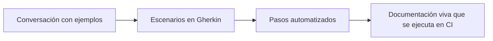

# BDD

Parte de: [[13-Testing-Calidad/_Índice Testing y calidad|Testing y calidad]]

> [!info] Cómo avanzar
> `progreso`: **pendiente** → **viendo** (estudiando) → **visto** (contestaste la autoevaluación sin abrir las respuestas) → **dominado** (hiciste el laboratorio o lo aplicaste de verdad).

## Contenido

### Qué es
**BDD** (*Behavior-Driven Development*, desarrollo guiado por comportamiento) es una práctica de colaboración que nace de TDD: antes de programar, negocio, desarrollo y QA acuerdan **ejemplos concretos** de cómo debe comportarse el sistema, escritos en lenguaje del dominio. Esos ejemplos se vuelven criterios de aceptación y, opcionalmente, pruebas automatizadas. Dan North la propuso para que las pruebas hablaran de comportamiento y no de métodos.

### Cómo funciona
1. **Descubrir**: en una conversación (por ejemplo, las "tres amigas": negocio, desarrollo, QA) se exploran reglas con ejemplos reales, incluidos los casos raros. Técnicas como *Example Mapping* ayudan: reglas en tarjetas, ejemplos debajo, preguntas abiertas aparte.
2. **Formular**: los ejemplos se escriben como escenarios estructurados, normalmente en **Gherkin**.
3. **Automatizar** (opcional): cada paso del escenario se enlaza con código que ejecuta y verifica.



#### Gherkin
Es un lenguaje estructurado, legible por personas no técnicas, con palabras clave en varios idiomas (incluido español con `# language: es`). Las principales:

- `Característica` (`Feature`): la funcionalidad.
- `Escenario` (`Scenario`): un ejemplo concreto.
- `Dado` (`Given`): el contexto inicial.
- `Cuando` (`When`): la acción.
- `Entonces` (`Then`): el resultado esperado.
- `Y` / `Pero`: pasos adicionales; `Esquema del escenario` con `Ejemplos` para tablas de casos.

### Ejemplo
Regla de una cuenta de Pochteca.Nomisma: no se puede retirar más del saldo.

```gherkin
  # language: es
Característica: Retiro de efectivo
  Para evitar sobregiros
  Como titular de una cuenta
  Quiero que no se permita retirar más de mi saldo

  Escenario: Retiro mayor al saldo es rechazado
    Dado una cuenta con saldo de 500.00 pesos
    Cuando intento retirar 800.00 pesos
    Entonces el retiro es rechazado con el código "SALDO_INSUFICIENTE"
    Y el saldo de la cuenta sigue siendo 500.00 pesos

  Esquema del escenario: Retiros permitidos
    Dado una cuenta con saldo de <saldo> pesos
    Cuando intento retirar <monto> pesos
    Entonces el saldo de la cuenta es <final> pesos

    Ejemplos:
      | saldo  | monto  | final  |
      | 500.00 | 500.00 | 0.00   |
      | 500.00 | 120.50 | 379.50 |
```

En .NET, la herramienta para automatizar Gherkin es **Reqnroll**, sucesora comunitaria de SpecFlow (SpecFlow llegó a fin de vida el 31 de diciembre de 2024). Cada paso se enlaza con un método:

```csharp
[Binding]
public sealed class RetiroPasos
{
    private Cuenta _cuenta = null!;
    private Resultado _r = null!;

    // reqnroll.json: "bindingCulture": { "name": "en-US" } para leer 500.00 con punto decimal
    [Given(@"una cuenta con saldo de (\d+\.\d{2}) pesos")]
    public void DadoSaldo(decimal saldo) => _cuenta = Cuenta.ConSaldo(saldo);

    [When(@"intento retirar (\d+\.\d{2}) pesos")]
    public void CuandoRetiro(decimal monto) => _r = _cuenta.Retirar(monto);

    [Then(@"el retiro es rechazado con el código ""(.*)""")]
    public void EntoncesRechazo(string codigo) => Assert.Equal(codigo, _r.Codigo);

    [Then(@"el saldo de la cuenta (?:sigue siendo|es) (\d+\.\d{2}) pesos")]
    public void EntoncesSaldo(decimal s) => Assert.Equal(s, _cuenta.Saldo);
}
```

### ¿Necesitas una herramienta para hacer BDD?
No. Lo esencial de BDD es la **conversación con ejemplos** y el lenguaje compartido. Puedes escribir los escenarios en la historia de usuario de Azure Boards como criterios de aceptación y automatizarlos con pruebas xUnit normales cuyos nombres y estructura sigan el Dado-Cuando-Entonces. Reqnroll o Cucumber agregan valor cuando personas no técnicas leen o escriben los escenarios y quieres que esa documentación se ejecute; si solo los leen programadores, la capa extra de enlace de pasos puede ser costo sin beneficio.

### Cuándo usarlo y cuándo no
Úsalo en reglas de negocio con ambigüedad o con mucho en juego (dinero, cumplimiento fiscal), cuando hay malentendidos frecuentes entre negocio y desarrollo, o para documentar comportamiento que dura años. No lo uses para detalles técnicos (formato de un JSON, reintentos de HTTP) ni como forma de escribir pruebas de interfaz paso a paso ("hago clic en el botón azul").

### Errores comunes
- **Escenarios imperativos de UI** ("cuando escribo en el campo 3"): frágiles y sin valor de negocio. Escribe intención.
- **Escribirlos sin negocio**: se pierde el objetivo de colaboración.
- **Pasos genéricos reutilizados a la fuerza** que vuelven confusos los escenarios.
- **Usar BDD para todo**: suites lentas y difíciles de mantener.

### Para profundizar
- [Referencia de Gherkin (Cucumber)](https://cucumber.io/docs/gherkin/reference/)
- [Reqnroll](https://reqnroll.net/)
- [Dan North: Introducing BDD](https://dannorth.net/introducing-bdd/)

## Ejercicios

Resuélvelos en papel o en la herramienta; la solución está plegada.

> [!question]- Escribe un escenario Gherkin para "no se puede retirar más del saldo".
> ```gherkin
> Escenario: Retiro mayor al saldo
>   Dado una cuenta con saldo de 500 MXN
>   Cuando el cliente intenta retirar 800 MXN
>   Entonces el retiro es rechazado con "Saldo insuficiente"
>   Y el saldo sigue siendo 500 MXN
> ```

## Autoevaluación

Contesta primero en voz alta o en papel; luego despliega la respuesta.

> [!question]- ¿Qué es BDD?
> Behavior-Driven Development: describir el comportamiento esperado con ejemplos concretos en lenguaje del negocio, acordados entre negocio, QA y desarrollo antes de construir.

> [!question]- ¿Qué es Gherkin?
> El formato `Dado / Cuando / Entonces` (*Given / When / Then*) para escenarios. Puede ejecutarse con herramientas como Reqnroll o SpecFlow en .NET.

> [!question]- ¿Necesitas una herramienta para hacer BDD?
> No. Lo valioso es la conversación y los ejemplos; puedes llevarlos a pruebas normales nombradas con el escenario. La herramienta vale si negocio de verdad lee o escribe los escenarios.

