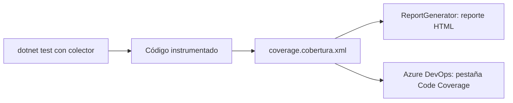

# Cobertura de pruebas

Parte de: [[13-Testing-Calidad/_Índice Testing y calidad|Testing y calidad]]

> [!info] Cómo avanzar
> `progreso`: **pendiente** → **viendo** (estudiando) → **visto** (contestaste la autoevaluación sin abrir las respuestas) → **dominado** (hiciste el laboratorio o lo aplicaste de verdad).

## Contenido

### Qué es
La **cobertura de pruebas** (*code coverage*) mide qué porcentaje del código se **ejecutó** mientras corrían las pruebas. Te dice qué partes nunca fueron tocadas por ninguna prueba, lo cual es información muy valiosa para encontrar huecos. Lo que **no** te dice es si esas pruebas verifican algo útil: una línea ejecutada no es una línea probada. Una suite puede tener 100 % de cobertura y no detectar un bug si no tiene aserciones correctas.

### Cómo funciona
Una herramienta **instrumenta** el código (inserta contadores en el IL o en el JavaScript), corre las pruebas y registra qué se ejecutó. Las métricas más comunes:

- **Cobertura de líneas**: líneas ejecutables que se ejecutaron al menos una vez.
- **Cobertura de ramas** (*branch coverage*): de cada decisión (`if`, `switch`, `?:`, `&&`, `??`), qué caminos se tomaron. Es más exigente y más útil.
- **Cobertura de métodos**: métodos llamados al menos una vez.

Ejemplo de cálculo: un proyecto tiene 200 líneas ejecutables y las pruebas ejecutan 170: la cobertura de líneas es 170 / 200 = **85 %**. Si una función tiene `if (a && b)`, para cubrir **las dos ramas del `if`** basta con **2 casos**: uno donde la condición completa es verdadera (`a = true, b = true`) y otro donde es falsa (por ejemplo `a = false`). Si además quieres que cada operando haya decidido el resultado (cobertura de condiciones), necesitas 3: `(true, true)`, `(false, _)` y `(true, false)`.



### Ejemplo: obtenerla en .NET
Con el colector de **coverlet** (incluido por defecto en las plantillas de proyectos de prueba como `coverlet.collector`):

```bash
dotnet test --collect:"XPlat Code Coverage" --results-directory ./TestResults
dotnet tool install --global dotnet-reportgenerator-globaltool
reportgenerator -reports:"TestResults/**/coverage.cobertura.xml" -targetdir:coverage -reporttypes:Html
```

Si tu proyecto usa Microsoft.Testing.Platform (por ejemplo con xUnit v3), existe la extensión `Microsoft.Testing.Extensions.CodeCoverage`, que se activa con `--coverage`. En Azure DevOps, después de las pruebas, publica el XML con la tarea `PublishCodeCoverageResults@2` para ver la cobertura en la ejecución del pipeline. En Itzamna.Clio (React con Vite), Vitest ofrece cobertura con `vitest run --coverage`.

Excluye lo que no aporta: código generado, `Program.cs`, migraciones y DTOs (con `[ExcludeFromCodeCoverage]` o filtros del colector).

### Cómo usarla bien
- **Como linterna, no como meta**: revisa el reporte para encontrar código importante sin pruebas (reglas de cobro, cálculos, validaciones) y decide si merece pruebas.
- **Mira ramas, no solo líneas**: los `else` olvidados y los bordes son donde viven los bugs.
- **Cuida la tendencia** en el código nuevo: un PR que agrega lógica sin pruebas se nota porque la cobertura de lo modificado es baja. Esto funciona mejor que una cifra global fija.
- **Complementa con pruebas de mutación** (Stryker.NET): la herramienta introduce pequeños cambios (cambiar `>=` por `>`) y comprueba si alguna prueba falla. Si ninguna falla, el código estaba "cubierto" pero no verificado.

### Qué NO garantiza
- Que las aserciones sean correctas o existan (una prueba sin `Assert` también cubre).
- Que se probaron los valores relevantes (el borde de 1,000 en un descuento).
- Que el sistema integrado funcione (SQL, configuración).
- Que se cubran requisitos que **no** están en el código (lo que olvidaste programar no aparece en el reporte).

### Cuándo usarlo y cuándo no
Úsala en cada pipeline para tener visibilidad y en revisiones para hablar de huecos concretos. Evita imponer un umbral alto obligatorio (por ejemplo 90 % global): el equipo empieza a escribir pruebas de getters y de código trivial para cumplir la cifra (ley de Goodhart: cuando una medida se vuelve objetivo, deja de ser buena medida). Un umbral modesto para código nuevo y la revisión humana dan mejores resultados.

### Errores comunes
- **Perseguir el 100 %**: costo alto y pruebas sin valor.
- **Confundir cobertura con calidad**: 85 % con malas aserciones protege menos que 60 % bien pensado.
- **Incluir código generado**: infla o desinfla la cifra.
- **Medir solo unitarias** cuando parte de la lógica se prueba en integración: combina los reportes.

### Para profundizar
- [Cobertura de código para pruebas unitarias (Microsoft Learn)](https://learn.microsoft.com/dotnet/core/testing/unit-testing-code-coverage)
- [coverlet en GitHub](https://github.com/coverlet-coverage/coverlet)
- [Stryker.NET](https://stryker-mutator.io/docs/stryker-net/introduction/)
- [Martin Fowler: Test Coverage](https://martinfowler.com/bliki/TestCoverage.html)

## Ejercicios

Resuélvelos en papel o en la herramienta; la solución está plegada.

> [!question]- 200 líneas ejecutables, las pruebas ejecutan 170. ¿Cobertura de líneas? Si una función tiene `if (a && b)`, ¿cuántos casos mínimos para cubrir ambas ramas del `if`?
> 170/200 = **85%**. Ramas del `if`: **2** casos (uno verdadero, uno falso). Para cubrir cada condición por separado (a falso, b falso) necesitas 3.

## Autoevaluación

Contesta primero en voz alta o en papel; luego despliega la respuesta.

> [!question]- ¿Qué mide la cobertura y qué NO garantiza?
> Qué porcentaje de líneas o ramas se ejecutó durante las pruebas. No garantiza que se verificó algo: una prueba sin aserciones también "cubre".

> [!question]- Cobertura de líneas vs de ramas.
> Líneas: se ejecutó la línea. Ramas: se ejecutaron ambos caminos de cada decisión (`if` verdadero y falso). La de ramas detecta más huecos.

> [!question]- ¿Cómo la usas bien?
> Para encontrar código importante sin probar, no como meta numérica. Fijar un mínimo en CI evita retrocesos, pero 100% no es objetivo. Mutation testing (p. ej. Stryker) mide mejor si las pruebas detectan fallos.

> [!question]- ¿Cómo se obtiene en .NET?
> `dotnet test --collect:"XPlat Code Coverage"` (coverlet) y un reporte HTML con ReportGenerator.

## Práctica

- [[Lab 1 - Pirámide de pruebas en un proyecto pequeño]]

