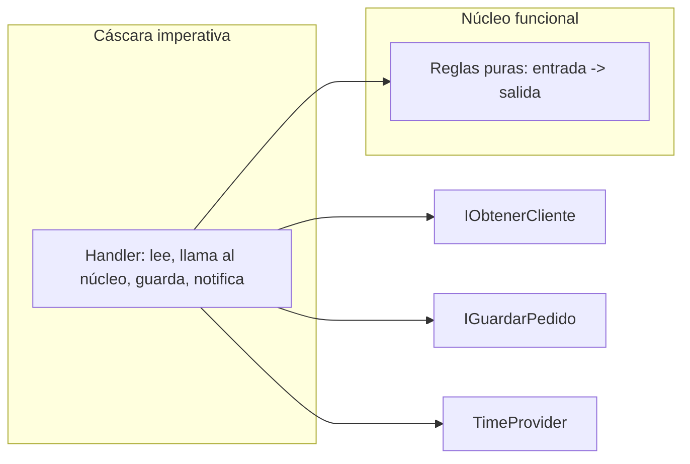

# Diseñar código fácil de probar

Parte de: [[13-Testing-Calidad/_Índice Testing y calidad|Testing y calidad]]

> [!info] Cómo avanzar
> `progreso`: **pendiente** → **viendo** (estudiando) → **visto** (contestaste la autoevaluación sin abrir las respuestas) → **dominado** (hiciste el laboratorio o lo aplicaste de verdad).

## Contenido

### Qué es
Código **fácil de probar** (*testable*) es el que puedes ejecutar en una prueba de forma rápida, aislada y repetible, controlando sus entradas y observando sus resultados sin montar medio sistema. No es una propiedad que se agregue al final: se logra con decisiones de diseño. Y casi siempre coincide con buen diseño en general: bajo acoplamiento, responsabilidades claras y dependencias explícitas.

### Qué lo hace difícil
- **Dependencias creadas adentro**: un método que hace `new SqlConnection(...)` o `new HttpClient()` no deja reemplazarlas.
- **Estado estático o global**: singletons estáticos, cachés `static`, configuración leída de variables de entorno en cualquier lugar; una prueba contamina a la siguiente.
- **Tiempo y aleatorios directos**: `DateTime.Now`, `Guid.NewGuid()`, `Random` sin control.
- **Métodos que hacen muchas cosas**: leer, calcular, guardar y notificar en el mismo método; para probar el cálculo debes simular todo lo demás.
- **Efectos secundarios mezclados con lógica**: la decisión ("¿aplica descuento?") está enredada con el I/O.

### Técnicas que lo hacen fácil


- **Inyección de dependencias por constructor**: la clase declara lo que necesita; la prueba le pasa dobles ([[Mocks, stubs y fakes]]).
- **Puertos para lo externo**: interfaces pequeñas para base de datos, correo, servicios HTTP. Tu patrón de [[SQL en archivos con una interfaz por consulta]] es exactamente eso.
- **`TimeProvider`** para el tiempo ([[TimeProvider para probar fechas]]) y generadores inyectados para IDs y aleatorios.
- **Núcleo funcional, cáscara imperativa**: extrae las reglas a funciones puras (mismo resultado para la misma entrada, sin I/O) y deja una capa delgada que orquesta los efectos. El núcleo se prueba con unitarias triviales; la cáscara, con pocas pruebas de integración.
- **Métodos pequeños con una responsabilidad** y valores de retorno en lugar de efectos ocultos.

### Seams
Michael Feathers llama **seam** (costura) a un punto donde puedes **cambiar el comportamiento del código sin editarlo en ese lugar**. Ejemplos: una interfaz inyectada (cambias la implementación al construir el objeto), un método virtual que una subclase de prueba sobrescribe, un parámetro que antes era un valor fijo, un `TimeProvider` en vez de `DateTime.Now`. Cuando trabajas con código legado sin pruebas, el primer paso es crear seams con cambios mínimos y seguros, y después escribir pruebas.

### Ejemplo
Antes, imposible de probar sin depender de la hora real:

```csharp
public bool EsHorarioLaboral()
{
    var h = DateTime.Now.Hour;
    return h >= 9 && h < 18;
}
```

Después, con el reloj como seam:

```csharp
public sealed class Horario(TimeProvider reloj)
{
    public bool EsHorarioLaboral() => reloj.GetLocalNow().Hour is >= 9 and < 18;
}
```

Un caso más completo en Itzamna.Dionisio: separar la regla del I/O.

```csharp
// Núcleo puro: fácil de probar con [Theory]
public static class ReglasEnvio
{
    public static decimal CostoEnvio(decimal total, string estado) => (total, estado) switch
    {
        ( >= 1500m, _) => 0m,
        (_, "CDMX") => 99m,
        _ => 149m
    };
}

// Cáscara: orquesta dependencias inyectadas
public sealed class CotizarEnvioHandler(IObtenerCarrito carritos)
{
    public async Task<decimal> Handle(int carritoId, CancellationToken ct)
    {
        var c = await carritos.EjecutarAsync(carritoId, ct);
        return ReglasEnvio.CostoEnvio(c.Total, c.Estado);
    }
}
```

`ReglasEnvio` se prueba con datos literales en milisegundos; el handler apenas necesita una prueba con un stub.

### Cuándo usarlo y cuándo no
Aplícalo siempre en lógica de negocio y en código que cambia seguido. No abstraigas todo: crear interfaces para clases sin dependencias externas ni variación (un mapper simple, un objeto de valor) agrega ruido sin beneficio. Si para probar algo necesitas muchos dobles, es señal de que la clase hace demasiado; divídela en lugar de agregar más mocks.

### Errores comunes
- **Interfaces "por si acaso"** para todo: complejidad sin valor.
- **Service locator** (`IServiceProvider` inyectado y resuelto adentro): oculta dependencias igual que `new`.
- **Hacer públicos métodos privados solo para probarlos**: prueba a través del comportamiento público o extrae una clase.
- **Lógica en constructores** o en propiedades estáticas que se ejecutan al cargar.

### Para profundizar
- [Buenas prácticas de pruebas unitarias en .NET (Microsoft Learn)](https://learn.microsoft.com/dotnet/core/testing/unit-testing-best-practices)
- [Inyección de dependencias en .NET (Microsoft Learn)](https://learn.microsoft.com/dotnet/core/extensions/dependency-injection)
- [Gary Bernhardt: Functional Core, Imperative Shell](https://www.destroyallsoftware.com/screencasts/catalog/functional-core-imperative-shell)

## Ejercicios

Resuélvelos en papel o en la herramienta; la solución está plegada.

> [!question]- Haz probable este método:
```csharp
public bool EsHorarioLaboral() {
  var h = DateTime.Now.Hour;
  return h >= 9 && h < 18;
}
```
> ```csharp
> public sealed class Horario(TimeProvider reloj) {
>     public bool EsHorarioLaboral() {
>         var h = reloj.GetLocalNow().Hour;
>         return h is >= 9 and < 18;
>     }
> }
> // Prueba con FakeTimeProvider (Microsoft.Extensions.TimeProvider.Testing)
> var reloj = new FakeTimeProvider(new DateTimeOffset(2026, 1, 5, 17, 59, 0, TimeSpan.Zero));
> reloj.SetLocalTimeZone(TimeZoneInfo.Utc);
> Assert.True(new Horario(reloj).EsHorarioLaboral());
> ```

## Autoevaluación

Contesta primero en voz alta o en papel; luego despliega la respuesta.

> [!question]- ¿Qué hace difícil probar un código?
> Dependencias creadas adentro (`new SqlConnection`), estado estático/global, tiempo y aleatorios directos, métodos que hacen muchas cosas y efectos secundarios mezclados con lógica.

> [!question]- ¿Qué técnicas lo hacen fácil?
> Inyección de dependencias por constructor, puertos para lo externo, `TimeProvider`, funciones puras para la lógica (núcleo funcional, cáscara imperativa), métodos pequeños.

> [!question]- ¿Qué es un *seam*?
> Un punto donde puedes cambiar el comportamiento sin editar el código: una interfaz inyectada, un método virtual, un parámetro.

## Práctica

- [[Lab 1 - Pirámide de pruebas en un proyecto pequeño]]

