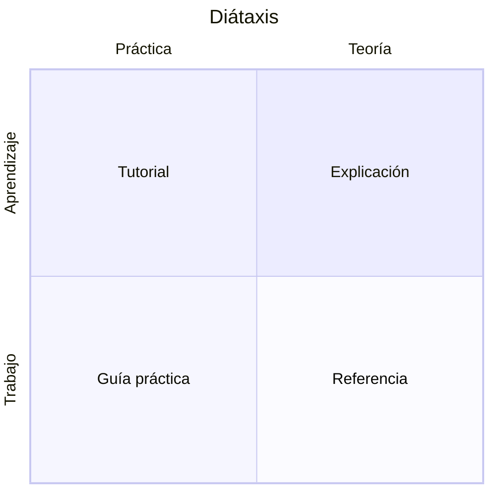

# Documentación técnica

Parte de: [[13-Testing-Calidad/_Índice Testing y calidad|Testing y calidad]]

> [!info] Cómo avanzar
> `progreso`: **pendiente** → **viendo** (estudiando) → **visto** (contestaste la autoevaluación sin abrir las respuestas) → **dominado** (hiciste el laboratorio o lo aplicaste de verdad).

## Contenido

### Qué es
La **documentación técnica** es todo lo escrito que permite a otra persona (o a ti en seis meses) entender, usar, operar y modificar un sistema sin depender de la memoria de quien lo construyó. Incluye el README, la documentación de la API, las decisiones de arquitectura, las guías de operación y los diagramas. Buena documentación reduce el tiempo de incorporación de nuevas personas, los errores de operación y las preguntas repetidas.

### Cómo funciona: el marco Diátaxis
Diátaxis, propuesto por Daniele Procida, organiza la documentación en **cuatro tipos** según la necesidad del lector. Mezclarlos es la causa más común de documentos confusos.



| Tipo | Orientado a | Pregunta que responde | Ejemplo en Itzamna.Dionisio |
|---|---|---|---|
| **Tutorial** | Aprender haciendo | "Llévame de la mano" | "Tu primer día: levantar la API y la base local" |
| **Guía práctica** (*how-to*) | Lograr una tarea | "¿Cómo hago X?" | "Cómo agregar una consulta nueva con su archivo .sql" |
| **Referencia** | Consultar datos exactos | "¿Qué es exactamente?" | OpenAPI de los endpoints, catálogo de `codigo` de ProblemDetails |
| **Explicación** | Entender | "¿Por qué es así?" | "Por qué usamos Dapper y procedimientos en vez de EF Core" |

### Documentación mínima de un proyecto
- **README**: qué es, cómo se ejecuta localmente (requisitos, comandos, User Secrets necesarios sin sus valores), cómo se corren las pruebas, cómo se despliega y a quién preguntar.
- **Referencia de la API**: el documento OpenAPI generado (ver [[Microsoft.AspNetCore.OpenApi vs Swashbuckle]]) con ejemplos y códigos de error.
- **Decisiones de arquitectura**: registros cortos de cada decisión importante con contexto, opciones y consecuencias ([[ADR - registro de decisiones de arquitectura]]).
- **Diagrama de contexto y contenedores**: cómo se relacionan Clio, Dionisio, Hecate y la base ([[Diagramas C4]]), mejor como código con [[Mermaid y diagramas como código|Mermaid]].
- **Runbook de operación**: qué hacer ante alertas comunes, cómo revisar logs, cómo hacer rollback.
- **CONTRIBUTING** o convenciones: ramas, mensajes de commit, reglas del equipo.

### Ejemplo
Esqueleto de un README en el repositorio:

```markdown
### Itzamna.Dionisio
API de pedidos (.NET 10, ASP.NET Core con controllers, Dapper y SQL Server).

#### Requisitos
- .NET SDK 10, Docker Desktop (para pruebas con Testcontainers)

#### Ejecutar localmente
1. `dotnet user-secrets set "ConnectionStrings:Dionisio" "<tu cadena>"`
2. `dotnet run --project src/Itzamna.Dionisio.Api`

#### Pruebas
`dotnet test` (requiere Docker en ejecución)

#### Decisiones
Ver `docs/adr/`.
```

### Cómo evitar que la documentación quede vieja
- **Junto al código**: carpeta `docs/` en el mismo repositorio, en Markdown, revisada en los mismos PR. Si el PR cambia el comportamiento, el revisor pide actualizar la documentación.
- **Generada desde la fuente** cuando se pueda: OpenAPI desde el código, diagramas como código, comentarios XML para bibliotecas.
- **Ejecutable**: los pasos del README se prueban en el pipeline o con un *dev container*; si el comando cambia, el pipeline falla.
- **Menos pero mejor**: documenta el porqué y lo que no es obvio; no repitas lo que el código ya dice.
- **Dueños y fechas**: cada documento con responsable y fecha de última revisión; revisa los críticos periódicamente.
- **Borra lo obsoleto**: un documento incorrecto es peor que ninguno.

### Cuándo usarlo y cuándo no
Documenta cuando otras personas usarán u operarán el sistema, cuando una decisión no es obvia, o cuando un proceso se repite. No documentes cada clase o método evidente, ni escribas manuales largos que nadie mantendrá; en esos casos, buen código, buenos nombres y pruebas claras ya son documentación.

### Errores comunes
- **Wikis separadas del código** que nadie actualiza.
- **Mezclar tipos de Diátaxis**: un tutorial lleno de referencia exhaustiva pierde al principiante.
- **Documentar el qué y no el porqué**.
- **Secretos en la documentación** (cadenas de conexión reales, contraseñas).

### Para profundizar
- [Diátaxis](https://diataxis.fr/)
- [Architectural Decision Records](https://adr.github.io/)
- [Guía de estilo de documentación de Microsoft](https://learn.microsoft.com/style-guide/welcome/)

## Autoevaluación

Contesta primero en voz alta o en papel; luego despliega la respuesta.

> [!question]- ¿Qué documentación mínima debe tener un proyecto?
> README (qué es, cómo correrlo en minutos, cómo probar), arquitectura y decisiones (ADRs), cómo desplegar y operar (runbook), y la API (OpenAPI).

> [!question]- ¿Qué tipos de documentación distingue el marco Diátaxis?
> Tutoriales (aprender haciendo), guías prácticas (resolver una tarea), referencia (datos exactos) y explicación (entender el porqué). Mezclarlos confunde.

> [!question]- ¿Cómo evitas que la documentación quede vieja?
> Junto al código (docs como código), revisada en el mismo PR que el cambio, generada cuando se pueda (OpenAPI, diagramas Mermaid) y corta.

