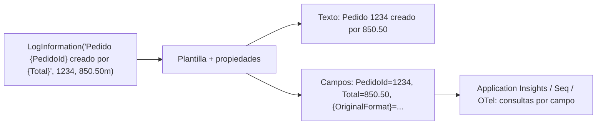

# Logging estructurado

Parte de: [[13-Testing-Calidad/_Índice Testing y calidad|Testing y calidad]]

> [!info] Cómo avanzar
> `progreso`: **pendiente** → **viendo** (estudiando) → **visto** (contestaste la autoevaluación sin abrir las respuestas) → **dominado** (hiciste el laboratorio o lo aplicaste de verdad).

## Contenido

### Qué es
El **logging estructurado** registra cada evento como un **mensaje con propiedades con nombre** (por ejemplo `PedidoId = 1234`, `Total = 850.50`) en lugar de un texto plano armado a mano. El sistema de logs guarda esas propiedades como campos consultables, de modo que puedes filtrar "todos los errores del pedido 1234" o "cobros mayores a 10,000 que fallaron" sin usar expresiones regulares sobre texto. En .NET se hace con `ILogger` (ver [[Logging con ILogger]]) y proveedores como [[Serilog]], Application Insights u OpenTelemetry.

### Cómo funciona
`ILogger` recibe una **plantilla de mensaje** con marcadores entre llaves y los valores por separado:



- La **plantilla** es constante, así que todos los eventos del mismo tipo se agrupan.
- Los **valores** se guardan tipados con el nombre del marcador.
- Se agregan propiedades de contexto automáticamente: `TraceId`, `SpanId`, nombre de la categoría (la clase), y las que pongas en *scopes* (`using (_logger.BeginScope(new Dictionary<string, object> { ["ClienteId"] = id }))`).

#### Por qué no usar interpolación
`_logger.LogInformation($"Pedido {id} creado")` compila, pero pierde todo lo anterior: el mensaje llega como texto ya armado, sin propiedades, cada evento tiene una plantilla distinta (no se agrupan), y el string se construye **aunque el nivel esté desactivado**, desperdiciando CPU y memoria. Los analizadores de .NET lo advierten (CA2254).

### Ejemplo
Corregir un log de error:

```csharp
// Mal: concatenación, pierde la excepción completa y las propiedades
_logger.LogError("Error al cobrar " + pedido.Id + ": " + ex.Message);

// Bien: la excepción como primer argumento (con stack trace) y propiedades con nombre
_logger.LogError(ex, "Error al cobrar el pedido {PedidoId} por {Monto}", pedido.Id, pedido.Total);
```

Para rutas calientes, el **generador de código `LoggerMessage`** crea en compilación un método optimizado: comprueba el nivel antes de hacer trabajo, evita *boxing* y valida la plantilla:

```csharp
public static partial class LogPedidos
{
    [LoggerMessage(EventId = 1001, Level = LogLevel.Information,
                   Message = "Pedido {PedidoId} creado por {Total}")]
    public static partial void PedidoCreado(this ILogger logger, int pedidoId, decimal total);

    [LoggerMessage(EventId = 1002, Level = LogLevel.Error,
                   Message = "Error al cobrar el pedido {PedidoId}")]
    public static partial void ErrorCobro(this ILogger logger, Exception ex, int pedidoId);
}

// Uso en el handler
_logger.PedidoCreado(pedido.Id, pedido.Total);
```

### Niveles y cuándo usarlos
| Nivel | Uso |
|---|---|
| `Trace` | Detalle muy fino para depurar; nunca activo en producción. |
| `Debug` | Información de diagnóstico en desarrollo. |
| `Information` | Eventos de negocio y del ciclo de vida normales (pedido creado, servicio iniciado). |
| `Warning` | Algo inesperado que no detuvo la operación (reintento, valor por defecto aplicado, validación rechazada repetidamente). |
| `Error` | Falló la operación actual (excepción no recuperada en una petición). |
| `Critical` | Falla que deja al sistema sin servicio (no hay conexión a la base, se cae el proceso). |

Configura el mínimo por categoría en `appsettings.json` (por ejemplo `Microsoft.AspNetCore: Warning`) para no inundar los logs con ruido del framework.

### Lo que nunca debe ir en un log
Contraseñas, tokens JWT o de refresco (Xolotl.Hecate), cadenas de conexión, llaves de API, datos de tarjetas, y datos personales sensibles (CURP, RFC completo, direcciones, datos de salud) salvo que estén enmascarados y haya una razón legal. Los logs se copian, se exportan y los leen muchas personas; trátalos como datos que pueden filtrarse. Cuida también no registrar cuerpos completos de peticiones.

### Cuándo usarlo y cuándo no
Úsalo siempre en servicios que corren en servidores o la nube: es la base para diagnosticar en producción junto con métricas y trazas ([[Métricas, trazas y logs]]). No uses logs como sustituto de métricas (contar eventos sumando logs es caro) ni como bitácora de auditoría legal (esa va en una tabla dedicada con garantías).

### Errores comunes
- **Interpolación o concatenación** en el mensaje.
- **Pasar `ex.Message`** en lugar de la excepción: se pierde el stack trace.
- **Todo en `Information`** o todo en `Error`: las alertas pierden sentido.
- **Nombres de propiedad inconsistentes** (`PedidoId`, `IdPedido`, `pedido`): las consultas fallan. Acuerda un vocabulario.
- **Datos sensibles** en propiedades o scopes.

### Para profundizar
- [Logging en .NET (Microsoft Learn)](https://learn.microsoft.com/dotnet/core/extensions/logging)
- [Generación de código de LoggerMessage en tiempo de compilación (Microsoft Learn)](https://learn.microsoft.com/dotnet/core/extensions/logger-message-generator)
- [Message Templates](https://messagetemplates.org/)
- Práctica: [[Lab 2 - Logging estructurado con trazas en ASP.NET Core]]

## Ejercicios

Resuélvelos en papel o en la herramienta; la solución está plegada.

> [!question]- Corrige: `_logger.LogError("Error al cobrar " + pedido.Id + ": " + ex.Message);`
> ```csharp
> _logger.LogError(ex, "Error al cobrar el pedido {PedidoId}", pedido.Id);
> ```
> Se pasa la excepción completa (con pila) como primer argumento y el id como campo estructurado.

> [!question]- Escribe un `LoggerMessage` generado por código para "Pedido {PedidoId} creado por {Total}".
> ```csharp
> public static partial class Logs
> {
>     [LoggerMessage(Level = LogLevel.Information, Message = "Pedido {PedidoId} creado por {Total}")]
>     public static partial void PedidoCreado(this ILogger logger, Guid pedidoId, decimal total);
> }
> // uso
> _logger.PedidoCreado(pedido.Id, pedido.Total);
> ```
> Evita asignaciones y valida la plantilla en compilación.

## Autoevaluación

Contesta primero en voz alta o en papel; luego despliega la respuesta.

> [!question]- ¿Qué es logging estructurado?
> Registrar eventos como datos con campos con nombre (`{PedidoId}`, `{Total}`), no solo texto. Permite filtrar y agregar ("todos los errores del pedido 42").

> [!question]- ¿Por qué no usar interpolación en el mensaje de `ILogger`?
> `_log.LogInformation($"Pedido {id}")` produce un texto plano: se pierde el campo `PedidoId` y se arma el string aunque el nivel esté deshabilitado. Usa la plantilla: `_log.LogInformation("Pedido {PedidoId} creado", id)`.

> [!question]- ¿Qué no debe ir nunca en un log?
> Contraseñas, tokens, números de tarjeta completos, datos personales sensibles sin necesidad. Enmascara o excluye.

> [!question]- ¿Qué niveles usar y cuándo?
> `Trace/Debug`: diagnóstico detallado (apagado en prod). `Information`: hechos de negocio relevantes. `Warning`: algo raro pero recuperable. `Error`: falló una operación. `Critical`: la app no puede seguir.

## Práctica

- [[Lab 2 - Logging estructurado con trazas en ASP.NET Core]]

