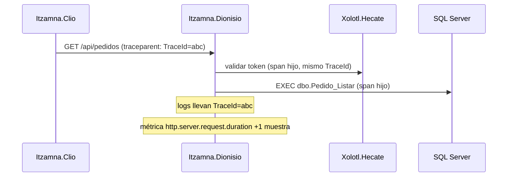

# Métricas, trazas y logs

Parte de: [[13-Testing-Calidad/_Índice Testing y calidad|Testing y calidad]]

> [!info] Cómo avanzar
> `progreso`: **pendiente** → **viendo** (estudiando) → **visto** (contestaste la autoevaluación sin abrir las respuestas) → **dominado** (hiciste el laboratorio o lo aplicaste de verdad).

## Contenido

### Qué es
Son las tres **señales** principales de la observabilidad, la capacidad de entender qué pasa dentro de un sistema en producción a partir de lo que emite:

- **Métricas**: números agregados en el tiempo (peticiones por segundo, latencia p95, uso de CPU, errores por minuto). Baratas de guardar y perfectas para tableros y alertas.
- **Trazas** (distribuidas): el recorrido de **una petición** a través de servicios y dependencias, dividido en *spans* con su duración (API, consulta SQL, llamada HTTP). Responden "¿dónde se fue el tiempo de esta petición?".
- **Logs**: eventos discretos con detalle y contexto (un error con su excepción, un pedido creado). Responden "¿qué pasó exactamente?". Ver [[Logging estructurado]].

Juntas permiten ir de "algo está mal" (métrica) a "en qué petición y en qué paso" (traza) a "por qué" (log). El estándar abierto para emitirlas es [[OpenTelemetry]].

### Cómo funciona


- Cada petición recibe un **TraceId** único. Cuando un servicio llama a otro, lo propaga en el encabezado HTTP `traceparent` (estándar W3C Trace Context). Cada operación es un *span* con su `SpanId` y su padre.
- En .NET, `System.Diagnostics.Activity` representa el span actual; ASP.NET Core, `HttpClient` y `SqlClient` crean spans automáticamente cuando hay un *listener* (OpenTelemetry o Application Insights).
- Los logs de `ILogger` incluyen el `TraceId` y el `SpanId` de la actividad actual.
- Las métricas se emiten con `System.Diagnostics.Metrics` (`Meter`, `Counter`, `Histogram`); ASP.NET Core ya publica `http.server.request.duration`, entre otras.

### Por qué poner el TraceId en los logs
Sin él, un log de error es una pieza suelta entre millones. Con él, desde el error saltas a la traza completa de esa petición (qué servicios llamó, cuál tardó) y a todos los demás logs de la misma petición, incluso en otros servicios. También puedes devolverlo al cliente en el ProblemDetails (`traceId`) para que soporte lo use al investigar un reporte.

### Ejemplo
Métrica de negocio propia y spans automáticos en Itzamna.Dionisio:

```csharp
public sealed class MetricasPedidos
{
    private readonly Counter<long> _creados;
    private readonly Histogram<double> _monto;
    public MetricasPedidos(IMeterFactory f)
    {
        var meter = f.Create("Itzamna.Dionisio.Pedidos");
        _creados = meter.CreateCounter<long>("pedidos.creados");
        _monto = meter.CreateHistogram<double>("pedidos.monto", unit: "MXN");
    }
    public void Registrar(decimal total, string canal)
    {
        _creados.Add(1, new KeyValuePair<string, object?>("canal", canal));
        _monto.Record((double)total);
    }
}

// Program.cs (paquetes OpenTelemetry.Extensions.Hosting, instrumentaciones y exportador OTLP)
builder.Services.AddSingleton<MetricasPedidos>();
builder.Services.AddOpenTelemetry()
    .WithTracing(t => t.AddAspNetCoreInstrumentation().AddHttpClientInstrumentation().AddSqlClientInstrumentation().AddOtlpExporter())
    .WithMetrics(m => m.AddAspNetCoreInstrumentation().AddMeter("Itzamna.Dionisio.Pedidos").AddOtlpExporter());
```

### Métricas mínimas para un API
Un buen punto de partida es el método **RED** por endpoint:

- **Rate**: peticiones por segundo.
- **Errors**: porcentaje de respuestas 5xx (y 4xx inesperados).
- **Duration**: latencia en percentiles (p50, p95, p99), no solo el promedio.

Y la **saturación** de recursos: CPU, memoria, longitud de la cola del thread pool, conexiones del pool de SQL, uso de DTU o vCores de la base. Las "cuatro señales doradas" del libro de SRE de Google (latencia, tráfico, errores y saturación) cubren lo mismo.

### Por qué no alertar sobre todo
Si cada pico de CPU o cada error aislado manda una alerta, llega la **fatiga de alertas**: el equipo empieza a ignorarlas y la importante pasa desapercibida. Alerta sobre **síntomas que afectan al usuario** (tasa de errores por encima del umbral durante 5 minutos, p95 de latencia fuera del objetivo, el servicio no responde) y deja las causas (CPU, memoria) en tableros para investigar. Cada alerta debe ser accionable y tener un runbook.

### Cuándo usarlo y cuándo no
Cualquier servicio en producción necesita las tres señales, aunque sea en su forma básica. En una herramienta de consola que corres a mano, basta con logs. Para empezar en Azure, Application Insights recibe las tres; con OpenTelemetry mantienes la libertad de cambiar de backend.

### Errores comunes
- **Etiquetas de alta cardinalidad** en métricas (`usuarioId`, `pedidoId`): explotan el costo. Esos datos van en trazas o logs.
- **Promedios en lugar de percentiles**: esconden a los usuarios lentos.
- **No propagar el contexto** en colas o procesos en segundo plano: trazas cortadas.
- **Muestreo sin pensar**: si muestreas el 1 % de trazas, quizá pierdas justo las de error; usa muestreo que conserve errores.

### Para profundizar
- [Señales de OpenTelemetry](https://opentelemetry.io/docs/concepts/signals/)
- [Observabilidad en .NET (Microsoft Learn)](https://learn.microsoft.com/dotnet/core/diagnostics/observability-with-otel)
- [W3C Trace Context](https://www.w3.org/TR/trace-context/)
- [Google SRE: Monitoring Distributed Systems](https://sre.google/sre-book/monitoring-distributed-systems/)

## Autoevaluación

Contesta primero en voz alta o en papel; luego despliega la respuesta.

> [!question]- Diferencia entre métricas, trazas y logs.
> Métricas: números agregados en el tiempo (peticiones/s, p95, errores) → alertas y tendencias. Trazas: el recorrido de una petición a través de servicios (spans con duración) → dónde se fue el tiempo. Logs: eventos detallados → por qué pasó algo.

> [!question]- ¿Qué es un `TraceId` y por qué ponerlo en los logs?
> Un identificador único de la petición que viaja entre servicios (header `traceparent` de W3C). En los logs permite saltar de una traza lenta a sus logs exactos.

> [!question]- ¿Qué métricas mínimas para un API?
> RED: *Rate* (peticiones/s), *Errors* (tasa de errores), *Duration* (latencia p50/p95/p99). Para recursos: USE (utilización, saturación, errores).

> [!question]- ¿Por qué no alertar sobre todo?
> La fatiga de alertas hace que se ignoren. Alerta sobre síntomas que afectan al usuario (SLO), no sobre cada métrica interna.

## Práctica

- [[Lab 2 - Logging estructurado con trazas en ASP.NET Core]]

