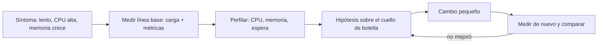

# Perfilado de rendimiento

Parte de: [[13-Testing-Calidad/_Índice Testing y calidad|Testing y calidad]]

> [!info] Cómo avanzar
> `progreso`: **pendiente** → **viendo** (estudiando) → **visto** (contestaste la autoevaluación sin abrir las respuestas) → **dominado** (hiciste el laboratorio o lo aplicaste de verdad).

## Contenido

### Qué es
**Perfilar** es medir, con una herramienta, en qué gasta realmente un programa su tiempo y su memoria mientras se ejecuta: qué métodos consumen CPU, qué objetos se asignan, dónde se bloquean los hilos. Se hace **antes de optimizar** porque la intuición casi siempre falla: el cuello de botella rara vez está donde creemos. Optimizar sin perfilar consume tiempo, complica el código y muchas veces no mejora nada.

### Cómo funciona

Tipos de perfilado:

- **CPU por muestreo**: toma la pila de los hilos periódicamente; los métodos que aparecen más son los que más CPU consumen. Se ve como flame graph.
- **Memoria / allocations**: qué tipos y qué código asignan más, y qué objetos sobreviven.
- **Espera / concurrencia**: dónde están bloqueados los hilos (locks, I/O, `Task.Wait`).
- **Macro vs micro**: perfilar la aplicación completa bajo carga (macro) frente a medir una función aislada con un benchmark (micro).

### Herramientas en .NET
| Herramienta | Para qué | Costo |
|---|---|---|
| [[dotnet-counters]] | Métricas en vivo: CPU, GC, thread pool | Gratuita |
| [[dotnet-trace]] | Trazas de CPU y eventos, flame graphs con speedscope | Gratuita |
| [[dotnet-dump]] | Volcado de memoria: objetos, hilos, fugas | Gratuita |
| Perfilador de Visual Studio | CPU, memoria, async, base de datos, en Windows | Incluido en Visual Studio (Community es gratuita para uso individual) |
| PerfView | Análisis profundo de CPU y GC | Gratuita |
| JetBrains dotTrace / dotMemory | Perfiladores comerciales muy completos | De pago |
| [[BenchmarkDotNet]] | Microbenchmarks confiables de funciones | Gratuita |
| k6 / NBomber | Generar carga para reproducir el problema ([[Pruebas de carga (k6 y NBomber)]]) | Gratuitas |

### BenchmarkDotNet y el error que evita
BenchmarkDotNet mide fragmentos de código de forma estadísticamente confiable: compila en Release, aísla en procesos separados, calienta el JIT, repite muchas veces y reporta media, error y memoria asignada. Evita el error clásico de medir con un `Stopwatch` alrededor de un bucle: ese número incluye la compilación JIT, el ruido del sistema, posibles recolecciones del GC y hasta código que el compilador eliminó. Úsalo para comparar dos implementaciones de una función caliente que el perfil ya señaló, no para encontrar el problema.

### Ejemplo: la API se pone lenta y la memoria sube
Itzamna.Dionisio va bien después de desplegar, pero con los días responde más lento y su memoria pasa de 400 MB a 3 GB.

1. **Confirma con métricas**: con `dotnet-counters` (o Application Insights) ves que el heap de gen 2 crece sin bajar y que el tiempo en GC aumenta: es retención de objetos, no solo carga.
2. **Toma dos dumps** separados por un tiempo con `dotnet-dump collect` y compara `dumpheap -stat`: crece la cantidad de un tipo, por ejemplo `CacheEntry` con objetos `ReporteDto`.
3. **Busca quién los retiene** con `gcroot`: termina en un diccionario estático que se usa como caché sin expiración.
4. **Revisa sospechosos típicos**: cachés sin límite ni expiración, suscripciones a eventos que nunca se quitan, `HttpClient` creado por petición (sockets), listas estáticas que acumulan, objetos `IDisposable` sin liberar, `async` que nunca termina y retiene su estado.
5. **Corrige** (por ejemplo `IMemoryCache` con `SizeLimit` y expiración) y **verifica** que la memoria se estabiliza bajo la misma carga.

### Cuándo usarlo y cuándo no
Perfila cuando hay un síntoma medible (latencia fuera de objetivo, costos de infraestructura altos, memoria creciente) o antes de una optimización. No optimices "por si acaso" código que no aparece en el perfil: la claridad del código vale más. Y recuerda que muchas veces el cuello está fuera de .NET: índices faltantes en SQL Server, el [[Problema N+1]] o llamadas externas lentas; ahí ayudan las trazas distribuidas y el plan de ejecución.

### Errores comunes
- **Optimizar sin línea base**: no puedes demostrar la mejora.
- **Perfilar en Debug** o sin carga realista.
- **Cambiar varias cosas a la vez**: no sabes cuál ayudó.
- **Confiar en el promedio**: mira percentiles y la distribución.
- **Ignorar la base de datos**: la mitad de los problemas de una API están en sus consultas.

### Para profundizar
- [Herramientas de diagnóstico de .NET (Microsoft Learn)](https://learn.microsoft.com/dotnet/core/diagnostics/)
- [Primer vistazo a las herramientas de generación de perfiles de Visual Studio (Microsoft Learn)](https://learn.microsoft.com/visualstudio/profiling/profiling-feature-tour)
- [BenchmarkDotNet](https://benchmarkdotnet.org/articles/overview.html)

## Autoevaluación

Contesta primero en voz alta o en papel; luego despliega la respuesta.

> [!question]- ¿Qué es perfilar y por qué antes de optimizar?
> Medir dónde se va el tiempo o la memoria con herramientas, en lugar de adivinar. Optimizar sin medir suele atacar lo que no importa.

> [!question]- Herramientas en .NET.
> `dotnet-counters` (métricas en vivo), `dotnet-trace` (trazas de CPU/eventos), `dotnet-dump`/`dotnet-gcdump` (memoria), BenchmarkDotNet (microbenchmarks), el profiler de Visual Studio.

> [!question]- ¿Qué es BenchmarkDotNet y qué error evita?
> Una librería para microbenchmarks que maneja calentamiento, iteraciones y estadística, y mide asignaciones con `[MemoryDiagnoser]`. Evita medir con `Stopwatch` una sola vez en Debug.

> [!question]- Caso: el API se pone lento con el tiempo y la memoria sube. ¿Qué revisas?
> Fuga de memoria: `dotnet-counters` para ver heap/GC, luego `dotnet-gcdump` y comparar dos capturas para ver qué tipo crece (cachés sin límite, eventos sin desuscribir, singletons con listas).

