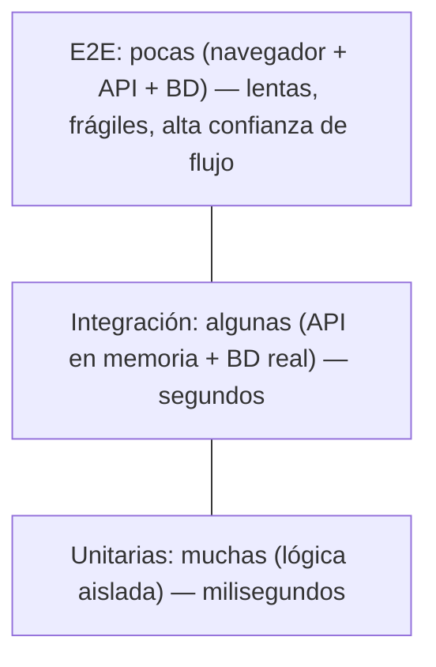

# Pirámide de pruebas

Parte de: [[13-Testing-Calidad/_Índice Testing y calidad|Testing y calidad]]

> [!info] Cómo avanzar
> `progreso`: **pendiente** → **viendo** (estudiando) → **visto** (contestaste la autoevaluación sin abrir las respuestas) → **dominado** (hiciste el laboratorio o lo aplicaste de verdad).

## Contenido

### Qué es
La **pirámide de pruebas** es un modelo, popularizado por Mike Cohn y explicado a fondo por Martin Fowler, que propone cómo repartir las pruebas automatizadas de un sistema según su costo y velocidad. En la base van **muchas pruebas unitarias** (rápidas, baratas, precisas), en medio **menos pruebas de integración**, y en la punta **pocas pruebas end-to-end** (lentas, frágiles, costosas). El objetivo es tener retroalimentación rápida y confiable sin depender de pruebas lentas para todo.

### Cómo funciona

Conforme subes en la pirámide:

- **Aumenta el alcance**: cada prueba cubre más piezas reales juntas, y por eso da más confianza de que el sistema completo funciona.
- **Aumenta el costo**: tardan más, requieren infraestructura (base de datos, navegador) y es más difícil saber qué falló.
- **Aumenta la fragilidad**: más partes móviles, más causas de fallos intermitentes.

La idea no es una proporción exacta sino un principio: **prueba cada regla en el nivel más bajo que la pueda verificar**, y usa niveles superiores para confirmar que las piezas encajan. Los detalles de cada nivel están en [[Pruebas unitarias]], [[Pruebas de integración]] y [[Pruebas end-to-end (Playwright y Cypress)]].

### Ejemplo: cuánto tarda una suite
Una suite tiene 400 unitarias de 5 ms, 60 de integración de 400 ms y 20 e2e de 15 s. En serie:

- Unitarias: 400 x 0.005 s = **2 s**
- Integración: 60 x 0.4 s = **24 s**
- E2E: 20 x 15 s = **300 s**
- Total: **326 s**, unos 5 minutos y medio.

Las 20 e2e son apenas el 4 % de las pruebas pero consumen el 92 % del tiempo. Por eso cada e2e debe justificar su lugar. En Azure DevOps puedes correr unitarias e integración en cada PR y las e2e en un *stage* posterior o en paralelo.

Aplicado a tus proyectos: en Itzamna.Dionisio las reglas de negocio de los handlers y validadores de FluentValidation van en unitarias; los endpoints con su SQL real se prueban con [[Pruebas de integración con WebApplicationFactory]] y [[Testcontainers]]; y en Itzamna.Clio unas pocas e2e con Playwright cubren el login con Xolotl.Hecate y el flujo de captura de pedido.

### El cono de helado
Es la pirámide invertida: casi todo se prueba con e2e o manualmente, con pocas unitarias. Problemas: la suite tarda horas, falla por causas ajenas al cambio (tiempos, datos, red), nadie confía en ella y se termina ignorando; los errores se descubren tarde y es difícil ubicarlos. Suele aparecer cuando el código no es fácil de probar de forma aislada (ver [[Diseñar código fácil de probar]]) o cuando un equipo de QA automatiza solo desde la interfaz.

### El trofeo de pruebas
Kent C. Dodds propuso el **trofeo**: análisis estático en la base (TypeScript, linters, analizadores), unitarias, una capa **ancha de integración** y pocas e2e. Tiene sentido cuando gran parte del valor y del riesgo está en cómo se conectan las piezas: un front de React donde probar componentes con sus hooks y llamadas simuladas da más confianza que probar funciones sueltas, o una API cuya lógica es delgada y la mayor parte es SQL y mapeo, como un CRUD con Dapper. Con herramientas modernas (WebApplicationFactory, Testcontainers) las pruebas de integración ya no son tan lentas.

### Cómo saber si tu proporción es mala
- La suite tarda tanto que nadie la corre localmente antes de subir cambios.
- Hay pruebas que "a veces fallan" y se vuelven a ejecutar hasta que pasan.
- Un bug sencillo de lógica solo lo detecta una e2e o QA manual.
- Cuando una prueba falla, cuesta mucho saber dónde está el problema.
- Al revés: todo pasa en unitarias pero producción falla en la integración (SQL roto, serialización, configuración), señal de que falta la capa media.

### Cuándo usarlo y cuándo no
Úsala como guía para decidir **dónde** escribir cada nueva prueba y para revisar la salud de la suite. No la conviertas en una cuota numérica ("80 % unitarias") ni la apliques igual a todos los proyectos: una librería de cálculos fiscales será casi toda unitaria; un portal con poca lógica, más de integración.

### Errores comunes
- **Duplicar la misma verificación en los tres niveles**: costo triple, sin confianza extra.
- **Probar reglas de negocio con e2e** porque "así se ve el resultado".
- **Medir solo cantidad** de pruebas por nivel en lugar de tiempo y confiabilidad.
- **No tener ninguna e2e**: nada comprueba que el sistema completo arranca y responde.

### Para profundizar
- [Martin Fowler: The Practical Test Pyramid](https://martinfowler.com/articles/practical-test-pyramid.html)
- [Martin Fowler: Test Pyramid](https://martinfowler.com/bliki/TestPyramid.html)
- [Kent C. Dodds: The Testing Trophy](https://kentcdodds.com/blog/the-testing-trophy-and-testing-classifications)
- Práctica: [[Lab 1 - Pirámide de pruebas en un proyecto pequeño]]

## Ejercicios

Resuélvelos en papel o en la herramienta; la solución está plegada.

> [!question]- Una suite tiene 400 unitarias (5 ms c/u), 60 de integración (400 ms c/u) y 20 e2e (15 s c/u). ¿Cuánto tarda en serie y qué capa domina?
> Unitarias 2 s + integración 24 s + e2e 300 s = **326 s (≈ 5.4 min)**. Las e2e son el 4% de las pruebas y el **92%** del tiempo.

## Autoevaluación

Contesta primero en voz alta o en papel; luego despliega la respuesta.

> [!question]- ¿Qué propone la pirámide de pruebas?
> Muchas pruebas unitarias (rápidas, baratas), menos de integración y pocas end-to-end (lentas, frágiles, caras). La proporción busca retroalimentación rápida con confianza suficiente.

> [!question]- ¿Qué es el "cono de helado" y por qué es un problema?
> La pirámide invertida: casi todo se prueba con e2e o a mano. Las pruebas tardan, fallan de forma intermitente y nadie confía en ellas.

> [!question]- ¿Cuándo tiene sentido un "trofeo" con más pruebas de integración?
> En apps donde la mayor parte del riesgo está en la integración (APIs CRUD con poca lógica, frontends que dependen de muchos componentes): una prueba de integración con `WebApplicationFactory` o Testcontainers da más confianza por prueba.

> [!question]- ¿Cómo sabes si tu proporción es mala?
> La suite tarda tanto que no se corre en cada cambio, o los bugs llegan a producción en zonas que "tenían pruebas".

## Práctica

- [[Lab 1 - Pirámide de pruebas en un proyecto pequeño]]

