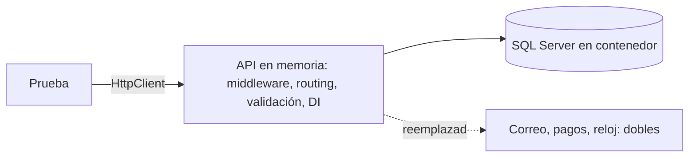

# Pruebas de integración

Parte de: [[13-Testing-Calidad/_Índice Testing y calidad|Testing y calidad]]

> [!info] Cómo avanzar
> `progreso`: **pendiente** → **viendo** (estudiando) → **visto** (contestaste la autoevaluación sin abrir las respuestas) → **dominado** (hiciste el laboratorio o lo aplicaste de verdad).

## Contenido

### Qué es
Una **prueba de integración** verifica que varias piezas reales funcionan **juntas**: tu código con la base de datos, el pipeline de ASP.NET Core con tus controllers y validadores, tu cliente HTTP con un servicio, la serialización con el contrato. Ocupa el centro de la [[Pirámide de pruebas]]: más lenta que una unitaria, pero detecta problemas que las unitarias no pueden ver, como un procedimiento almacenado con un nombre de columna equivocado o un servicio que no se registró en DI.

### Cómo funciona
El alcance varía; lo importante es decidir qué es real y qué se reemplaza:

- **Integración con base de datos**: tu clase de consulta de Dapper contra una base SQL Server real y desechable.
- **Integración de la API en memoria**: la aplicación completa con `WebApplicationFactory`, peticiones HTTP reales sin red, y la base real o un doble.
- **Integración con un servicio externo**: contra un simulador (WireMock.Net) o un ambiente de pruebas del proveedor.



Regla práctica: **real todo lo que es tuyo** (código, SQL, configuración) y **dobles solo para lo externo** que no controlas o tiene efectos (enviar correos, cobrar).

### Ejemplo
API de Itzamna.Dionisio probada en memoria con base real:

```csharp
public sealed class PedidosEndpointsTests(DionisioFactory f) : IClassFixture<DionisioFactory>
{
    [Fact]
    public async Task Crear_y_consultar_pedido()
    {
        var client = f.CreateClient();

        var crear = await client.PostAsJsonAsync("/api/pedidos", new { clienteId = 1, total = 250.00m });
        Assert.Equal(HttpStatusCode.Created, crear.StatusCode);
        var ubicacion = crear.Headers.Location!;

        var leer = await client.GetFromJsonAsync<PedidoDto>(ubicacion);
        Assert.Equal(250.00m, leer!.Total);
    }
}
```

La fábrica (`DionisioFactory`) configura la cadena de conexión hacia un contenedor de [[Testcontainers]] y reemplaza el notificador. El detalle de la fábrica está en [[Pruebas de integración con WebApplicationFactory]].

### Base real o en memoria
- **Base real en contenedor**: se comporta igual que producción (tipos, collation, procedimientos, transacciones, bloqueos). Es lo recomendado cuando usas Dapper con SQL y procedimientos, porque precisamente quieres probar ese SQL.
- **EF Core InMemory**: no es una base relacional; no valida restricciones, no ejecuta SQL y no soporta procedimientos. Da falsa confianza; Microsoft desaconseja usarlo para probar acceso a datos.
- **SQLite en memoria** en lugar de SQL Server: más fiel que InMemory, pero con diferencias de dialecto y tipos.
- **Base compartida de desarrollo**: datos cambiantes y pruebas que se pisan entre personas; evítala.

### Paralelismo y datos compartidos
xUnit ejecuta clases de prueba en paralelo. Si dos pruebas usan la misma base y los mismos datos (por ejemplo, ambas esperan "3 pedidos" o borran la tabla), los resultados dependen de cuál corre primero: **pruebas intermitentes**. Soluciones:

- Cada prueba crea **sus propios datos** con identificadores únicos y verifica solo esos.
- Limpia el estado antes de cada prueba (Respawn) y agrupa en una colección que no corra en paralelo.
- Usa una base por clase o por colección.
- Envuelve cada prueba en una transacción que se revierte al final (cuando el código bajo prueba no maneja sus propias transacciones).

### Cuándo usarlo y cuándo no
Úsalas para cada endpoint importante (caso feliz y errores principales), para cada consulta SQL no trivial y para configuraciones críticas (autenticación, autorización, ProblemDetails). No las uses para cubrir todas las combinaciones de reglas de negocio: eso es más barato en [[Pruebas unitarias]].

### Errores comunes
- **Reemplazar casi todo con mocks**: ya no es integración.
- **Depender del orden** de ejecución o de datos precargados que otro modifica.
- **Secretos reales** o servicios productivos en la configuración de pruebas.
- **Ignorar el tiempo de arranque**: crear la app o el contenedor en cada prueba vuelve la suite lentísima; comparte fixtures.

### Para profundizar
- [Pruebas de integración en ASP.NET Core (Microsoft Learn)](https://learn.microsoft.com/aspnet/core/test/integration-tests)
- [Elegir una estrategia de pruebas en EF Core (Microsoft Learn)](https://learn.microsoft.com/ef/core/testing/choosing-a-testing-strategy)
- [Testcontainers para .NET](https://dotnet.testcontainers.org/)

## Autoevaluación

Contesta primero en voz alta o en papel; luego despliega la respuesta.

> [!question]- ¿Qué verifica una prueba de integración?
> Que varias piezas reales funcionen juntas: tu código con la base de datos, el pipeline HTTP, la serialización, la configuración de DI.

> [!question]- ¿Cómo pruebas un API de ASP.NET Core en memoria?
> Con `WebApplicationFactory<Program>`, que levanta la app con un `TestServer` y te da un `HttpClient`. Puedes sustituir servicios con `ConfigureTestServices`.

> [!question]- ¿Base real o en memoria?
> Real (p. ej. Testcontainers o LocalDB): el proveedor en memoria de EF no valida restricciones, transacciones ni SQL real, y puede dar falsos verdes.

> [!question]- ¿Qué pasa si las pruebas comparten datos y corren en paralelo?
> Se pisan entre sí y fallan de forma intermitente. Aísla: base por clase de prueba, transacción que se revierte, o datos con ids únicos y limpieza (p. ej. Respawn).

## Práctica

- [[Lab 1 - Pirámide de pruebas en un proyecto pequeño]]

