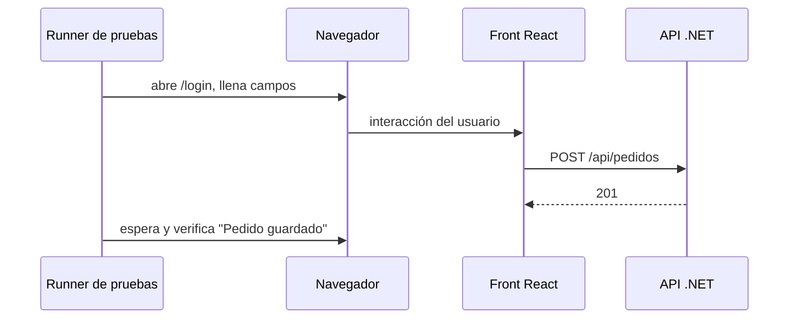

# Pruebas end-to-end (Playwright y Cypress)

Parte de: [[13-Testing-Calidad/_Índice Testing y calidad|Testing y calidad]]

> [!info] Cómo avanzar
> `progreso`: **pendiente** → **viendo** (estudiando) → **visto** (contestaste la autoevaluación sin abrir las respuestas) → **dominado** (hiciste el laboratorio o lo aplicaste de verdad).

## Contenido

### Qué es
Una **prueba end-to-end** (e2e) ejercita el sistema completo como lo haría un usuario: abre un navegador real, navega por el front (Itzamna.Clio en React), que llama a la API (Itzamna.Dionisio), que lee y escribe en la base. Verifica que el **flujo de punta a punta** funciona: login, captura, guardado y consulta. Es la punta de la [[Pirámide de pruebas]]: da mucha confianza sobre el flujo, pero es la más lenta y la más propensa a fallos intermitentes. Las dos herramientas más usadas para web son **Playwright** (de Microsoft) y **Cypress**.

### Cómo funciona


#### Diferencias principales
| Aspecto | Playwright | Cypress |
|---|---|---|
| Arquitectura | Controla el navegador desde fuera, por protocolo | Corre dentro del navegador junto a la app |
| Navegadores | Chromium, Firefox y WebKit (motor de Safari) | Familia Chrome, Edge y Firefox; WebKit experimental |
| Lenguajes | TypeScript/JavaScript, C# (.NET), Python, Java | JavaScript/TypeScript |
| Varias pestañas y orígenes | Soporte nativo (contextos, páginas, popups) | Una pestaña; varios orígenes con `cy.origin` |
| Paralelismo | Integrado y gratuito (workers) | Por archivo; la orquestación avanzada usa su servicio de nube de pago |
| Depuración | Trace Viewer, codegen, modo UI | Runner interactivo con *time travel* muy cómodo |

Ambos tienen **espera automática**: antes de hacer clic esperan a que el elemento sea visible y esté habilitado, lo que reduce mucho los `sleep`.

### Ejemplo
Playwright con TypeScript en el repo de Itzamna.Clio:

```typescript
import { test, expect } from '@playwright/test';

test('capturar un pedido y verlo en la lista', async ({ page, request }) => {
  // Datos propios de la prueba creados por API (rápido y aislado)
  const cliente = await (await request.post('/api/pruebas/clientes', { data: { nombre: `E2E ${Date.now()}` } })).json();

  await page.goto('/pedidos/nuevo');
  await page.getByLabel('Cliente').fill(cliente.nombre);
  await page.getByRole('option', { name: cliente.nombre }).click();
  await page.getByLabel('Total').fill('1250');
  await page.getByRole('button', { name: 'Guardar' }).click();

  await expect(page.getByRole('alert')).toHaveText(/Pedido guardado/);
  await expect(page.getByRole('row', { name: new RegExp(cliente.nombre) })).toBeVisible();
});
```

El login se resuelve una vez y se reutiliza el estado guardado (`storageState`) para no pasar por Xolotl.Hecate en cada prueba. En Azure DevOps corre en un agente Linux con `npx playwright install --with-deps` y publica el reporte HTML y las trazas como artefactos.

### Cómo reducir pruebas frágiles
- **Selectores por rol, etiqueta o texto visible** (`getByRole`, `getByLabel`) o `data-testid`; nunca clases CSS ni XPath largos.
- **Nada de esperas fijas** (`waitForTimeout(3000)`): usa aserciones que reintentan (`toBeVisible`, `toHaveText`).
- **Datos aislados por prueba**, creados por API o semillas; no dependas de datos que otra prueba modifica.
- **Ambiente estable** y dedicado, con servicios externos simulados (pagos, correo).
- **Pruebas independientes** entre sí, que se puedan correr en cualquier orden.
- **Reintentos con evidencia**: configura un reintento en CI, pero guarda trazas y revisa toda prueba que pasa "a la segunda"; no la ignores.

### Qué flujos merecen e2e
Los **caminos críticos del negocio**, donde un fallo cuesta dinero o confianza: login y cierre de sesión, captura y guardado de un pedido, pagos, generación de un reporte clave de Wee.Reporteria. También un *smoke test* tras cada despliegue. No uses e2e para validar cada mensaje de error o regla de cálculo: eso va en [[Pruebas unitarias]] o en [[Pruebas de integración]].

### Cuándo usarlo y cuándo no
Elige **Playwright** si quieres probar Safari/WebKit, varios navegadores, varias pestañas, o escribir pruebas en C#. **Cypress** es buena opción si el equipo ya lo usa y valora su experiencia interactiva. Evita e2e si la funcionalidad cambia a diario (la prueba se rompe más rápido de lo que aporta) o si puedes obtener la misma confianza más abajo.

### Errores comunes
- **Demasiadas e2e**: suite de horas ([[Pirámide de pruebas]]).
- **Login por la interfaz en cada prueba**: lento; reutiliza sesión.
- **Probar contra producción** con datos reales.
- **Aceptar intermitencias** como normales.

### Para profundizar
- [Playwright: buenas prácticas](https://playwright.dev/docs/best-practices)
- [Playwright para .NET](https://playwright.dev/dotnet/)
- [Cypress: navegadores soportados](https://docs.cypress.io/app/references/launching-browsers)

## Autoevaluación

Contesta primero en voz alta o en papel; luego despliega la respuesta.

> [!question]- ¿Qué verifica una prueba e2e?
> Un flujo completo como lo haría un usuario, en un navegador real contra la app desplegada (UI + API + base).

> [!question]- Diferencias principales entre Playwright y Cypress.
> Playwright: varios navegadores (Chromium, Firefox, WebKit), varios lenguajes (incluido .NET), pestañas y orígenes múltiples, espera automática. Cypress: corre dentro del navegador, gran experiencia de depuración, enfocado en JavaScript/TypeScript.

> [!question]- ¿Cómo reduces pruebas e2e frágiles?
> Selectores estables (`getByRole`, `data-testid`), nada de `sleep` fijos (usar esperas automáticas/aserciones que reintentan), datos de prueba propios por ejecución, y pocos flujos críticos.

> [!question]- ¿Qué flujos merecen e2e?
> Los que, si fallan, cuestan dinero o confianza: registro/login, compra/pago, el flujo principal del producto.

## Práctica

- [[Lab 1 - Pirámide de pruebas en un proyecto pequeño]]

