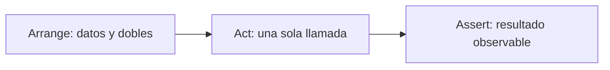

# Pruebas unitarias

Parte de: [[13-Testing-Calidad/_Índice Testing y calidad|Testing y calidad]]

> [!info] Cómo avanzar
> `progreso`: **pendiente** → **viendo** (estudiando) → **visto** (contestaste la autoevaluación sin abrir las respuestas) → **dominado** (hiciste el laboratorio o lo aplicaste de verdad).

## Contenido

### Qué es
Una **prueba unitaria** verifica una pieza pequeña de lógica (un método, una clase, una regla) de forma aislada de lo lento o externo: base de datos, red, archivos, reloj. Son la base de la [[Pirámide de pruebas]]: se ejecutan en milisegundos, te dicen exactamente qué se rompió y te permiten refactorizar con confianza. En .NET normalmente se escriben con [[xUnit]].

### Cómo funciona
Una buena prueba unitaria cumple las propiedades **FIRST**:

- **Fast** (rápida): milisegundos; si tarda, la gente deja de correrlas.
- **Isolated / Independent** (aislada): no depende del orden ni de otras pruebas ni de estado compartido.
- **Repeatable** (repetible): mismo resultado en tu PC, en otra máquina y en el agente de Azure DevOps, a cualquier hora.
- **Self-validating** (autoverificable): pasa o falla sola, sin que alguien revise la salida.
- **Timely** (oportuna): se escribe junto con el código, no meses después.

#### Arrange-Act-Assert
Organiza cada prueba en tres bloques:

1. **Arrange (preparar)**: crea los objetos, datos y dobles necesarios.
2. **Act (actuar)**: ejecuta **una** acción, la que estás probando.
3. **Assert (verificar)**: comprueba el resultado o el estado.

Esa estructura hace que cualquiera entienda la prueba de un vistazo. Un buen nombre describe el escenario y el resultado esperado: `Calcular_con_total_igual_a_1000_aplica_10_por_ciento`.



### Ejemplo
Regla: 10 % de descuento si el total es mayor o igual a 1,000; si no, 0. El valor más importante a probar es el **borde**.

```csharp
public static class Descuento
{
    public static decimal Calcular(decimal total) => total >= 1000m ? total * 0.10m : 0m;
}

public sealed class DescuentoTests
{
    [Theory]
    [InlineData(999.99, 0)]       // justo debajo del borde
    [InlineData(1000, 100)]       // exactamente en el borde
    [InlineData(2500, 250)]       // caso normal
    [InlineData(0, 0)]
    public void Calcular_devuelve_descuento_segun_total(decimal total, decimal esperado)
    {
        // Arrange: datos en los parámetros
        // Act
        var r = Descuento.Calcular(total);
        // Assert
        Assert.Equal(esperado, r);
    }
}
```

Con `[Theory]` e `[InlineData]` cubres varios casos sin repetir código. Si el borde se escribiera mal (`>` en lugar de `>=`), el caso de 1000 lo detecta de inmediato.

### Probar comportamiento, no implementación
Si una prueba verifica **detalles internos** (qué métodos privados se llamaron, en qué orden se consultó cada dependencia), queda atada a la implementación: cualquier refactor que conserve el comportamiento la rompe. Eso genera pruebas frágiles que se arreglan "por inercia" y dejan de proteger. Verifica lo **observable**: el valor devuelto, el estado final, o los efectos hacia afuera que importan (un correo enviado). Más en [[Mocks, stubs y fakes]].

### Fechas y aleatorios
Un error clásico es usar `DateTime.Now`, `Guid.NewGuid()` o `Random` dentro del código bajo prueba. La prueba pasa hoy y falla el día 31, a medianoche, en otra zona horaria o una de cada mil veces. Solución: inyecta las fuentes no deterministas. Para el tiempo usa `TimeProvider` y `FakeTimeProvider` ([[TimeProvider para probar fechas]]); para aleatorios, inyecta un `Random` con semilla fija o una interfaz generadora de IDs.

### Cuándo usarlo y cuándo no
Úsalas para reglas de negocio, cálculos (impuestos, descuentos, comisiones), validadores de FluentValidation, mapeos con lógica, funciones puras de TypeScript en Itzamna.Clio (con Vitest). No sirven para comprobar SQL, configuración, serialización o middleware: eso va en [[Pruebas de integración]]. No las escribas para código trivial (propiedades automáticas) ni para código del framework (ver [[Qué probar y qué no]]).

### Errores comunes
- **Varios Act en una prueba**: si falla, no sabes cuál paso fue.
- **Lógica en la prueba** (`if`, bucles que calculan el esperado): replicas el bug. Usa valores literales.
- **Estado estático compartido** entre pruebas: resultados que dependen del orden.
- **Nombres como `Test1`**: el reporte de fallas no dice nada.
- **Ignorar los bordes** y probar solo el caso feliz.

### Para profundizar
- [Buenas prácticas de pruebas unitarias en .NET (Microsoft Learn)](https://learn.microsoft.com/dotnet/core/testing/unit-testing-best-practices)
- [Pruebas unitarias con xUnit en .NET (Microsoft Learn)](https://learn.microsoft.com/dotnet/core/testing/unit-testing-csharp-with-xunit)
- [Martin Fowler: Unit Test](https://martinfowler.com/bliki/UnitTest.html)

## Ejercicios

Resuélvelos en papel o en la herramienta; la solución está plegada.

> [!question]- Escribe una prueba xUnit para `Descuento.Calcular(total)`: 10% si total ≥ 1000, si no 0. Cubre el borde.
> ```csharp
> [Theory]
> [InlineData(999.99, 0)]
> [InlineData(1000, 100)]
> [InlineData(2500, 250)]
> public void Calcula_descuento(decimal total, decimal esperado) =>
>     Assert.Equal(esperado, Descuento.Calcular(total));
> ```
> El caso 999.99/1000 prueba el borde exacto, donde suelen estar los errores (`>` vs `>=`).

## Autoevaluación

Contesta primero en voz alta o en papel; luego despliega la respuesta.

> [!question]- ¿Qué es una prueba unitaria y qué propiedades debe tener?
> Verifica una unidad de comportamiento aislada de dependencias lentas o no deterministas. Propiedades: rápida, aislada, repetible, auto-verificable y escrita a tiempo (FIRST).

> [!question]- Explica Arrange-Act-Assert.
> Arrange: prepara datos y dobles. Act: ejecuta **una** acción. Assert: verifica el resultado. Ayuda a que cada prueba diga una sola cosa.

> [!question]- ¿Qué pasa si la prueba verifica detalles internos (qué métodos privados se llamaron)?
> Se rompe con cada refactor aunque el comportamiento no cambie. Prueba el comportamiento observable; usa dobles solo en las fronteras ([[Mocks, stubs y fakes]]).

> [!question]- Error común con fechas y aleatorios.
> Usar `DateTime.Now` o `Random` directo: la prueba depende del momento. Inyecta `TimeProvider` y una semilla o abstracción.

## Práctica

- [[Lab 1 - Pirámide de pruebas en un proyecto pequeño]]

