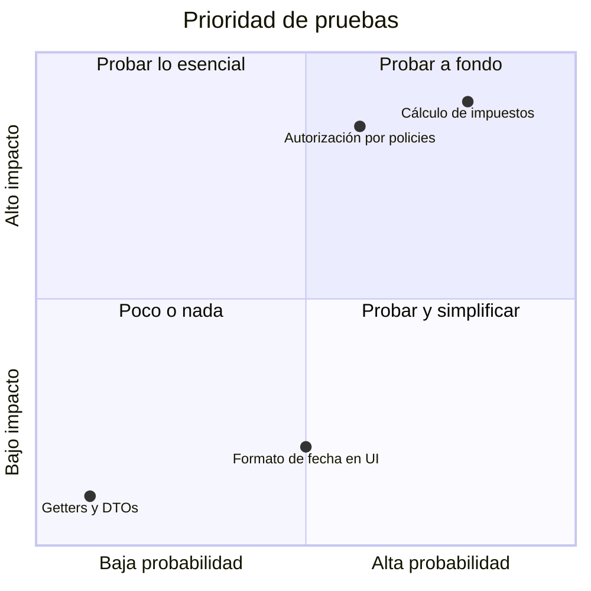

# Qué probar y qué no

Parte de: [[13-Testing-Calidad/_Índice Testing y calidad|Testing y calidad]]

> [!info] Cómo avanzar
> `progreso`: **pendiente** → **viendo** (estudiando) → **visto** (contestaste la autoevaluación sin abrir las respuestas) → **dominado** (hiciste el laboratorio o lo aplicaste de verdad).

## Contenido

### Qué es
Ningún equipo tiene tiempo para probar todo, y no todo vale lo mismo. Decidir **qué probar** es priorizar el esfuerzo de pruebas según el **riesgo**: qué tan probable es que algo falle y cuánto cuesta si falla. Una suite bien enfocada protege lo importante, corre rápido y no se vuelve una carga de mantenimiento.

### Cómo funciona: priorizar por riesgo
Evalúa cada parte del sistema con dos preguntas: **¿qué tan probable es un bug aquí?** (complejidad, cambios frecuentes, código nuevo, historial de fallas) y **¿qué tan grave sería?** (dinero, datos fiscales, seguridad, pérdida de datos, reputación).



Prioriza:

- **Reglas de negocio y cálculos**: impuestos, descuentos, comisiones, conciliación (Pochteca.Nomisma), vencimientos.
- **Bordes y casos raros**: cero, negativos, listas vacías, límites exactos (`>=` contra `>`), fechas de fin de mes y cambios de horario.
- **Seguridad**: autenticación y autorización (que un usuario no vea pedidos de otro), validación de entrada.
- **Puntos de integración**: SQL de cada consulta, contratos JSON con el front, llamadas a servicios externos.
- **Bugs que ya ocurrieron**: cada uno merece una prueba de regresión.
- **Código que cambia seguido**: donde más se rompe.

### Qué normalmente no vale la pena probar
- **Código trivial**: propiedades automáticas, constructores que solo asignan, DTOs sin lógica.
- **El framework y bibliotecas de terceros**: no pruebes que ASP.NET Core enruta o que Dapper mapea columnas; prueba **tu uso** de ellos en integración.
- **Código generado**: clientes generados desde OpenAPI, migraciones de EF Core (revísalas, pero no las pruebes unitariamente).
- **Detalles de implementación**: qué método privado se llamó o en qué orden.
- **Configuración trivial** que se verifica al arrancar (y que una sola prueba de humo detecta).

### Ejemplo: un bug en producción
Un cliente reporta que pedidos de exactamente $1,000.00 no recibieron el 10 % de descuento en Itzamna.Dionisio. Lo que haces primero:

1. **Reproduce el bug con una prueba que falla**, en el nivel más bajo posible:
```csharp
[Fact]
public void Calcular_con_total_exacto_de_1000_aplica_descuento() =>
    Assert.Equal(100m, Descuento.Calcular(1000m)); // falla: el código usaba >
```
2. **Corrige** el código hasta que la prueba pase (`>=`).
3. **Busca bugs hermanos**: ¿hay otros umbrales con el mismo error?
4. Deja la prueba como **regresión** para que nunca vuelva.

Escribir la prueba antes de corregir asegura que realmente entendiste la causa y que la corrección la resuelve.

### Cuándo usarlo y cuándo no
Haz este análisis al planear una funcionalidad (¿qué riesgos tiene?) y al revisar PRs (¿las pruebas cubren lo riesgoso?). En código desechable (prototipos, scripts de una vez) puedes probar poco o nada, siempre que de verdad se tire. En código que manejará dinero o datos personales, el umbral es mucho más alto.

### Errores comunes
- **Probar lo fácil en lugar de lo importante**: muchas pruebas de getters y ninguna del cálculo de impuestos. Infla la cobertura sin bajar el riesgo (ver [[Cobertura de pruebas]]).
- **Solo el caso feliz**: los bugs viven en bordes y errores.
- **Corregir un bug sin prueba de regresión**: reaparece meses después.
- **Probar el framework** por desconfianza: tiempo perdido.
- **No revisar el criterio**: lo que era de bajo riesgo puede volverse crítico cuando el negocio cambia.

### Para profundizar
- [Martin Fowler: The Practical Test Pyramid](https://martinfowler.com/articles/practical-test-pyramid.html)
- [Buenas prácticas de pruebas unitarias en .NET (Microsoft Learn)](https://learn.microsoft.com/dotnet/core/testing/unit-testing-best-practices)
- Relacionado: [[Pirámide de pruebas]], [[Pruebas unitarias]], [[TDD]]

## Autoevaluación

Contesta primero en voz alta o en papel; luego despliega la respuesta.

> [!question]- ¿Qué priorizas al decidir qué probar?
> Reglas de negocio y cálculos, casos borde, código que ya falló (prueba de regresión), integraciones críticas y flujos que cuestan dinero si fallan.

> [!question]- ¿Qué normalmente no vale la pena probar?
> Getters/setters triviales, código del framework, mapeos sin lógica, y detalles de implementación que cambiarán.

> [!question]- Caso: encuentras un bug en producción. ¿Qué haces primero?
> Escribir una prueba que lo reproduzca y falle; luego corregir hasta que pase. Así no regresa.

> [!question]- Error común.
> Probar dobles en lugar de código real (el mock devuelve X y verificas que devuelve X).

## Práctica

- [[Lab 1 - Pirámide de pruebas en un proyecto pequeño]]

