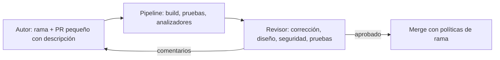

# Revisión de código

Parte de: [[13-Testing-Calidad/_Índice Testing y calidad|Testing y calidad]]

> [!info] Cómo avanzar
> `progreso`: **pendiente** → **viendo** (estudiando) → **visto** (contestaste la autoevaluación sin abrir las respuestas) → **dominado** (hiciste el laboratorio o lo aplicaste de verdad).

## Contenido

### Qué es
La **revisión de código** (*code review*) es la práctica de que otra persona lea y comente un cambio antes de integrarlo a la rama principal, normalmente mediante un *pull request* (PR) en Azure Repos o GitHub. Sus objetivos son detectar defectos y riesgos, mantener la calidad y coherencia del diseño, y **compartir conocimiento**: después de la revisión, al menos dos personas entienden el cambio. Para la parte humana del proceso, ve también [[Cómo hacer un buen code review]].

### Cómo funciona


En Azure DevOps configuras **políticas de rama**: número mínimo de revisores, build de validación obligatoria, comentarios resueltos y vinculación con elementos de trabajo. Así la automatización filtra lo mecánico y la persona se concentra en lo que solo una persona puede juzgar.

#### Qué buscar, en orden
1. **Corrección**: ¿resuelve el problema descrito? ¿Qué casos no cubre (nulos, listas vacías, concurrencia, errores de red)?
2. **Diseño**: ¿encaja con la arquitectura (vertical slice, una interfaz por consulta)? ¿Agrega acoplamiento innecesario?
3. **Seguridad**: SQL parametrizado, autorización en cada endpoint, secretos fuera del repo, datos sensibles fuera de los logs.
4. **Pruebas**: ¿hay pruebas de lo riesgoso? ¿Fallarían si el código estuviera mal?
5. **Legibilidad y mantenimiento**: nombres, complejidad, comentarios que explican el porqué.

El **estilo** (espacios, orden de `using`, llaves) no debería discutirse en una revisión: lo resuelven `dotnet format`, `.editorconfig`, ESLint y Prettier, y los [[Analizadores de Roslyn y warnings como errores]].

### Tamaño del PR
Los PR **pequeños y enfocados** se revisan mejor: con cientos de líneas un revisor puede leer con atención; con miles, solo hojea y aprueba. Estudios de revisión en la industria (como el de SmartBear con Cisco) observaron que la capacidad de encontrar defectos cae mucho por encima de unos pocos cientos de líneas y después de una hora de revisión continua. Prácticas que ayudan:

- Un PR por cambio lógico; separa refactors de cambios de comportamiento.
- Descripción con **qué, por qué y cómo probarlo**, y capturas si hay cambios de UI en Itzamna.Clio.
- *Feature flags* para integrar trabajo incompleto sin romper.
- Autor revisa su propio diff antes de pedir revisión.

### Ejemplo: comentarios sin fricción
Comenta **sobre el código, no sobre la persona**, distingue lo bloqueante de lo opcional y pregunta antes de afirmar. Una convención útil son los *Conventional Comments* (etiqueta al inicio):

```text
issue (bloqueante): Este endpoint no valida que el pedido pertenezca al usuario del token;
cualquiera con un id podría verlo. ¿Agregamos la policy "DueñoDelPedido"?

question: ¿Qué pasa si `partidas` llega vacío? No veo validación en el validador.

suggestion: Podríamos mover el cálculo a `ReglasEnvio` para probarlo sin base de datos.

nit: `datos2` no dice qué contiene; ¿`partidasValidas`?

praise: Muy clara la prueba de borde con 1000.00, gracias.
```

Evita "esto está mal" sin explicación, el sarcasmo y las peticiones de reescribir todo al estilo propio. Si una discusión se alarga más de dos o tres comentarios, mejor una llamada corta y luego deja por escrito la conclusión.

### Cuándo usarlo y cuándo no
Úsala en todo cambio que va a la rama principal, incluso en equipos pequeños; en un proyecto personal, revisar tu propio PR al día siguiente también ayuda. Para cambios urgentes en producción, define un proceso rápido (un revisor, revisión posterior) en lugar de saltarte la revisión. El *pair programming* puede sustituir parte de la revisión porque ocurre en tiempo real.

### Errores comunes
- **PR gigantes**: aprobación sin lectura real ("LGTM").
- **Discutir estilo** que una herramienta podría resolver.
- **Revisar tarde**: PR esperando días bloquean al autor; acuerda tiempos de respuesta.
- **Revisar solo el diff** sin entender el contexto: pide la historia o el ticket.
- **Tono personal**: genera defensividad y revisiones cada vez más superficiales.

### Para profundizar
- [Google Engineering Practices: Code Review](https://google.github.io/eng-practices/review/)
- [Conventional Comments](https://conventionalcomments.org/)
- [Pull requests en Azure Repos (Microsoft Learn)](https://learn.microsoft.com/azure/devops/repos/git/about-pull-requests)

## Autoevaluación

Contesta primero en voz alta o en papel; luego despliega la respuesta.

> [!question]- ¿Qué buscas primero en una revisión?
> Corrección y diseño (¿resuelve el problema?, ¿hay casos no cubiertos?, ¿seguridad?), luego legibilidad y pruebas. El estilo lo resuelven formateadores y analizadores automáticos.

> [!question]- ¿Qué tamaño de PR facilita revisar bien?
> Pequeño y enfocado (cientos de líneas, no miles), con descripción del porqué y cómo probarlo.

> [!question]- ¿Cómo comentas sin generar fricción?
> Sobre el código, no la persona; distingue bloqueante de sugerencia (`nit:`); pregunta antes de afirmar ("¿qué pasa si `x` es null?"). Ver [[Cómo hacer un buen code review]].

