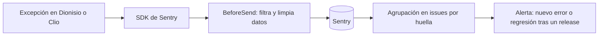

# Sentry

Parte de: [[13-Testing-Calidad/_Índice Testing y calidad|Testing y calidad]]

> [!info] Cómo avanzar
> `progreso`: **pendiente** → **viendo** (estudiando) → **visto** (contestaste la autoevaluación sin abrir las respuestas) → **dominado** (hiciste el laboratorio o lo aplicaste de verdad).

## Contenido

### Qué es
**Sentry** es una plataforma de **seguimiento de errores** y monitoreo de rendimiento de aplicaciones. Sus SDKs capturan excepciones no manejadas (y las que tú reportes) en el backend y en el front, las agrupan por causa, y te muestran el stack trace, la versión desplegada, el navegador o servidor, las acciones previas (*breadcrumbs*) y cuántos usuarios fueron afectados. También ofrece trazas de rendimiento, *session replay* para el front y alertas. Existe como servicio en la nube (con un plan gratuito para uso individual; revisa límites actuales en su sitio, Pendiente de confirmar) y como versión autohospedada.

### Cómo funciona


1. El SDK se integra al inicio de la aplicación con un **DSN** (identificador del proyecto; no es una contraseña, pero no lo publiques sin necesidad).
2. Captura automáticamente excepciones no manejadas, y con la integración de ASP.NET Core también datos de la petición y spans.
3. Antes de enviar, puedes **filtrar o modificar** el evento (`SetBeforeSend`).
4. Sentry agrupa eventos similares en un **issue**, que puedes asignar, resolver y vincular a un *release*. Si reaparece tras resolverlo, lo marca como **regresión**.
5. Con mapas de origen (*source maps*) de Vite, los errores de React muestran el código TypeScript original en lugar del JavaScript minificado.

### Ejemplo: integración en ASP.NET Core
Paquete NuGet `Sentry.AspNetCore`:

```csharp
var builder = WebApplication.CreateBuilder(args);

builder.WebHost.UseSentry(o =>
{
    o.Dsn = builder.Configuration["Sentry:Dsn"];          // desde configuración, no en el código
    o.Environment = builder.Environment.EnvironmentName;
    o.Release = typeof(Program).Assembly.GetName().Version?.ToString();
    o.TracesSampleRate = 0.1;                             // 10 % de trazas en producción
    o.SendDefaultPii = false;                             // no enviar IP, usuario ni encabezados
    o.SetBeforeSend((evento, _) =>
    {
        evento.Request?.Headers?.Remove("Authorization"); // nunca el JWT
        return evento;
    });
});
```

En el front de Itzamna.Clio, el paquete `@sentry/react` se inicializa en `main.tsx` con `Sentry.init({ dsn, environment, release })` y un `ErrorBoundary` alrededor de la aplicación. En el pipeline de Azure DevOps, el paso de build sube los source maps y registra el release.

Las excepciones que ya manejas con tu `IExceptionHandler` y conviertes en ProblemDetails con `codigo` siguen llegando a Sentry si el manejador las registra con `ILogger` en nivel `Error` (la integración con logging captura esos eventos) o si llamas `SentrySdk.CaptureException(ex)`. Errores de validación (400) no deberían enviarse: no son fallas del sistema.

### Qué cuidar al enviarle datos
- **Datos personales**: deja `SendDefaultPii` en `false` salvo que tengas base legal y aviso de privacidad; enmascara correos, RFC y nombres.
- **Secretos**: elimina encabezados `Authorization`, cookies y cuerpos de petición con contraseñas o tokens. Usa `BeforeSend` y las reglas de limpieza del lado del servidor.
- **Volumen y costo**: ajusta `TracesSampleRate` y la frecuencia de muestreo de errores; un bucle que falla miles de veces por minuto agota la cuota.
- **Ambiente y release** correctos: sin ellos, no sabes si un error es de pruebas o de producción, ni qué despliegue lo introdujo.
- **Residencia de datos**: revisa en qué región se almacenan si tu organización tiene requisitos.

### Cuándo usarlo y cuándo no
Úsalo cuando quieres saber de los errores **antes que tus usuarios**, especialmente en el front (los errores de JavaScript en el navegador del cliente no llegan a tus logs de servidor). Si ya usas Application Insights con OpenTelemetry, puede que cubra tus necesidades de backend y Sentry solo aporte en el front; evalúa duplicidad y costo. No es un sustituto de logs estructurados ni de métricas: es una herramienta especializada en errores ([[Métricas, trazas y logs]]).

### Errores comunes
- **DSN en el código** y en repos públicos: cualquiera puede mandar eventos falsos a tu proyecto.
- **Enviar todo**: errores de validación, 404 esperados; ahogan los problemas reales.
- **Sin source maps**: stack traces ilegibles del front.
- **Ignorar el ruido**: issues sin dueño que nadie revisa; define quién clasifica cada semana.

### Para profundizar
- [Sentry para ASP.NET Core](https://docs.sentry.io/platforms/dotnet/guides/aspnetcore/)
- [Sentry para React](https://docs.sentry.io/platforms/javascript/guides/react/)
- Relacionado: [[Logging estructurado]], [[Manejo global de errores (IExceptionHandler)]]

## Autoevaluación

Contesta primero en voz alta o en papel; luego despliega la respuesta.

> [!question]- ¿Para qué sirve Sentry?
> Captura errores y excepciones de apps (backend, frontend, móvil) con pila, contexto, usuario afectado y agrupación; también ofrece monitoreo de rendimiento. Tiene plan gratuito con límites (Pendiente de confirmar los límites actuales).

> [!question]- ¿Cómo lo integras en ASP.NET Core?
> Paquete `Sentry.AspNetCore` y `builder.WebHost.UseSentry(o => o.Dsn = ...)`; el DSN va en configuración/secretos, no en el código.

> [!question]- ¿Qué cuidas al enviarle datos?
> Datos personales y secretos (desactivar envío de PII por defecto o limpiar con `BeforeSend`), el entorno y la versión (`release`) para saber en qué despliegue apareció el error, y la tasa de muestreo de rendimiento.

## Práctica

- [[Lab 2 - Logging estructurado con trazas en ASP.NET Core]]

