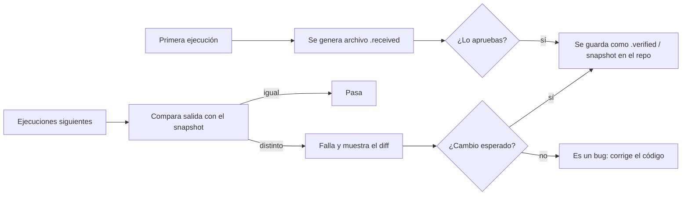

# Snapshot testing

Parte de: [[13-Testing-Calidad/_Índice Testing y calidad|Testing y calidad]]

> [!info] Cómo avanzar
> `progreso`: **pendiente** → **viendo** (estudiando) → **visto** (contestaste la autoevaluación sin abrir las respuestas) → **dominado** (hiciste el laboratorio o lo aplicaste de verdad).

## Contenido

### Qué es
El **snapshot testing** (pruebas de instantánea) guarda la salida de un código en un archivo la primera vez que corre la prueba, y en las siguientes ejecuciones compara la salida nueva contra ese archivo "aprobado". Si son distintos, la prueba falla y te muestra la diferencia. Sirve para verificar salidas grandes o estructuradas (un JSON de respuesta, un componente React renderizado, un SQL generado, un Excel exportado) sin escribir decenas de aserciones a mano.

### Cómo funciona


1. La prueba produce un valor y lo serializa a texto (JSON, HTML, texto plano).
2. Si no existe snapshot, se crea uno y lo revisas antes de aprobarlo.
3. El snapshot se versiona en el repositorio, junto al código.
4. Cada cambio en la salida obliga a una decisión consciente: aceptar el nuevo snapshot o corregir el código. Esa decisión queda visible en el PR.

Herramientas: en .NET, **Verify** (`Verify.Xunit`, archivos `.verified.txt` y `.received.txt`, con *scrubbing* de GUIDs y fechas); en JavaScript/TypeScript, **Vitest** y **Jest** con `toMatchSnapshot()` o `toMatchInlineSnapshot()`.

### Ejemplo
Verificar el contrato JSON de un endpoint de Itzamna.Dionisio con Verify:

```csharp
using VerifyXunit;

public sealed class ContratoPedidoTests(DionisioFactory f) : IClassFixture<DionisioFactory>
{
    [Fact]
    public async Task Get_pedido_mantiene_su_contrato()
    {
        var json = await f.CreateClient().GetStringAsync("/api/pedidos/1");
        await VerifyJson(json);   // compara con ContratoPedidoTests.Get_pedido_mantiene_su_contrato.verified.txt
    }
}
```

Verify reemplaza automáticamente GUIDs y fechas por marcadores (`Guid_1`, `DateTime_1`), de modo que el snapshot es estable. Si alguien renombra `total` a `importe`, la prueba falla y el diff muestra el cambio: justo lo que quieres detectar antes de romper a Itzamna.Clio.

En React con Vitest:

```typescript
import { render } from '@testing-library/react';
import { it, expect } from 'vitest';
import { ResumenPedido } from './ResumenPedido';

it('muestra el resumen del pedido', () => {
  const { container } = render(<ResumenPedido codigo="P-001" total={1250} />);
  expect(container).toMatchSnapshot();
});
```

### Cuándo es útil
- **Contratos de API**: detectar cambios no intencionales en el JSON que consumen otros sistemas.
- **Salidas generadas**: SQL o scripts que produce una herramienta, plantillas de correo, archivos de exportación, código de un source generator.
- **Código legado** sin pruebas: congelar el comportamiento actual (*characterization tests*) antes de refactorizar.
- **Estructuras grandes** donde escribir aserciones campo por campo sería impráctico.

No es útil cuando la salida cambia constantemente por diseño, cuando lo importante es una regla concreta (mejor una aserción explícita que diga qué esperas), ni para componentes de UI muy dinámicos donde cualquier ajuste de estilo invalida el snapshot.

### Errores comunes
- **Aprobar snapshots sin leerlos**: el error más común. Si actualizas en bloque cada vez que falla (`-u` en Vitest o aceptar todo en Verify), la prueba deja de proteger y solo registra lo que haya. Revisa el diff en el PR como cualquier código.
- **Datos no deterministas** (fechas, GUIDs, orden de diccionarios): snapshots que fallan sin cambio real. Usa scrubbers o datos fijos y ordena colecciones.
- **Snapshots gigantes**: nadie los revisa. Toma snapshots de partes significativas.
- **Usarlo como única prueba** de lógica de negocio: no expresa la intención; acompáñalo de [[Pruebas unitarias]] claras.
- **No versionar los archivos aprobados** o versionar los `.received`: agrega estos últimos al `.gitignore`.

### Para profundizar
- [Verify en GitHub](https://github.com/VerifyTests/Verify)
- [Vitest: Snapshot](https://vitest.dev/guide/snapshot)
- Relacionado: [[Pruebas de integración]], [[TDD]]

## Autoevaluación

Contesta primero en voz alta o en papel; luego despliega la respuesta.

> [!question]- ¿Qué es snapshot testing?
> Guardar la salida de algo (JSON, HTML, objeto serializado) en un archivo aprobado y, en cada ejecución, comparar contra él. Herramientas: Verify (.NET), snapshots de Jest/Vitest.

> [!question]- ¿Cuándo es útil?
> Para salidas grandes y estables donde escribir aserciones campo por campo es tedioso: contratos de API, reportes generados, componentes de UI.

> [!question]- Error común.
> Aceptar snapshots nuevos sin revisarlos ("actualizar todo"): la prueba deja de detectar regresiones. Y snapshots con datos variables (fechas, ids) sin limpiar.

