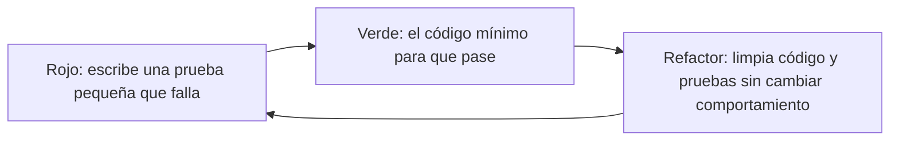

# TDD

Parte de: [[13-Testing-Calidad/_Índice Testing y calidad|Testing y calidad]]

> [!info] Cómo avanzar
> `progreso`: **pendiente** → **viendo** (estudiando) → **visto** (contestaste la autoevaluación sin abrir las respuestas) → **dominado** (hiciste el laboratorio o lo aplicaste de verdad).

## Contenido

### Qué es
**TDD** (*Test-Driven Development*, desarrollo guiado por pruebas) es una práctica de diseño en la que escribes **una prueba que falla antes** de escribir el código de producción, luego el mínimo código para que pase y después mejoras el diseño. Kent Beck la popularizó con Extreme Programming. Más que una técnica de pruebas, es una forma de pensar el diseño desde el uso: el código nace con pruebas y con interfaces que son fáciles de usar.

### Cómo funciona
El ciclo es **rojo, verde, refactor**:



1. **Rojo**: piensa el siguiente comportamiento más pequeño que falta y escribe una prueba para él. Ejecútala y confirma que **falla por la razón correcta** (si pasa de entrada, no estás probando nada nuevo).
2. **Verde**: escribe el código más simple que la haga pasar, aunque parezca ingenuo (incluso devolver una constante).
3. **Refactor**: con todas las pruebas en verde, elimina duplicación, mejora nombres y estructura. Las pruebas te protegen.

Los pasos son cortos, de minutos. Cada prueba nueva fuerza a generalizar un poco el código ("triangulación").

### Ejemplo: kata FizzBuzz
Regla: para un número, devolver "Fizz" si es múltiplo de 3, "Buzz" si es múltiplo de 5, "FizzBuzz" si de ambos, o el número como texto. Secuencia de pruebas que guía la implementación:

1. `1` devuelve `"1"`: la implementación más simple es `return "1";`.
2. `2` devuelve `"2"`: obliga a generalizar a `return n.ToString();`.
3. `3` devuelve `"Fizz"`: aparece `if (n % 3 == 0)`.
4. `6` devuelve `"Fizz"`: confirma que es "múltiplo de 3" y no "igual a 3".
5. `5` devuelve `"Buzz"`.
6. `10` devuelve `"Buzz"`.
7. `15` devuelve `"FizzBuzz"`: obliga a manejar el caso combinado y su orden.
8. `30` devuelve `"FizzBuzz"`: confirma la generalización.

```csharp
public sealed class FizzBuzzTests
{
    [Theory]
    [InlineData(1, "1")] [InlineData(2, "2")]
    [InlineData(3, "Fizz")] [InlineData(6, "Fizz")]
    [InlineData(5, "Buzz")] [InlineData(10, "Buzz")]
    [InlineData(15, "FizzBuzz")] [InlineData(30, "FizzBuzz")]
    public void Convertir(int n, string esperado) => Assert.Equal(esperado, FizzBuzz.Convertir(n));
}

public static class FizzBuzz
{
    public static string Convertir(int n) => (n % 3, n % 5) switch
    {
        (0, 0) => "FizzBuzz",
        (0, _) => "Fizz",
        (_, 0) => "Buzz",
        _ => n.ToString()
    };
}
```

La versión final con `switch` sobre una tupla surgió en un paso de refactor, no al inicio. En un caso real de Itzamna.Dionisio harías lo mismo con una regla de descuentos o de vencimiento de pedidos.

### Beneficio de diseño
Escribir la prueba primero te obliga a **usar el código antes de que exista**. Si es difícil de probar (necesita base de datos, reloj real, diez dependencias), lo notas de inmediato y diseñas mejor: dependencias inyectadas, funciones pequeñas, responsabilidades claras (ver [[Diseñar código fácil de probar]]). Además obtienes una suite de regresión como subproducto y documentación ejecutable de cómo se usa cada pieza.

### Cuándo no conviene TDD estricto
- **Exploración y prototipos**: cuando aún no sabes qué quieres (probar una biblioteca, un *spike*); haz el experimento, tíralo y luego desarrolla con pruebas.
- **Interfaces de usuario muy visuales** donde el resultado se juzga a ojo.
- **Código de integración delgado** (configuración de DI, mapeo trivial) donde una prueba de integración posterior es más útil.
- **Equipos sin práctica** bajo presión de entrega: TDD se aprende con katas antes de aplicarlo en un proyecto crítico.

Aun en esos casos, escribir la prueba que reproduce un bug **antes** de corregirlo es TDD aplicado y siempre vale la pena.

### Errores comunes
- **Saltarse el refactor**: el código pasa las pruebas pero se vuelve un desorden; el tercer paso es el que da el beneficio de diseño.
- **Escribir muchas pruebas de golpe** antes de implementar: pierdes el ritmo de pasos cortos y la retroalimentación.
- **Pasos demasiado grandes**: si una prueba requiere una hora de código, divídela.
- **No ver la prueba en rojo**: puede que nunca falle (aserción equivocada).
- **Probar implementación** en lugar de comportamiento, lo que vuelve caro refactorizar.

### Para profundizar
- [Martin Fowler: Test Driven Development](https://martinfowler.com/bliki/TestDrivenDevelopment.html)
- [Kent Beck: Canon TDD](https://tidyfirst.substack.com/p/canon-tdd)
- Relacionado: [[Pruebas unitarias]], [[BDD]]

## Ejercicios

Resuélvelos en papel o en la herramienta; la solución está plegada.

> [!question]- Kata FizzBuzz con TDD: escribe la secuencia de pruebas (en orden) que guiaría la implementación.
> 1) `1 → "1"`. 2) `2 → "2"` (generaliza a `n.ToString()`). 3) `3 → "Fizz"`. 4) `6 → "Fizz"` (generaliza a `% 3`). 5) `5 → "Buzz"`. 6) `10 → "Buzz"`. 7) `15 → "FizzBuzz"` (el orden de condiciones importa). Cada prueba fuerza el cambio más pequeño.

## Autoevaluación

Contesta primero en voz alta o en papel; luego despliega la respuesta.

> [!question]- ¿Cuál es el ciclo de TDD?
> Rojo (escribe una prueba que falla), Verde (el código mínimo para pasarla), Refactor (mejora el diseño con las pruebas en verde). Ciclos cortos.

> [!question]- ¿Qué beneficio de diseño trae TDD?
> Obliga a pensar primero en la interfaz y el uso; el código resultante suele ser más desacoplado y fácil de probar.

> [!question]- ¿Cuándo no conviene TDD estricto?
> Exploración o prototipos donde aún no sabes qué quieres, o UI muy visual. Puedes explorar y luego escribir pruebas antes de consolidar.

> [!question]- Error común.
> Saltarse el refactor, o escribir pruebas tan acopladas a la implementación que impiden refactorizar.

