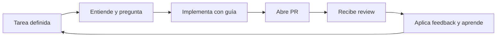

# Desarrollador junior - expectativas

Parte de: [[Escalera de carrera (junior, semi senior, senior, staff)]]

> [!info] Cómo avanzar
> `progreso`: **pendiente** → **viendo** (estudiando) → **visto** (contestaste la autoevaluación sin abrir las respuestas) → **dominado** (hiciste el laboratorio o lo aplicaste de verdad).

## Contenido

### Qué es
Un **desarrollador junior** está en la etapa de aprender a trabajar en un código base real con un equipo real. Se espera que complete **tareas bien definidas con guía**, que aprenda las herramientas y convenciones del equipo, que **pida ayuda a tiempo** y que **aplique la retroalimentación** que recibe. Es el primer escalón de la [[Escalera de carrera (junior, semi senior, senior, staff)]].

### Cómo funciona
El ciclo típico de un junior en un equipo .NET se ve así:

Expectativas concretas:
- **Entender antes de codificar.** Leer la historia de usuario y sus criterios de aceptación, y preguntar lo que no está claro.
- **Seguir las convenciones.** En un proyecto como Itzamna.Dionisio: vertical slice, SQL en archivos `.sql` con una interfaz por consulta, errores con [[ProblemDetails]] y `codigo`. El junior no reinventa la estructura; la imita bien.
- **Pedir ayuda con buen formato.** Regla práctica: si llevas 30–60 minutos atorado sin avanzar, pregunta, pero con contexto: qué intentaste, qué esperabas y qué pasó.
- **Probar su propio trabajo.** Correr las pruebas, probar el endpoint en Swagger o con un `.http`, revisar el caso de error, no solo el camino feliz.
- **Aprender del review.** No repetir el mismo comentario en el siguiente PR.

### Ejemplo
Tarea: "Agregar validación del RFC en `CrearClienteCommand`".

Pregunta mal formulada: "No me funciona la validación, ¿me ayudas?".

Pregunta bien formulada:
> "Agregué una regla `Matches` en `CrearClienteValidator` para el RFC. La prueba con `XAXX010101000` pasa, pero con un RFC de persona moral de 12 caracteres falla. Revisé la expresión y creo que asume 13 caracteres. ¿Hay un validador de RFC que ya usemos en otro slice o lo ajusto aquí?"

La segunda versión muestra que investigaste, ahorra tiempo al senior y además puede revelar que ya existe código reutilizable.

**Señal de que está listo para subir:** entrega tareas medianas (un endpoint completo con su procedimiento, validación y pruebas) con poca supervisión, y sus PRs reciben comentarios de detalle, no de fondo ("esto no resuelve el requisito" o "esto rompe la convención").

### Cuándo usarlo y cuándo no
Estas expectativas sirven para evaluarte si estás empezando, para guiar a alguien a quien mentoreas ([[Mentoría a otros desarrolladores]]) y para calibrar lo que pides a un junior en tu equipo. No exijas a un junior que defina problemas ambiguos o diseñe sistemas; si lo haces, se frustra y comete errores caros. Tampoco lo sobreprotejas: dale tareas un poco más allá de su nivel con red de seguridad.

### Errores comunes
1. **Quedarse atorado días sin preguntar** por miedo a parecer incompetente. Cuesta más tiempo al equipo que una pregunta a tiempo.
2. **Preguntar sin haber intentado nada.** Lo contrario: pierde la oportunidad de aprender y cansa a quien ayuda.
3. **Tomar el review como ataque personal.** El comentario es sobre el código. Pregunta el porqué y anótalo.
4. **Copiar código sin entenderlo** (de Stack Overflow o de una IA). Si no puedes explicar cada línea en el PR, no está listo.
5. **Probar solo el camino feliz.** Revisa nulos, listas vacías y errores de la base.

### Para profundizar
- [Google Engineering Practices: The CL author's guide](https://google.github.io/eng-practices/review/developer/handling-comments.html): cómo recibir comentarios de revisión.
- [Get your work recognized: write a brag document — Julia Evans](https://jvns.ca/blog/brag-documents/)
- [How to Contribute to Open Source — Open Source Guides](https://opensource.guide/how-to-contribute/): práctica extra para aprender a leer código ajeno.

## Autoevaluación

Contesta primero en voz alta o en papel; luego despliega la respuesta.

> [!question]- ¿Qué se espera de un junior?
> Completar tareas bien definidas con guía, aprender el código base y las herramientas, pedir ayuda a tiempo y aplicar la retroalimentación.

> [!question]- Señal de que un junior está listo para subir.
> Entrega tareas medianas con poca supervisión y sus PRs requieren pocas correcciones de fondo.

