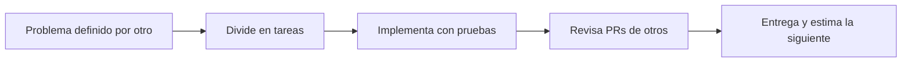

# Desarrollador semi senior - expectativas

Parte de: [[Escalera de carrera (junior, semi senior, senior, staff)]]

> [!info] Cómo avanzar
> `progreso`: **pendiente** → **viendo** (estudiando) → **visto** (contestaste la autoevaluación sin abrir las respuestas) → **dominado** (hiciste el laboratorio o lo aplicaste de verdad).

## Contenido

### Qué es
Un **semi senior** (o *mid-level*) ya domina la ejecución: entrega **funcionalidades completas de forma autónoma**, estima con razonable precisión, escribe pruebas y revisa código de otros. Es el nivel donde más tiempo pasa la mayoría de los desarrolladores y donde se decide si das el salto a senior.

### Cómo funciona
La diferencia con el junior es que el semi senior ya no necesita que le dividan el trabajo; la diferencia con el senior es que todavía necesita que le **definan el problema**.

Expectativas concretas:
- **Autonomía en la ejecución.** Recibe "módulo de reembolsos" y lo lleva a producción: endpoints, procedimientos, validación, pruebas de integración, despliegue en el pipeline de Azure DevOps.
- **Estimación razonable.** Sus rangos se cumplen la mayoría de las veces y avisa temprano cuando no ([[Estimación de tareas]]).
- **Calidad sostenida.** Pruebas que cubren casos borde, manejo de errores, logs útiles.
- **Revisión de código.** Revisa PRs de juniors y pares con comentarios útiles ([[Cómo hacer un buen code review]]).

**Lo que típicamente le falta para ser senior:**
1. **Manejar ambigüedad.** Definir el problema, no solo resolverlo: ¿qué se pide realmente?, ¿qué queda fuera?, ¿cómo sabremos que funcionó?
2. **Pensar en el sistema completo y la operación.** Qué pasa con el rendimiento, la observabilidad, los despliegues, los datos existentes y los otros servicios.
3. **Influir en las decisiones del equipo.** Proponer, documentar y defender decisiones técnicas ([[Cómo documentar una decisión técnica]], [[Influir sin autoridad]]).

### Ejemplo
Te piden: "Agrega exportación a Excel del reporte de ventas en Wee.Reporteria".

- **Respuesta semi senior:** implementas el endpoint que genera el archivo, con pruebas, y lo entregas en tiempo.
- **Respuesta que ya huele a senior:** antes de implementar preguntas cuántas filas puede tener (si son 500,000, generar el archivo en la petición HTTP va a dar *timeouts*), propones generarlo en segundo plano y notificar cuando esté listo, verificas qué columnas usan realmente y dejas un ADR corto con la decisión. Entregas casi lo mismo, pero evitaste un incidente y dejaste evidencia de criterio.

Ese segundo comportamiento es exactamente lo que debes empezar a practicar en este nivel.

### Cuándo usarlo y cuándo no
Usa esta lista para autoevaluarte y para construir tu [[Plan personal hacia senior]]. Si ya cumples todo lo de "ejecución", tu crecimiento no está en más tickets, sino en las tres brechas de arriba. No la uses como excusa para evitar tareas pequeñas: un semi senior también hace trabajo rutinario; la diferencia está en cómo aborda lo ambiguo.

### Errores comunes
1. **Quedarse cómodo en la ejecución.** Ser el que "saca todo" es valioso, pero sin diseño ni influencia te estancas.
2. **Implementar literalmente lo que dice el ticket** sin preguntar el objetivo. Ver [[Pensamiento de producto]].
3. **Revisiones superficiales.** Aprobar PRs con "LGTM" sin leerlos te quita una de las mejores formas de mostrar criterio.
4. **No documentar decisiones.** Tomas buenas decisiones pero nadie las ve.
5. **Estimar solo el código.** Olvidar pruebas, migraciones, revisión y despliegue hace que siempre te pases.

### Para profundizar
- [Google Engineering Practices: What to look for in a code review](https://google.github.io/eng-practices/review/reviewer/looking-for.html)
- [Documenting Architecture Decisions — Michael Nygard](https://cognitect.com/blog/2011/11/15/documenting-architecture-decisions)
- [Design Docs at Google — Malte Ubl](https://www.industrialempathy.com/posts/design-docs-at-google/)

## Autoevaluación

Contesta primero en voz alta o en papel; luego despliega la respuesta.

> [!question]- ¿Qué se espera de un semi senior?
> Entregar funcionalidades completas de forma autónoma, estimar con razonable precisión, escribir pruebas y revisar código de otros.

> [!question]- ¿Qué le falta típicamente para ser senior?
> Manejar ambigüedad (definir el problema, no solo resolverlo), pensar en el sistema completo y en la operación, e influir en las decisiones del equipo.

