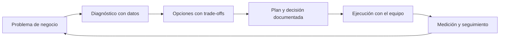

# Desarrollador senior - expectativas

Parte de: [[Escalera de carrera (junior, semi senior, senior, staff)]]

> [!info] Cómo avanzar
> `progreso`: **pendiente** → **viendo** (estudiando) → **visto** (contestaste la autoevaluación sin abrir las respuestas) → **dominado** (hiciste el laboratorio o lo aplicaste de verdad).

## Contenido

### Qué es
Un **desarrollador senior** diseña y lidera la entrega de **partes significativas del sistema**, anticipa riesgos, toma **decisiones técnicas documentadas**, mentorea y mejora la forma de trabajar del equipo. Recibe problemas, no tareas. Es el nivel que consolida las cuatro dimensiones de [[Qué significa ser senior (alcance, autonomía, impacto y ownership)]].

### Cómo funciona
La autonomía de un senior se ve como un ciclo completo que él mismo conduce:

Expectativas concretas:
- **Diseño.** Escribe un design doc antes de una funcionalidad grande ([[Design docs y RFCs]]) y ADRs para decisiones puntuales.
- **Riesgos.** Piensa en lo que puede salir mal: datos existentes, concurrencia, carga, seguridad, despliegue y rollback.
- **Operación.** Le importa lo que pasa en producción: logs estructurados, alertas, métricas.
- **Equipo.** Mentorea, hace revisiones que enseñan, mejora procesos (DoD, plantillas de PR, pipelines).
- **Negocio.** Traduce entre negocio y tecnología, negocia alcance y plazos ([[Negociar alcance y plazos con negocio]]).

### Ejemplo
Problema: "Los cobros fallan en fechas de corte" (Pochteca.Nomisma, Postgres).

Así se ve la autonomía senior en la práctica:
1. **Diagnóstico.** Revisas logs y métricas: los días 15 y 30 hay picos de cobros programados; la consulta que selecciona pendientes hace un *scan* completo y los bloqueos provocan *timeouts* en cascada.
2. **Opciones.** (a) Índice parcial sobre cobros pendientes; (b) procesar en lotes con `FOR UPDATE SKIP LOCKED`; (c) mover a una cola con workers. Escribes pros, contras y costo de cada una.
3. **Decisión.** Propones (a)+(b) ahora, que es barato y reversible, y dejas (c) como evolución si el volumen se triplica. Lo registras en un ADR.
4. **Ejecución.** Divides el trabajo, un semi senior implementa el procesamiento por lotes con tu guía, tú haces el índice y la prueba de carga.
5. **Seguimiento.** En el siguiente corte verificas la métrica: cero *timeouts*. Lo cuentas en la retro.

Lo que regresa el senior no es "ya quedó", sino diagnóstico, opciones, plan, ejecución y resultado medible.

### Cuándo usarlo y cuándo no
Usa esta lista para identificar evidencia que ya tienes y la que te falta, y para preparar historias STAR para entrevistas ([[Entrevistas de comportamiento (método STAR)]]). Ten en cuenta que en equipos pequeños el senior también programa mucho; no se trata de dejar de codificar, sino de hacerlo con visión de sistema. Si lo que te atrae es dirigir personas (1:1, contratación, desempeño), esa es la ruta de gestión, distinta a la técnica.

### Errores comunes
1. **Querer hacerlo todo solo.** El senior que no delega se vuelve cuello de botella. Delegar con guía es parte del rol.
2. **Decidir sin documentar.** Seis meses después nadie recuerda por qué se eligió algo y se repite la discusión.
3. **Sobrediseñar.** Proponer microservicios y Kafka para un problema que se resuelve con un índice. El criterio incluye elegir lo simple.
4. **Ignorar la operación.** Entregar sin alertas ni logs útiles es dejar el problema para quien esté de guardia.
5. **Ser "el que sabe" y no enseñar.** Si eres el único que entiende un módulo, es un riesgo para el equipo, no un mérito.

### Para profundizar
- [Design Docs at Google — Malte Ubl](https://www.industrialempathy.com/posts/design-docs-at-google/)
- [Architectural Decision Records (adr.github.io)](https://adr.github.io/)
- [Staff archetypes — StaffEng](https://staffeng.com/guides/staff-archetypes/): para ver qué viene después.

## Autoevaluación

Contesta primero en voz alta o en papel; luego despliega la respuesta.

> [!question]- ¿Qué se espera de un senior?
> Diseñar y liderar la entrega de partes significativas del sistema, anticipar riesgos, tomar decisiones técnicas documentadas, mentorear y mejorar la forma de trabajar del equipo.

> [!question]- ¿Cómo se ve la autonomía de un senior en la práctica?
> Recibe un problema de negocio ("los cobros fallan en fechas de corte") y regresa con diagnóstico, opciones con trade-offs, un plan y la ejecución.

## Práctica

- [[Lab 1 - Mi plan de 6 meses hacia senior]]

