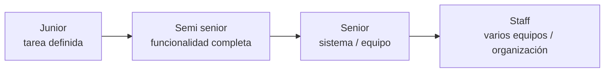

# Escalera de carrera (junior, semi senior, senior, staff)

Parte de: [[14-Carrera-Liderazgo/01 Qué es ser senior/_Índice Qué es ser senior|Qué es ser senior]]

> [!info] Cómo avanzar
> `progreso`: **pendiente** → **viendo** (estudiando) → **visto** (contestaste la autoevaluación sin abrir las respuestas) → **dominado** (hiciste el laboratorio o lo aplicaste de verdad).

## Contenido

### Qué es
La **escalera de carrera** (*career ladder*) describe los niveles de un desarrollador dentro de la ruta técnica y qué se espera en cada uno. En México lo más común es junior → semi senior (o "mid") → senior → y, en empresas grandes o de producto, staff y principal. Sirve para saber dónde estás, qué te falta y cómo comparar ofertas entre empresas que usan títulos distintos.

### Cómo funciona
Lo que cambia de un nivel a otro no es "saber más cosas", sino dos ejes: **qué tan grande y ambiguo es el problema que resuelves solo** y **el radio de impacto** de tu trabajo.



| Nivel | Problema típico | Guía que necesita | Radio de impacto |
|---|---|---|---|
| Junior | "Agrega validación al campo RFC" | Alta | Su tarea |
| Semi senior | "Implementa el módulo de reembolsos" | Media, en lo ambiguo | Su funcionalidad |
| Senior | "Los cobros fallan en fechas de corte" | Poca; define el problema | Sistema y equipo |
| Staff | "Cada equipo integra pagos distinto y hay incidentes" | Mínima; define la dirección | Varios equipos |

El detalle de cada nivel está en sus notas: [[Desarrollador junior - expectativas]], [[Desarrollador semi senior - expectativas]], [[Desarrollador senior - expectativas]] y [[Staff engineer - expectativas]].

Dos ideas importantes:
- **Los títulos no son estándar.** Un "senior" en una consultora pequeña puede equivaler a semi senior en una empresa de producto, y al revés. Compara por responsabilidades: ¿diseñas o solo implementas?, ¿quién define el problema?, ¿mentoreas?, ¿participas en decisiones de arquitectura?
- **Staff no es "senior con más años".** Es un rol con otro tipo de trabajo: más influencia entre equipos, estrategia técnica y menos código propio. Muchas personas excelentes se quedan como senior toda su carrera por elección, y está bien. La alternativa al llegar a senior también puede ser la ruta de gestión (engineering manager), que es un cambio de carrera, no un ascenso automático.

### Ejemplo
Recibes dos ofertas: "Senior .NET Developer" en una consultora y "Software Engineer II" en una empresa de producto. Para compararlas, pregunta en la entrevista:
- "¿Quién escribe los design docs o ADRs del equipo?"
- "¿Cómo es un proyecto típico de alguien en este rol: lo recibe definido o ayuda a definirlo?"
- "¿Qué diferencia a este nivel del siguiente en su escalera?"

Si en la consultora la respuesta es "recibes historias ya detalladas y las implementas", el título senior no refleja alcance de senior. Si en la empresa de producto "Engineer II" lidera un módulo completo con diseño propio, puede ser más alcance real aunque el título sea menor.

### Cuándo usarlo y cuándo no
Úsala para tu [[Plan personal hacia senior]], para preparar evaluaciones y para negociar nivel en una oferta ([[Negociación salarial]]). Si tu empresa tiene una escalera escrita, esa manda: pídela a tu líder. No la uses para etiquetar personas ni para presumir títulos; y no asumas que subir de nivel es obligatorio: un senior sólido y feliz aporta mucho.

### Errores comunes
1. **Comparar por título.** Lleva a aceptar ofertas con más título y menos aprendizaje. Compara alcance, autonomía y responsabilidades.
2. **Pensar que se sube acumulando tecnologías.** Saber Kafka, Kubernetes y Go no te hace senior si no resuelves problemas ambiguos de punta a punta.
3. **Querer saltar niveles.** Ir de junior a "senior" en un año cambiando de empresa suele dejar huecos que luego se notan en entrevistas de diseño.
4. **No pedir la escalera escrita.** Sin criterios explícitos, tu evaluación depende de impresiones.

### Para profundizar
- [Staff archetypes — StaffEng](https://staffeng.com/guides/staff-archetypes/)
- [Staff engineer archetypes — Will Larson](https://lethain.com/staff-engineer-archetypes/)
- [Get your work recognized: write a brag document — Julia Evans](https://jvns.ca/blog/brag-documents/)

## Subtemas

- [[Desarrollador junior - expectativas]]
- [[Desarrollador semi senior - expectativas]]
- [[Desarrollador senior - expectativas]]
- [[Staff engineer - expectativas]]

## Autoevaluación

Contesta primero en voz alta o en papel; luego despliega la respuesta.

> [!question]- ¿Qué cambia principalmente de un nivel a otro?
> El tamaño y la ambigüedad del problema que resuelves solo, y el radio de impacto: tarea → funcionalidad → sistema/equipo → varios equipos/organización.

> [!question]- ¿Los títulos significan lo mismo en todas las empresas?
> No. Un "senior" de una empresa puede ser semi senior en otra. Compara por responsabilidades y alcance, no por título.

> [!question]- ¿Staff es "más senior" o un rol distinto?
> Es un rol con otro tipo de trabajo: más influencia técnica entre equipos, estrategia, decisiones de arquitectura y menos código propio. No todos los seniors quieren o necesitan ese camino.

## Práctica

- [[Lab 1 - Mi plan de 6 meses hacia senior]]

## Progreso de los subtemas

```base
filters:
  and:
    - file.inFolder("14-Carrera-Liderazgo/01 Qué es ser senior/Escalera de carrera (junior, semi senior, senior, staff)")
    - file.name != "Escalera de carrera (junior, semi senior, senior, staff)"
views:
  - type: table
    name: Progreso
    order:
      - file.name
      - progreso
      - nivel
```
