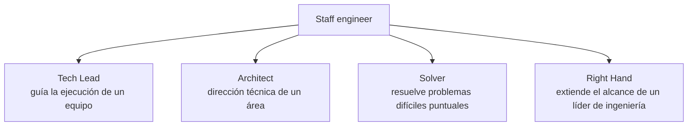

# Staff engineer - expectativas

Parte de: [[Escalera de carrera (junior, semi senior, senior, staff)]]

> [!info] Cómo avanzar
> `progreso`: **pendiente** → **viendo** (estudiando) → **visto** (contestaste la autoevaluación sin abrir las respuestas) → **dominado** (hiciste el laboratorio o lo aplicaste de verdad).

## Contenido

### Qué es
Un **staff engineer** es un ingeniero de la ruta técnica (no gerente) cuyo impacto abarca **varios equipos**: da dirección técnica, resuelve problemas transversales, define estándares y arquitectura de largo plazo, y hace crecer a otros seniors. Es el nivel siguiente a senior en empresas con escaleras largas; en empresas pequeñas puede no existir como título aunque alguien haga ese trabajo.

### Cómo funciona
El trabajo de staff es menos "escribir código propio" y más **hacer que la organización tome mejores decisiones técnicas**. Su herramienta principal es la influencia: documentos, revisiones de diseño, prototipos, alineación entre equipos.

Will Larson, en su libro *Staff Engineer* y en StaffEng, describe cuatro **arquetipos** frecuentes:

- **Tech Lead:** dirige el enfoque técnico y la ejecución de uno o pocos equipos; muy común.
- **Architect:** responsable de la dirección, calidad y coherencia de un área técnica crítica.
- **Solver:** se mete a fondo en problemas complejos (rendimiento, migraciones, incidentes recurrentes) y pasa al siguiente.
- **Right Hand:** trabaja junto a un director o VP y lleva iniciativas organizacionales.

Los arquetipos no son cajas rígidas; varían según la organización y una persona puede pasar por varios.

### Ejemplo
Situación transversal: Xolotl.Hecate emite tokens JWT RS256 y cada servicio (Dionisio, Hermes, Iris, Nomisma) valida tokens a su manera: unos cachean las llaves públicas, otros no; algunos no validan `aud`. Ha habido dos incidentes en la rotación de llaves.

Un senior arreglaría su servicio. Un staff:
1. Hace un inventario de cómo valida cada servicio (una tabla en un documento).
2. Escribe un RFC: "Validación estándar de tokens en todos los servicios", con un paquete NuGet interno que configura `AddJwtBearer` de forma consistente (lectura del endpoint JWKS, validación de `iss`, `aud` y tiempo de vida).
3. Consigue aliados en cada equipo, revisa el documento con ellos y ajusta.
4. Hace la primera migración en un servicio como ejemplo y deja una guía.
5. Mide: cero incidentes en la siguiente rotación de llaves.

Escribió poco código, pero cambió cómo trabajan cinco servicios.

### Cuándo usarlo y cuándo no
Considera la ruta staff si disfrutas el problema técnico grande, la escritura y la influencia, y aceptas programar menos. Si lo que te motiva es escribir código la mayor parte del día, quedarte como senior es una carrera completa y valiosa. Si te motiva el desarrollo de personas, mira la ruta de gestión. En empresas pequeñas, enfócate en el comportamiento (alcance multiequipo) más que en el título.

### Errores comunes
1. **Pensar que staff es "senior con más años".** Sin impacto entre equipos, la antigüedad no basta.
2. **Seguir actuando como el mejor programador del equipo** y acaparar el código crítico. El staff libera a otros, no compite con ellos.
3. **Arquitectura de torre de marfil.** Documentos que nadie implementa porque no se hicieron con los equipos.
4. **Trabajo invisible.** Mucho del trabajo staff es alineación; sin registros (RFCs, decisiones, métricas), no se ve.

### Para profundizar
- [Staff archetypes — StaffEng](https://staffeng.com/guides/staff-archetypes/)
- [Staff engineer archetypes — Will Larson](https://lethain.com/staff-engineer-archetypes/)
- [Design Docs at Google — Malte Ubl](https://www.industrialempathy.com/posts/design-docs-at-google/)

## Autoevaluación

Contesta primero en voz alta o en papel; luego despliega la respuesta.

> [!question]- ¿Qué se espera de un staff engineer?
> Impacto técnico en varios equipos: dirección técnica, resolver problemas transversales, estándares, arquitectura de largo plazo y hacer crecer a otros seniors.

> [!question]- ¿Qué arquetipos de staff se suelen describir?
> Líder técnico de un equipo, arquitecto, "solucionador" de problemas difíciles, y mano derecha de un líder de ingeniería. Varían según la organización.

