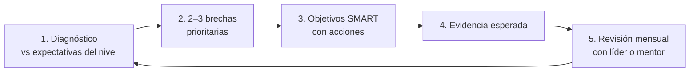

# Plan personal hacia senior

Parte de: [[14-Carrera-Liderazgo/01 Qué es ser senior/_Índice Qué es ser senior|Qué es ser senior]]

> [!info] Cómo avanzar
> `progreso`: **pendiente** → **viendo** (estudiando) → **visto** (contestaste la autoevaluación sin abrir las respuestas) → **dominado** (hiciste el laboratorio o lo aplicaste de verdad).

## Contenido

### Qué es
Un **plan personal hacia senior** es un documento corto y vivo que convierte "quiero ser senior" en objetivos concretos, con acciones, evidencia esperada, plazo y alguien que te revise. Sirve para dejar de depender de la suerte o de la antigüedad y para llegar a la conversación de promoción con pruebas, no con impresiones.

### Cómo funciona
Un plan útil tiene cinco partes:

1. **Diagnóstico honesto.** Compara tu trabajo de los últimos 6 meses con [[Desarrollador senior - expectativas]]. Para cada expectativa: ¿tienes un ejemplo concreto? Si no lo tienes, es brecha.
2. **Brechas prioritarias.** Elige solo 2 o 3. Diez objetivos a la vez es no tener plan.
3. **Objetivos SMART:** específicos, medibles, alcanzables, relevantes y con tiempo.
4. **Evidencia.** Las promociones se deciden con ejemplos: ADRs, design docs, incidentes resueltos, mentorías, métricas que mejoraron, presentaciones. Si no queda rastro, el avance se pierde en la memoria de los demás.
5. **Responsable externo.** Tu líder o un mentor que revise contigo cada mes. Sin eso, el plan se abandona en la tercera semana.

### Ejemplo
Objetivo vago: "Quiero saber más de arquitectura".

Versión SMART:
> "En los próximos 3 meses escribiré 1 design doc para el módulo de notificaciones de Ocelotl.Hermes y 2 ADRs de decisiones del equipo, y los presentaré en la reunión técnica. Lo mediré por documentos aprobados y por el feedback de mi líder."

Plantilla de plan (cópiala a una nota):

| Brecha | Objetivo SMART | Acciones | Evidencia | Fecha |
|---|---|---|---|---|
| Comunico poco mis decisiones | 2 ADRs y 1 design doc en 3 meses | Usar plantilla de ADR; pedir review a mi líder | Enlaces a los documentos | 31/mar |
| Poca visión de operación | Tener alertas en mis 2 servicios | Configurar alertas en Azure Monitor; documentar runbook | Alertas activas + runbook | 28/feb |
| No mentoreo | 1 sesión quincenal con un junior | Agenda fija; registrar temas | Registro de sesiones y PRs del mentoreado | continuo |

**Reflexión modelo sobre la brecha principal:** "Diseño bien pero casi no documento ni presento mis decisiones: no tengo ningún ADR ni design doc que muestre mi criterio. Mi acción es escribir un ADR por cada decisión importante y un design doc antes de la próxima funcionalidad grande, y presentarlo al equipo." Lo valioso de esta respuesta es que nombra una brecha concreta, explica por qué importa (visibilidad del criterio) y define una acción verificable.

El [[Lab 1 - Mi plan de 6 meses hacia senior]] te guía para escribir el tuyo.

### Cuándo usarlo y cuándo no
Úsalo cuando quieras subir de nivel en tu empresa actual o prepararte para buscar un puesto senior fuera. Compártelo con tu líder: muchas veces descubres que la empresa valora algo distinto a lo que pensabas. No lo conviertas en una lista de cursos: un curso sin aplicación no es evidencia. Ajusta el plan si cambian las prioridades del equipo.

### Errores comunes
1. **Objetivos de aprendizaje sin aplicación** ("terminar curso de microservicios"). La evidencia es aplicar algo en el trabajo real.
2. **Demasiadas brechas.** Elige 2–3 y termina.
3. **No registrar.** Lleva un registro semanal tipo *brag document* ([[Diario de aprendizaje]]).
4. **No pedir feedback.** Tu percepción de tus brechas puede no coincidir con la de tu líder.
5. **Plan secreto.** Si tu líder no sabe que buscas crecer, no te dará las oportunidades.

### Para profundizar
- [Get your work recognized: write a brag document — Julia Evans](https://jvns.ca/blog/brag-documents/)
- [Staff archetypes — StaffEng](https://staffeng.com/guides/staff-archetypes/)
- [Documenting Architecture Decisions — Michael Nygard](https://cognitect.com/blog/2011/11/15/documenting-architecture-decisions)

## Ejercicios

Resuélvelos en papel o en la herramienta; la solución está plegada.

> [!question]- Convierte en objetivo SMART: "quiero saber más de arquitectura".
> "En los próximos 3 meses escribiré 3 ADRs reales en el `ARQUITECTURA.md` de mis proyectos y resolveré los 7 casos de diseño de sistemas de la bóveda, revisándolos con mi mentor cada 2 semanas." Es específico, medible, alcanzable, relevante y con fecha.

## Autoevaluación

Contesta primero en voz alta o en papel; luego despliega la respuesta.

> [!question]- ¿Qué partes debe tener un plan hacia senior?
> Diagnóstico honesto contra las expectativas del nivel, 2–3 brechas prioritarias, acciones concretas con evidencia esperada, plazo y un responsable externo (líder o mentor) para revisar.

> [!question]- ¿Por qué la evidencia importa tanto?
> Porque las promociones se deciden con ejemplos: ADRs, design docs, incidentes resueltos, mentorías, métricas mejoradas. Sin evidencia, el avance se pierde.

> [!question]- Reflexión: ¿cuál es tu brecha principal hoy? Respuesta modelo.
> Modelo: "Diseño bien pero comunico poco mis decisiones: no tengo ADRs ni design docs que muestren mi criterio. Acción: escribir un ADR por decisión importante y un design doc antes de la próxima funcionalidad grande, y presentarlo al equipo."

## Práctica

- [[Lab 1 - Mi plan de 6 meses hacia senior]]

