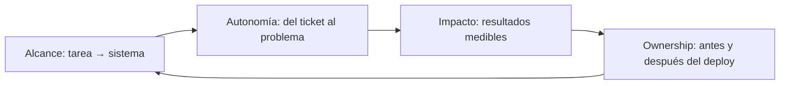

# Qué significa ser senior (alcance, autonomía, impacto y ownership)

Parte de: [[14-Carrera-Liderazgo/01 Qué es ser senior/_Índice Qué es ser senior|Qué es ser senior]]

> [!info] Cómo avanzar
> `progreso`: **pendiente** → **viendo** (estudiando) → **visto** (contestaste la autoevaluación sin abrir las respuestas) → **dominado** (hiciste el laboratorio o lo aplicaste de verdad).

## Contenido

### Qué es
Ser **senior** no es una cantidad de años ni una lista de tecnologías en el CV. Es un conjunto de comportamientos observables: resuelves problemas más grandes y ambiguos (**alcance**), lo haces sin que te digan cada paso (**autonomía**), tus decisiones mueven resultados del negocio y del equipo (**impacto**) y te haces responsable de lo que entregas también después del despliegue (**ownership**). Sirve tener esta definición clara porque es la que usan, explícita o implícitamente, quienes deciden promociones y quienes te entrevistan.

### Cómo funciona
Las cuatro dimensiones se refuerzan entre sí:

- **Alcance.** Un junior recibe "agrega el campo RFC al formulario". Un senior recibe "los clientes se quejan de facturas rechazadas por el SAT" y él decide qué tocar: validación con FluentValidation, catálogo de regímenes, reintentos del timbrado, alertas.
- **Autonomía.** No significa trabajar solo, sino saber cuándo pedir ayuda, a quién y con qué información. El senior llega a la reunión con diagnóstico y opciones, no con "¿qué hago?".
- **Impacto.** Se mide en cosas que le importan a alguien: menos incidentes, menos tiempo de respuesta, menos tickets de soporte, una funcionalidad que sí se usa. El código es el medio.
- **Ownership.** Revisas los logs después de desplegar, cierras el ciclo con quien reportó el problema y dejas algo que evite que vuelva a pasar (una prueba, una alerta, un ADR).

Hay una quinta idea que atraviesa todo: el senior es un **multiplicador**. Si escribes código excelente pero nadie más del equipo mejora gracias a ti, tu impacto queda limitado a tus horas. Las revisiones de código, la mentoría, la documentación y las buenas decisiones de equipo multiplican lo que produces.

### Ejemplo
Situación en Itzamna.Dionisio: después de desplegar el endpoint de pagos ves en Application Insights un pico de reintentos del webhook del proveedor. Nadie lo ha reportado.

- Comportamiento semi senior: lo anotas para "cuando haya tiempo".
- Comportamiento senior: investigas, descubres que el procedimiento `usp_Pago_Registrar` inserta dos veces cuando el proveedor reenvía el evento, propones y aplicas [[Idempotencia]] con una tabla de eventos procesados y llave única, agregas una alerta en Azure Monitor, escribes un post-mortem de media página y lo compartes en la retro. Además dejas un ADR que explica por qué se eligió la llave de idempotencia del proveedor y no un hash del cuerpo.

Eso es ownership con evidencia: un PR, una alerta, un documento y una mejora medible (cero duplicados en el mes siguiente).

### Cuándo usarlo y cuándo no
Usa estas cuatro dimensiones para autoevaluarte, para preparar tu conversación de desempeño y para contar historias en entrevistas ([[Entrevistas de comportamiento (método STAR)]]). Úsalas también para leer las descripciones de puesto: si una vacante "senior" solo pide años y frameworks, probablemente el título está inflado. No las uses como checklist rígido: cada empresa pondera distinto, y en una startup pequeña el alcance puede ser enorme aunque el título diga semi senior. Para ver cómo cambian por nivel, revisa [[Escalera de carrera (junior, semi senior, senior, staff)]].

### Errores comunes
1. **Esperar el ascenso por antigüedad.** Las promociones suelen reconocer que ya actúas en el siguiente nivel, no prometer que lo harás. Empieza a mostrar los comportamientos antes.
2. **Hacer más de lo mismo.** Cerrar 30 tickets en lugar de 20 te hace un semi senior muy productivo, no un senior. Busca problemas más ambiguos, no más volumen.
3. **No hacer visible el trabajo.** Si resolviste un incidente y nadie lo sabe, para la evaluación no existió. Lleva un registro (ver [[Diario de aprendizaje]] y [[Plan personal hacia senior]]).
4. **Confundir ownership con heroísmo.** Quedarte despierto toda la noche arreglando todo solo no escala; ownership incluye pedir ayuda y dejar el sistema mejor preparado.
5. **Ignorar al equipo.** Un senior que bloquea PRs por gusto o no comparte contexto resta, aunque su código sea impecable.

### Para profundizar
- [Staff archetypes — StaffEng](https://staffeng.com/guides/staff-archetypes/): útil para ver hacia dónde crece el alcance después de senior.
- [Get your work recognized: write a brag document — Julia Evans](https://jvns.ca/blog/brag-documents/): cómo hacer visible tu impacto.
- [Google Engineering Practices: Code Review](https://google.github.io/eng-practices/review/): un ejemplo de cómo un senior multiplica a través de las revisiones.

## Autoevaluación

Contesta primero en voz alta o en papel; luego despliega la respuesta.

> [!question]- ¿Qué distingue a un senior más allá de los años o de saber más tecnologías?
> **Alcance**: resuelve problemas de nivel sistema o equipo, no solo tareas. **Autonomía**: toma un problema ambiguo y lo lleva a producción sin que le digan cada paso. **Impacto**: sus decisiones mejoran resultados del negocio y del equipo. **Ownership**: se hace responsable de lo que entrega, también después de desplegar.

> [!question]- Reflexión: describe una situación en la que mostraste ownership. Respuesta modelo.
> Modelo: "Tras desplegar el módulo de pagos noté en los logs reintentos anormales. Aunque nadie lo había reportado, investigué, encontré que el webhook no era idempotente, lo corregí con una tabla de eventos procesados, agregué una alerta y escribí un post-mortem corto." Clave: detectaste, actuaste sin que te lo pidieran, cerraste el ciclo y dejaste prevención.

> [!question]- ¿Qué pasa si un senior solo produce código propio muy bueno pero no ayuda a otros?
> Su impacto queda limitado a su capacidad individual. Se espera que multiplique: revisiones, mentoría, documentación, mejores decisiones del equipo.

> [!question]- Error común al buscar el ascenso.
> Esperar a que te lo den por antigüedad, o hacer más tareas del mismo nivel. Hay que demostrar comportamientos del siguiente nivel y hacerlos visibles (con evidencia).

## Práctica

- [[Lab 1 - Mi plan de 6 meses hacia senior]]

