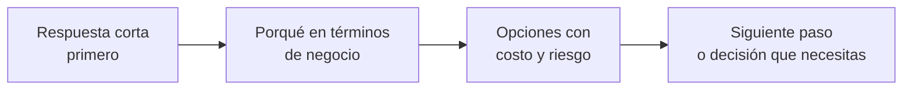

# Comunicación con personas no técnicas

Parte de: [[14-Carrera-Liderazgo/02 Liderazgo y comunicación/_Índice Liderazgo y comunicación|Liderazgo y comunicación]]

> [!info] Cómo avanzar
> `progreso`: **pendiente** → **viendo** (estudiando) → **visto** (contestaste la autoevaluación sin abrir las respuestas) → **dominado** (hiciste el laboratorio o lo aplicaste de verdad).

## Contenido

### Qué es
Comunicarte con personas no técnicas (producto, ventas, finanzas, dirección, clientes) significa hablar en **su** idioma: impacto en clientes, dinero, tiempo y riesgo. No se trata de simplificar hasta mentir, sino de traducir. Un senior que hace bien esta traducción gana confianza del negocio y logra que se tomen mejores decisiones técnicas.

### Cómo funciona
Lo que cambia respecto a hablar con otro desarrollador:

| Con un desarrollador | Con alguien no técnico |
|---|---|
| Mecanismo (cómo funciona) | Consecuencia (qué gana o arriesga el negocio) |
| Jerga aceptada | Jerga traducida o evitada |
| Detalle completo | Lo necesario para decidir |
| "Hay un problema de concurrencia" | "Hay riesgo de cobrar doble a algunos clientes" |

Una estructura útil para cualquier respuesta:

1. **Respuesta primero.** "Sí se puede, en 3 semanas" o "No para el viernes".
2. **Porqué en términos de su mundo:** clientes afectados, dinero, auditoría, tiempo de soporte.
3. **Opciones.** Nunca solo "no se puede". Ofrece al menos dos caminos con su costo.
4. **Lo que necesitas de ellos:** una decisión, una prioridad, una fecha.

### Ejemplo
**El PM pregunta: "¿Por qué una funcionalidad tan sencilla como agregar pago con la segunda pasarela tarda 3 semanas?"**

Respuesta defensiva (no funciona):
> "Es que hay que implementar el adaptador, el webhook, la idempotencia, la conciliación, las pruebas de integración con el sandbox y el circuit breaker..."

Respuesta traducida:
> "Mostrar el botón es un día. Lo que lleva tiempo es asegurar que el cobro no se duplique si falla la red y que el dinero cuadre con lo que reporta la pasarela; si nos saltamos eso, el riesgo es cobrar doble a clientes y tener diferencias en la conciliación de fin de mes. Tenemos dos opciones: lanzar en 1 semana solo con tarjeta de crédito y sumar transferencias después, o las 3 semanas con todo. ¿Qué es más importante para el lanzamiento?"

Explicaste el porqué como **riesgo para el negocio**, diste opciones y devolviste una decisión que le corresponde a producto.

Otras frases útiles:
- "En pocas palabras: ..."
- "El riesgo de no hacerlo es ..."
- "Si tuviera que elegir una sola cosa, sería ..."
- "Para decidir necesito saber ..."

### Cuándo usarlo y cuándo no
Úsalo en estimaciones, reportes de incidentes, demos, negociación de alcance ([[Negociar alcance y plazos con negocio]]) y al justificar deuda técnica ([[Gestión de deuda técnica]]). Si la persona no técnica pide el detalle, dáselo; algunos líderes de negocio quieren entender más, y eso es bueno. No uses la simplificación para esconder un problema serio: si hay riesgo de seguridad o de datos, dilo claro.

### Errores comunes
1. **Justificarte con detalle técnico.** Suena a excusa y no ayuda a decidir.
2. **"No se puede" sin alternativas.** Te ven como obstáculo; con opciones te ven como socio.
3. **Prometer para evitar el conflicto.** Decir "sí" a una fecha imposible daña más la confianza que un "no" con plan.
4. **Condescendencia.** Explicar como si el otro no entendiera nada. Asume inteligencia, no contexto.
5. **No confirmar acuerdos por escrito.** Después de la reunión, manda un resumen de 3 líneas con la decisión.

### Para profundizar
- [Technical Writing courses — Google for Developers](https://developers.google.com/tech-writing)
- [RICE: Simple prioritization for product managers — Intercom](https://www.intercom.com/blog/rice-simple-prioritization-for-product-managers/): para entender cómo piensa producto.
- [What is BATNA? — Harvard Program on Negotiation](https://www.pon.harvard.edu/daily/batna/translate-your-batna-to-the-current-deal/)

## Autoevaluación

Contesta primero en voz alta o en papel; luego despliega la respuesta.

> [!question]- ¿Qué cambia al hablar con alguien no técnico?
> Hablas de impacto en su mundo (clientes, dinero, tiempo, riesgo), no de la tecnología. Evitas jerga o la traduces.

> [!question]- Reflexión: el PM pregunta por qué una funcionalidad "sencilla" tarda 3 semanas. Respuesta modelo.
> "Mostrar el botón es un día. Lo que lleva tiempo es que el cobro no se duplique si falla la red y que funcione con las dos pasarelas; si lo saltamos, el riesgo es cobrar doble a clientes. Podemos lanzar en 1 semana solo con una pasarela y agregar la otra después." Explica el porqué en términos de riesgo y ofrece opciones.

> [!question]- Error común.
> Responder con detalle técnico para justificarse, o decir "no se puede" sin alternativas.

## Práctica

- [[Lab 2 - Escribir un design doc corto]]

