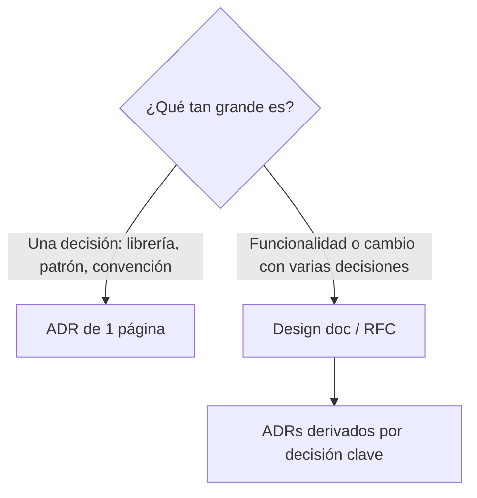

# Cómo documentar una decisión técnica

Parte de: [[14-Carrera-Liderazgo/02 Liderazgo y comunicación/_Índice Liderazgo y comunicación|Liderazgo y comunicación]]

> [!info] Cómo avanzar
> `progreso`: **pendiente** → **viendo** (estudiando) → **visto** (contestaste la autoevaluación sin abrir las respuestas) → **dominado** (hiciste el laboratorio o lo aplicaste de verdad).

## Contenido

### Qué es
Documentar una decisión técnica es dejar por escrito **qué se decidió, por qué, qué otras opciones había y qué consecuencias se aceptaron**. Los dos formatos principales son el **ADR** (*Architecture Decision Record*), para una decisión puntual, y el **design doc** o RFC, para una propuesta grande que agrupa varias decisiones. El detalle de cada formato está en [[ADR - registro de decisiones de arquitectura]] y [[Design docs y RFCs]]; aquí el foco es cuándo y cómo hacerlo como hábito de senior.

### Cómo funciona
Elige el formato por tamaño y alcance:



Lo que **no puede faltar** en ningún formato:
1. **Contexto:** el problema y las restricciones (tiempo, equipo, costos, compatibilidad).
2. **Opciones consideradas** con sus trade-offs, incluyendo "no hacer nada".
3. **Decisión** en una frase clara.
4. **Consecuencias aceptadas:** lo que se gana, lo que se pierde y lo que queda pendiente.
5. **Estado y fecha:** propuesto, aceptado, reemplazado por ADR-00X.

**Cuándo documentar:**
- **Antes de implementar** si la decisión es difícil de revertir (esquema de base de datos, protocolo entre servicios, proveedor de pagos) o afecta a otros equipos.
- **Siempre que alguien pregunte "¿por qué se hizo así?" por segunda vez.** Esa pregunta repetida es la señal de que falta el documento.
- No hace falta para decisiones triviales y reversibles (el nombre de una variable).

### Ejemplo
ADR en el repo de Itzamna.Dionisio, archivo `docs/adr/0007-idempotencia-webhook-pagos.md`:

```markdown
# ADR-0007: Idempotencia en el webhook de pagos

Estado: Aceptado · Fecha: 2026-10-14

## Contexto
El proveedor reenvía eventos si no respondemos 200 en 10 s. Hemos
registrado pagos duplicados (3 en septiembre).

## Opciones
1. Tabla EventoProcesado con llave única por event_id del proveedor.
2. Hash del cuerpo del mensaje como llave.
3. Bloqueo distribuido en Redis.

## Decisión
Opción 1: usp_Pago_Registrar inserta en EventoProcesado dentro de la
misma transacción; si la llave existe, regresa el resultado previo.

## Consecuencias
+ Sin dependencias nuevas; transaccional con SQL Server.
- La tabla crece; se purga a los 90 días con un job.
- Si el proveedor cambia el event_id en reintentos, no nos protege
  (confirmado que no lo hace en su documentación).
```

Guárdalo junto al código, revísalo en un PR como cualquier cambio y enlázalo desde la descripción del PR que lo implementa. Ver también [[Idempotencia]] y [[Webhooks]].

### Cuándo usarlo y cuándo no
Úsalo para decisiones que alguien más va a heredar. En equipos con Azure DevOps, la carpeta `docs/adr` en el repo funciona mejor que una wiki aparte porque se versiona con el código. No conviertas cada PR en un ADR: si el documento cuesta más que la decisión, sobra.

Un flujo práctico como senior: cuando en una reunión se toma una decisión importante, ofrécete a escribir el ADR ese mismo día, ábrelo como PR y pide revisión a quienes participaron. Así el documento refleja lo que se acordó, todos pueden corregirlo y queda enlazado al historial del repositorio. Además, cada ADR que escribes es evidencia concreta de criterio técnico para tu evaluación y para tus historias de entrevista. El [[Lab 2 - Escribir un design doc corto]] te da práctica con el formato largo.

### Errores comunes
1. **Documentar solo la decisión, sin las opciones.** Sin alternativas, no se ve el criterio y la discusión se repite.
2. **Escribirlo después de meses.** Se olvidan las restricciones reales y queda una justificación a posteriori.
3. **Editar ADRs viejos.** Si cambias de opinión, escribe uno nuevo que reemplace al anterior; la historia vale.
4. **Documentos que nadie encuentra.** Guárdalos en el repo y enlázalos.
5. **Ocultar desventajas.** Un ADR sin consecuencias negativas no es creíble.

### Para profundizar
- [Documenting Architecture Decisions — Michael Nygard](https://cognitect.com/blog/2011/11/15/documenting-architecture-decisions)
- [Architectural Decision Records (adr.github.io)](https://adr.github.io/)
- [Design Docs at Google — Malte Ubl](https://www.industrialempathy.com/posts/design-docs-at-google/)

## Autoevaluación

Contesta primero en voz alta o en papel; luego despliega la respuesta.

> [!question]- ¿Qué formato usas para una decisión puntual y cuál para una propuesta grande?
> Decisión puntual: un ADR. Propuesta grande con varias decisiones: un design doc ([[Design docs y RFCs]]).

> [!question]- ¿Qué no puede faltar?
> Contexto (problema y restricciones), opciones consideradas con sus trade-offs, la decisión y las consecuencias aceptadas.

> [!question]- ¿Cuándo documentar?
> Antes de implementar si la decisión es difícil de revertir o afecta a otros; y siempre que alguien pregunte "¿por qué se hizo así?" por segunda vez.

## Práctica

- [[Lab 2 - Escribir un design doc corto]]

