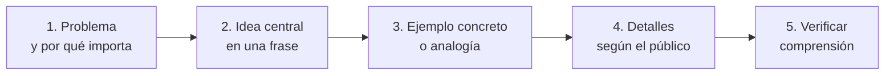

# Cómo explicar un tema técnico

Parte de: [[14-Carrera-Liderazgo/02 Liderazgo y comunicación/_Índice Liderazgo y comunicación|Liderazgo y comunicación]]

> [!info] Cómo avanzar
> `progreso`: **pendiente** → **viendo** (estudiando) → **visto** (contestaste la autoevaluación sin abrir las respuestas) → **dominado** (hiciste el laboratorio o lo aplicaste de verdad).

## Contenido

### Qué es
Explicar un tema técnico es lograr que otra persona **entienda lo suficiente para decidir o actuar**, no demostrar cuánto sabes. Es una habilidad diaria del senior: en una revisión de diseño, en una mentoría, en una entrevista o en la daily cuando alguien pregunta "¿por qué no podemos hacer X?".

### Cómo funciona
Una estructura que funciona casi siempre va **de lo general a lo particular**:

1. **Problema primero.** Nadie se interesa por la solución si no entiende qué duele. "Hoy, si el cliente da doble clic en Pagar, a veces se cobra dos veces."
2. **Idea central en una frase.** Si no la puedes decir en una frase, todavía no la entiendes bien.
3. **Ejemplo o analogía.** Un caso del sistema real o algo cotidiano. Las analogías ayudan a entrar, pero avisa dónde dejan de funcionar.
4. **Detalles al nivel del público.** Para un PM: impacto y riesgo. Para un junior: el mecanismo. Para un arquitecto: trade-offs y casos borde.
5. **Verificar.** Preguntar "¿se entendió?" casi siempre recibe un "sí" por cortesía. Mejor pide que lo expliquen con sus palabras o que lo apliquen a un caso: "Con esto, ¿qué pasaría si el proveedor reenvía el mismo evento?".

Ajusta también el canal: por escrito puedes usar un diagrama de secuencia; en voz alta, frases cortas y una idea a la vez.

### Ejemplo
**Explicar idempotencia a un PM en dos frases:**
> "Una operación idempotente da el mismo resultado aunque se repita. Así, si el cliente da doble clic en Pagar o la red falla y reintentamos, se cobra una sola vez."

**La misma idea para un junior**, con más mecanismo:
> "El cliente manda un encabezado `Idempotency-Key` con un GUID. Antes de cobrar, el procedimiento busca esa llave; si ya existe, regresamos la respuesta guardada en lugar de cobrar otra vez. La llave única en la tabla es lo que nos protege de dos peticiones simultáneas."

**Y verificación:**
> "Imagina que llegan dos peticiones con la misma llave al mismo milisegundo. ¿Qué evita que ambas cobren?" (Respuesta esperada: la restricción única en la base hace que una falle.)

Para la parte técnica completa, ver [[Idempotencia]].

### Cuándo usarlo y cuándo no
Usa la estructura completa en explicaciones nuevas o importantes: una propuesta, una capacitación, un artículo ([[Escribir artículos técnicos]]) o una presentación ([[Presentaciones técnicas]]). Para una pregunta rápida en el chat, basta la idea central y un enlace. Si el público no es técnico, revisa [[Comunicación con personas no técnicas]]: ahí el énfasis cambia a impacto y opciones.

### Errores comunes
1. **Empezar por los detalles.** Arrancar con "usamos una tabla con un índice único filtrado..." pierde a la audiencia antes de que sepa para qué.
2. **Jerga sin traducir.** Siglas como JWKS, CQRS o N+1 sin explicar excluyen a quien no las conoce.
3. **No verificar.** Asumir que el silencio es comprensión.
4. **Analogías que se rompen.** Llevar una analogía demasiado lejos genera ideas equivocadas; úsala para entrar y luego vuelve al caso real.
5. **Explicar todo lo que sabes.** El objetivo es lo que el otro necesita, no lo que tú dominas.

### Para profundizar
- [Technical Writing courses — Google for Developers](https://developers.google.com/tech-writing)
- [Design Docs at Google — Malte Ubl](https://www.industrialempathy.com/posts/design-docs-at-google/)
- [Google Engineering Practices: Code Review](https://google.github.io/eng-practices/review/): ejemplos de cómo explicar el porqué en comentarios.

## Autoevaluación

Contesta primero en voz alta o en papel; luego despliega la respuesta.

> [!question]- ¿Qué estructura ayuda a explicar algo técnico?
> Empieza por el problema y por qué importa, luego la idea central en una frase, un ejemplo concreto o analogía, y al final los detalles. Ajusta la profundidad al público.

> [!question]- ¿Cómo verificas que te entendieron?
> Pide que lo expliquen con sus palabras o que apliquen la idea a un caso; "¿se entendió?" casi siempre recibe "sí".

> [!question]- Ejercicio de reflexión: explica "idempotencia" en dos frases a un PM. Respuesta modelo.
> "Una operación idempotente da el mismo resultado si se repite. Así, si el cliente da doble clic en Pagar o la red falla y reintentamos, se cobra una sola vez."

## Práctica

- [[Lab 2 - Escribir un design doc corto]]

