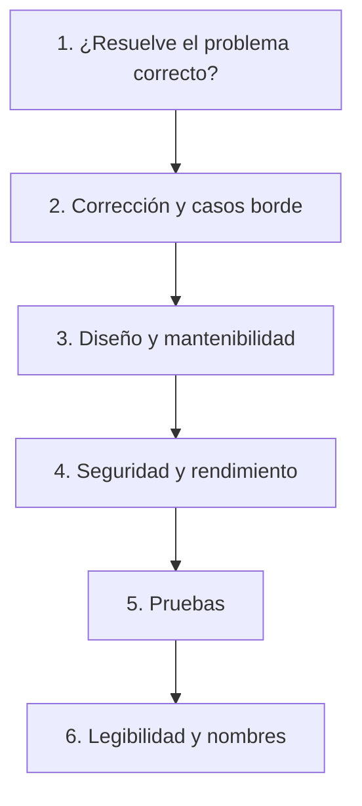

# Cómo hacer un buen code review

Parte de: [[14-Carrera-Liderazgo/02 Liderazgo y comunicación/_Índice Liderazgo y comunicación|Liderazgo y comunicación]]

> [!info] Cómo avanzar
> `progreso`: **pendiente** → **viendo** (estudiando) → **visto** (contestaste la autoevaluación sin abrir las respuestas) → **dominado** (hiciste el laboratorio o lo aplicaste de verdad).

## Contenido

### Qué es
El **code review** es la revisión de un cambio (un PR en Azure Repos o GitHub) por otra persona antes de integrarlo. Su objetivo principal no es encontrar errores de formato, sino **mantener la salud del código base** a lo largo del tiempo: que el cambio resuelva el problema correcto, sea correcto, mantenible y seguro. Para un senior es una de las herramientas más fuertes para multiplicar: cada revisión enseña.

### Cómo funciona
Revisa en orden de importancia; si lo primero falla, lo demás sobra:



1. **Problema correcto:** lee la historia o el issue primero. Un código perfecto que no cumple el criterio de aceptación no sirve.
2. **Corrección:** nulos, listas vacías, concurrencia, transacciones, zonas horarias, errores de la base.
3. **Diseño:** ¿respeta la arquitectura (vertical slice, una interfaz por consulta)? ¿agrega acoplamiento innecesario?
4. **Seguridad y rendimiento:** SQL parametrizado, autorización en el endpoint, secretos fuera del repo, consultas N+1.
5. **Pruebas:** ¿prueban el comportamiento o solo inflan la cobertura?
6. **Legibilidad:** nombres claros. El formato (espacios, llaves) lo deben resolver `dotnet format`, `.editorconfig` y el pipeline, no las personas.

**Cómo escribir un comentario útil:** específico, con el porqué, con una alternativa si la tienes, y con su **peso** marcado. Una convención popular es *Conventional Comments*: `issue:`, `suggestion:`, `question:`, `nitpick:`, `praise:`, con decoradores como `(blocking)` o `(non-blocking)`.

**PR enorme:** pide dividirlo (por ejemplo, primero la migración y el procedimiento, luego el endpoint, luego el front) o agenda 15 minutos para revisar el diseño en llamada antes de leer línea por línea. Revisar 2,000 líneas con atención real no es posible; lo que pasa en la práctica es un "LGTM" a ciegas.

### Ejemplo
Fragmento de un PR en Itzamna.Dionisio:

```csharp
public async Task<IActionResult> Cancelar(int id)
{
    var pedido = await _consulta.ObtenerPedido(id);
    pedido.Cancelar();                 // ¿y si no existe?
    await _comando.Guardar(pedido);
    return Ok();
}
```

Comentarios con peso y porqué:

```text
issue (blocking): si el id no existe, ObtenerPedido regresa null y aquí
lanzamos NullReferenceException → 500. Propongo regresar 404 con
ProblemDetails y codigo "PEDIDO_NO_ENCONTRADO", como en Pedidos/Obtener.

question: ¿quién puede cancelar? No veo [Authorize] con la política
"Pedidos.Cancelar". ¿Se valida en otro lado?

nitpick (non-blocking): "Guardar" podría ser "ActualizarEstado"; describe
mejor lo que hace el procedimiento usp_Pedido_ActualizarEstado.

praise: buena prueba de integración para el caso de pedido ya enviado.
```

### Cuándo usarlo y cuándo no
Todo cambio que va a producción debería pasar por revisión; en Azure DevOps se configura con políticas de rama (revisores mínimos, build verde, work item vinculado). Para cambios triviales (un typo en documentación) basta una revisión rápida. Para decisiones de diseño grandes, el PR es un mal lugar para discutirlas: hazlo antes con un design doc o ADR ([[Cómo documentar una decisión técnica]]). Como autor, ayuda a tu revisor: PR pequeño, descripción con qué, por qué y cómo probar.

### Errores comunes
1. **LGTM automático.** Aprobar sin leer quita valor al proceso y destruye la confianza en él.
2. **Bloquear por preferencias personales.** Si no hay regla del equipo ni riesgo real, es `nitpick` no bloqueante.
3. **Comentarios sin porqué** ("esto está mal"). El autor no aprende y se pone a la defensiva.
4. **Revisar días después.** Un PR esperando 3 días frena a todo el equipo; intenta responder el mismo día.
5. **Tono duro.** Comenta el código, no a la persona: "este método" en vez de "tú siempre".

### Para profundizar
- [Google Engineering Practices: Code Review](https://google.github.io/eng-practices/review/)
- [How to write code review comments — Google](https://google.github.io/eng-practices/review/reviewer/comments.html)
- [Conventional Comments](https://conventionalcomments.org/)
- [Improve pull request descriptions using templates — Azure DevOps](https://learn.microsoft.com/en-us/azure/devops/repos/git/pull-request-templates)

## Autoevaluación

Contesta primero en voz alta o en papel; luego despliega la respuesta.

> [!question]- ¿Qué priorizas al revisar un PR?
> 1) ¿Resuelve el problema correcto? 2) Corrección y casos borde. 3) Diseño y mantenibilidad. 4) Seguridad y rendimiento. 5) Pruebas. 6) Legibilidad. El formato lo deja a herramientas.

> [!question]- ¿Cómo escribes un comentario útil?
> Específico, con el porqué y, si puedes, una alternativa; marca su peso (`bloqueante`, `sugerencia`, `nit`). Ej.: "Bloqueante: si `pedido` llega null aquí lanzamos NRE en producción; ¿agregamos guard clause?"

> [!question]- ¿Qué haces si un PR es enorme?
> Pedir dividirlo o revisar primero el diseño en una llamada corta; revisar 2,000 líneas a fondo no es realista.

> [!question]- Error común del revisor.
> Aprobar sin leer ("LGTM" automático) o bloquear por preferencias personales. Ambos dañan la confianza.

