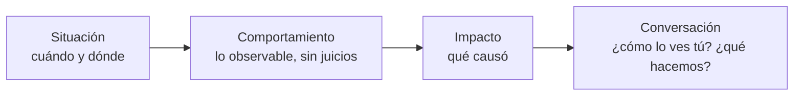

# Dar y recibir feedback

Parte de: [[14-Carrera-Liderazgo/02 Liderazgo y comunicación/_Índice Liderazgo y comunicación|Liderazgo y comunicación]]

> [!info] Cómo avanzar
> `progreso`: **pendiente** → **viendo** (estudiando) → **visto** (contestaste la autoevaluación sin abrir las respuestas) → **dominado** (hiciste el laboratorio o lo aplicaste de verdad).

## Contenido

### Qué es
El **feedback** es información sobre el efecto de un comportamiento, dada para que la persona pueda mantenerlo o cambiarlo. Bien dado, acelera el crecimiento de todo el equipo; mal dado (vago, tardío o personal), genera defensa y nada cambia. Saber recibirlo es igual de importante: es la forma más barata de descubrir tus puntos ciegos.

### Cómo funciona
**Para dar feedback**, el modelo **SBI** (*Situation–Behavior–Impact*, popularizado por el Center for Creative Leadership) obliga a ser concreto:

- **Situación:** "En la demo del martes..."
- **Comportamiento:** lo que se vio o escuchó, no la interpretación. "Cambiaste el esquema de la respuesta sin avisar" (observable) en lugar de "fuiste descuidado" (juicio).
- **Impacto:** "...y QA perdió medio día ajustando sus pruebas."
- Después, **pregunta** y escucha: quizá había una razón que no conocías.

Reglas prácticas:
- **Cerca del hecho.** Días, no meses. Guardarlo para la evaluación anual es injusto.
- **En privado** el feedback de mejora; el reconocimiento puede ser público.
- **También el positivo, con el mismo detalle.** "En el PR de reembolsos, tu descripción con pasos de prueba hizo que lo revisara en 10 minutos" enseña qué repetir.

**Para recibir feedback**, incluso si te parece injusto:
1. Escucha sin interrumpir ni defenderte.
2. Agradece: dar feedback cuesta.
3. Pide un ejemplo concreto si es vago: "¿Me das un caso en el que lo notaste?".
4. Decide después, en frío, qué tomar. No tienes que estar de acuerdo con todo, pero sí entenderlo.

### Ejemplo
**Feedback a un compañero de equipo**, en una conversación 1 a 1:

> "En el PR de ayer de Ocelotl.Iris (S), aprobaste el cambio de la migración sin comentarios y luego el pipeline falló en QA porque faltaba el script de rollback (B). Tuvimos el ambiente caído dos horas (I). ¿Qué pasó? ¿Te ayudaría que agreguemos el rollback a la checklist de la plantilla de PR?"

**Recibir feedback vago** de tu líder: "Tienes que comunicar mejor."

> "Gracias, me interesa mejorar en eso. ¿Me das un ejemplo reciente donde lo notaste? ... Entiendo: en la reunión con finanzas expliqué el detalle técnico y no la decisión que necesitábamos. La próxima vez empiezo por la decisión. ¿Te parece si en dos semanas me dices si lo notas distinto?"

Convertiste algo vago en un comportamiento concreto y en un seguimiento.

### Cuándo usarlo y cuándo no
SBI funciona en 1 a 1, en mentoría ([[Mentoría a otros desarrolladores]]), en conflictos ([[Manejo de conflictos]]) y para escribir evaluaciones de pares. En code review el equivalente es el comentario con porqué ([[Cómo hacer un buen code review]]). No des feedback en caliente, justo después de un incidente con todos alterados; espera unas horas. Si el tema es una falta grave (acoso, discriminación), no es feedback: escala a tu líder o a recursos humanos.

### Errores comunes
1. **Feedback vago** ("tienes que mejorar tu actitud"). No hay nada que cambiar porque no se sabe qué.
2. **Guardarlo para la evaluación.** La persona no tuvo oportunidad de corregir.
3. **Juicios en lugar de hechos** ("eres flojo"). Ataca la identidad y provoca defensa.
4. **El "sándwich" automático** (bueno-malo-bueno) usado siempre: la gente aprende a ignorar lo positivo.
5. **Defenderte al recibirlo.** Aunque tengas razón, cortas el canal y no te volverán a decir nada.

### Para profundizar
- [Google Engineering Practices: How to write code review comments](https://google.github.io/eng-practices/review/reviewer/comments.html)
- [Google Engineering Practices: How to handle reviewer comments](https://google.github.io/eng-practices/review/developer/handling-comments.html)
- [Get your work recognized: write a brag document — Julia Evans](https://jvns.ca/blog/brag-documents/)

## Autoevaluación

Contesta primero en voz alta o en papel; luego despliega la respuesta.

> [!question]- ¿Qué modelo ayuda a dar feedback concreto?
> SBI: **Situación** (cuándo/dónde), **Comportamiento** (lo observable), **Impacto** (qué causó). Ej.: "En la demo del martes (S), cambiaste el esquema sin avisar (B), y QA perdió medio día (I)."

> [!question]- ¿Cómo recibes feedback que te parece injusto?
> Escuchar sin defenderte, agradecer, pedir un ejemplo concreto y decidir después qué tomar. Responder en caliente suele empeorarlo.

> [!question]- Error común.
> Feedback vago ("tienes que comunicar mejor") o solo en la evaluación anual. Debe ser específico y cercano al hecho.

