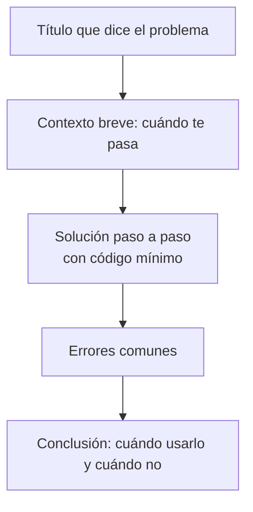

# Escribir artículos técnicos

Parte de: [[14-Carrera-Liderazgo/02 Liderazgo y comunicación/_Índice Liderazgo y comunicación|Liderazgo y comunicación]]

> [!info] Cómo avanzar
> `progreso`: **pendiente** → **viendo** (estudiando) → **visto** (contestaste la autoevaluación sin abrir las respuestas) → **dominado** (hiciste el laboratorio o lo aplicaste de verdad).

## Contenido

### Qué es
Un **artículo técnico** es un texto que explica cómo resolver un problema concreto, con contexto, pasos y código mínimo. Puede publicarse en un blog personal, en dev.to, en Medium, en la wiki de la empresa o en el README de un repositorio. Escribir ayuda a llegar a senior por tres razones: **ordena tu conocimiento**, te obliga a **entender a fondo** (no puedes explicar lo que no entiendes) y **demuestra criterio** a otros, porque funciona como portafolio.

### Cómo funciona
Estructura que funciona:



1. **Título que diga el problema**, no un título ingenioso. "Cómo evitar cobros duplicados en webhooks con SQL Server" se encuentra en buscadores; "Lecciones de un viernes difícil" no.
2. **Contexto breve.** Dos o tres párrafos: qué pasaba, por qué importa y para quién es el artículo.
3. **Solución paso a paso**, con **código mínimo** que compile. Quita lo que no aporte a la idea (logs, configuración irrelevante). Si hace falta el ejemplo completo, enlaza un repositorio.
4. **Errores comunes** o casos borde. Es la parte que más valoran los lectores con experiencia.
5. **Cierre**: cuándo usar esta solución y cuándo no. Demuestra criterio.

**Proceso de escritura:**
- Primero escribe un borrador rápido sin corregir; después edita.
- Lee en voz alta: si te trabas, la frase es demasiado larga.
- Revisa que cada bloque de código corra.
- Pide a alguien que lo lea y te diga dónde se perdió.
- Publica. Un artículo bueno publicado vale más que uno perfecto en borradores.

**Fuente fácil de temas:** problemas reales que ya resolviste, explicados para **tu yo de hace un año**. Un ADR, un bug difícil, una configuración que te costó un día, un laboratorio de esta bóveda. Si te costó trabajo, a alguien más también.

### Ejemplo
Esqueleto de un artículo a partir de un caso de Xolotl.Hecate:

```markdown
Título: Validar tokens JWT RS256 en ASP.NET Core sin romper la rotación de llaves

Contexto: tenemos un servidor de identidad propio y cuatro APIs.
Cuando rotamos la llave privada, dos APIs dejaron de aceptar tokens
durante 20 minutos. El problema: cacheaban la llave pública a mano.

Solución:
1. Configurar AddJwtBearer con Authority para que lea el JWKS.
2. Validar issuer, audience y lifetime.
3. Publicar la llave nueva en el JWKS antes de firmar con ella.

Errores comunes:
- Desactivar ValidateAudience "porque daba error".
- Copiar la llave pública en appsettings.

Cuándo no: si usas Microsoft Entra ID, todo esto ya lo resuelve
la configuración estándar de Microsoft.Identity.Web.
```

Con 800–1,200 palabras y un repositorio de ejemplo, es un artículo que puedes enlazar desde tu CV y tu GitHub ([[Portafolio y GitHub]]).

### Cuándo usarlo y cuándo no
Escribe cuando resuelvas algo no trivial, cuando quieras fijar un aprendizaje o cuando prepares una charla ([[Presentaciones técnicas]]). Un ritmo sostenible es uno al mes. No publiques información interna de la empresa (nombres de clientes, arquitectura confidencial, código propietario): generaliza el caso. No necesitas ser experto mundial: explicar bien algo que acabas de aprender es valioso para quien va un paso atrás.

### Errores comunes
1. **Esperar a ser experto** para escribir. Nunca llega el momento.
2. **Mucho código, poca explicación.** El valor está en el porqué.
3. **Títulos vagos** que nadie encuentra.
4. **Copiar la documentación oficial.** Aporta tu caso, tus errores y tu criterio; enlaza la documentación.
5. **Exponer datos internos** de la empresa sin permiso.

### Para profundizar
- [Technical Writing courses — Google for Developers](https://developers.google.com/tech-writing)
- [Get your work recognized: write a brag document — Julia Evans](https://jvns.ca/blog/brag-documents/)
- [Design Docs at Google — Malte Ubl](https://www.industrialempathy.com/posts/design-docs-at-google/)

## Autoevaluación

Contesta primero en voz alta o en papel; luego despliega la respuesta.

> [!question]- ¿Por qué escribir artículos técnicos ayuda a llegar a senior?
> Ordena tu conocimiento, demuestra criterio a otros (portafolio) y obliga a entender a fondo.

> [!question]- ¿Qué estructura funciona?
> Título que diga el problema, contexto breve, solución paso a paso con código mínimo, errores comunes y conclusión con cuándo no usarlo.

> [!question]- Fuente fácil de temas.
> Problemas reales que resolviste (un ADR, un bug difícil, un laboratorio de esta bóveda) explicados para tu yo de hace un año.

