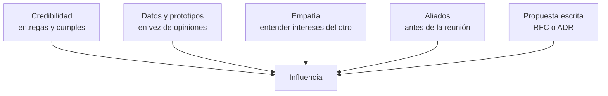

# Influir sin autoridad

Parte de: [[14-Carrera-Liderazgo/02 Liderazgo y comunicación/_Índice Liderazgo y comunicación|Liderazgo y comunicación]]

> [!info] Cómo avanzar
> `progreso`: **pendiente** → **viendo** (estudiando) → **visto** (contestaste la autoevaluación sin abrir las respuestas) → **dominado** (hiciste el laboratorio o lo aplicaste de verdad).

## Contenido

### Qué es
**Influir sin autoridad** es lograr que un equipo o una organización adopte una idea, práctica o decisión técnica sin poder ordenarlo. Es la forma normal de trabajar de seniors y staff: no son jefes de nadie, pero se espera que mejoren cómo trabaja el equipo. La influencia se construye con credibilidad, datos y relaciones, no con insistencia.

### Cómo funciona
Fuentes de influencia que sí funcionan:

1. **Credibilidad.** Si tus entregas son confiables, tus propuestas se escuchan. Nadie adopta las ideas de quien siempre entrega tarde.
2. **Datos y prototipos.** "Creo que deberíamos..." pesa poco; "Lo probé en un módulo, atrapó 2 bugs y agrega 40 segundos al pipeline" pesa mucho.
3. **Intereses, no posiciones.** El que se opone a las pruebas de integración probablemente no está "en contra de la calidad": le preocupa el tiempo del pipeline o la complejidad. Resuelve esa preocupación.
4. **Aliados antes de la reunión.** Platica la idea 1 a 1 con las personas clave; la reunión debería confirmar, no sorprender.
5. **Por escrito.** Un RFC o ADR ordena la discusión y deja registro ([[Cómo documentar una decisión técnica]]).
6. **Bajar el costo de adopción.** Plantillas, ejemplos, un paquete NuGet, un script. Lo fácil se adopta.

**Si pierdes la discusión:** aplica *disagree and commit*. Dejas tu punto registrado (en el ADR, como opción descartada con tus argumentos), apoyas la decisión de verdad, sin sabotaje pasivo, y propones revisarla con datos en una fecha concreta.

### Ejemplo
**Quieres introducir [[Pruebas de integración]] en Itzamna.Dionisio y el equipo se resiste ("tardan mucho", "no hay tiempo").**

1. Lo pruebas primero en tu propio slice: una prueba con `WebApplicationFactory` y una base de SQL Server en contenedor que ejecuta el procedimiento real.
2. Mides: tiempo agregado al pipeline, bugs atrapados. Encuentras uno real: un procedimiento que regresaba columnas en otro orden y rompía el mapeo de Dapper.
3. Lo muestras en la reunión técnica con ese bug concreto: "Este error llegó a QA el mes pasado; esta prueba lo habría detenido en el PR".
4. Ofreces una plantilla para que agregar una prueba cueste 10 minutos.
5. Pides un experimento acotado: "Probemos un sprint solo en los slices nuevos y revisamos en la retro".

Nota cómo cada paso responde a una objeción real (tiempo, valor, costo de adopción) en vez de debatir en abstracto.

### Cuándo usarlo y cuándo no
Úsalo para cambios de práctica (pruebas, plantillas de PR, DoD), decisiones de arquitectura y estándares entre equipos. Si el tema es urgente y de seguridad (un secreto en el repo), no es momento de construir consenso: escala de inmediato. Si después de intentar con datos no hay acuerdo y el tema es importante, llévalo a quien decide con las opciones documentadas.

### Errores comunes
1. **Ganar la discusión en lugar de resolver el problema.** Humillar a quien se opone garantiza resistencia futura.
2. **Llegar a la reunión sin haber hablado con nadie.** Las sorpresas generan defensa.
3. **Opiniones sin evidencia.** "En mi experiencia" no basta; trae un dato o un prototipo.
4. **Sabotaje pasivo tras perder.** Destruye tu credibilidad más que cualquier error técnico.
5. **Querer cambiarlo todo a la vez.** Una mejora adoptada vale más que cinco propuestas.

### Para profundizar
- [Staff archetypes — StaffEng](https://staffeng.com/guides/staff-archetypes/)
- [Design Docs at Google — Malte Ubl](https://www.industrialempathy.com/posts/design-docs-at-google/)
- [Architectural Decision Records (adr.github.io)](https://adr.github.io/)

## Autoevaluación

Contesta primero en voz alta o en papel; luego despliega la respuesta.

> [!question]- ¿Cómo influyes en decisiones si no eres el jefe?
> Con credibilidad (entregas bien, cumples), datos y prototipos, entendiendo los intereses del otro, construyendo aliados antes de la reunión y proponiendo por escrito (RFC/ADR).

> [!question]- Reflexión: quieres introducir pruebas de integración y el equipo se resiste. ¿Qué haces? Respuesta modelo.
> "Lo pruebo primero en un módulo propio, mido (bugs atrapados, tiempo de CI) y lo muestro con un ejemplo real de un bug que se habría evitado. Ofrezco una plantilla para que cueste poco adoptarlo y pido probarlo un sprint."

> [!question]- ¿Qué hacer si pierdes la discusión?
> *Disagree and commit*: dejas registrado tu punto (ADR), apoyas la decisión y revisas con datos más adelante.

