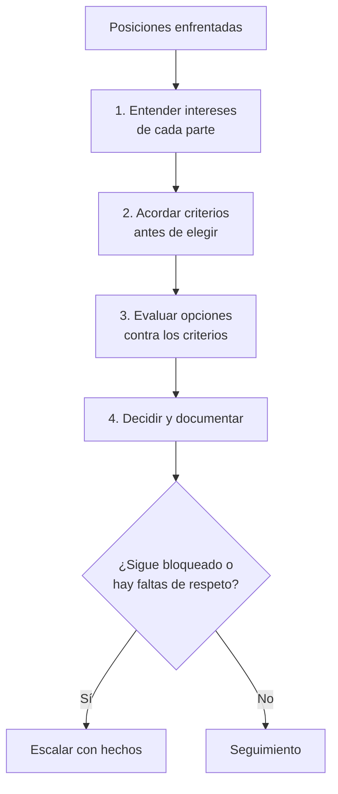

# Manejo de conflictos

Parte de: [[14-Carrera-Liderazgo/02 Liderazgo y comunicación/_Índice Liderazgo y comunicación|Liderazgo y comunicación]]

> [!info] Cómo avanzar
> `progreso`: **pendiente** → **viendo** (estudiando) → **visto** (contestaste la autoevaluación sin abrir las respuestas) → **dominado** (hiciste el laboratorio o lo aplicaste de verdad).

## Contenido

### Qué es
Un **conflicto** en un equipo técnico es un desacuerdo que bloquea el trabajo o deteriora la relación: dos personas que defienden arquitecturas distintas, revisiones de código cada vez más duras, choques entre desarrollo y QA por fechas. El conflicto en sí no es malo (buenas decisiones salen de desacuerdos); lo malo es dejarlo crecer o volverlo personal.

### Cómo funciona
El primer paso es **separar posiciones de intereses**: la posición es lo que cada quien pide ("usemos una cola", "no, llamada directa"); el interés es lo que le preocupa (latencia, tiempo de entrega, complejidad de operación). Casi siempre hay acuerdo posible en los intereses aunque las posiciones choquen.

Pasos prácticos:
1. **Habla en privado y pronto.** Un 1 a 1 de 20 minutos evita semanas de tensión.
2. **Describe hechos, no intenciones,** usando SBI ([[Dar y recibir feedback]]).
3. **Pregunta y escucha.** "¿Qué te preocupa de este enfoque?" Repite con tus palabras para confirmar.
4. **Acuerden criterios objetivos.** "Elegimos lo que cumpla 200 ms en p95, que podamos operar con el equipo actual y que esté en 2 semanas."
5. **Decidan y registren** en un ADR ([[Cómo documentar una decisión técnica]]).

**Cuándo escalar:** cuando ya intentaste resolverlo directamente y el conflicto sigue bloqueando el trabajo, o cuando hay faltas de respeto. Escala con hechos concretos (fechas, PRs, mensajes), no con quejas sobre la persona, y con una propuesta de lo que necesitas.

### Ejemplo
**Un compañero rechaza siempre tus PRs con comentarios duros** ("esto es basura", "otra vez mal").

Respuesta modelo:
1. Le pides un 1 a 1: "¿Tienes 20 minutos? Quiero que mis PRs te lleguen mejor."
2. Describes con SBI: "En los últimos tres PRs (S), los comentarios fueron del tipo 'esto es basura' sin explicar el problema (B). Me cuesta saber qué corregir y tardo más en entregar (I)."
3. Preguntas: "¿Qué es lo que más te preocupa de mi código?" Quizá descubres que le preocupa que no se respete la convención de una interfaz por consulta.
4. Propones acuerdos: escribir los estándares de revisión del equipo en la wiki, usar etiquetas como `issue (blocking)` y `nitpick`, y que él te diga qué ejemplos seguir.
5. Si en las siguientes semanas no cambia, lo hablas con tu líder llevando ejemplos concretos y lo que ya intentaste.

**Conflicto técnico entre dos compañeros** sobre si usar Azure Service Bus o llamadas HTTP directas: como senior, facilitas. Pides a cada uno que escriba sus 3 preocupaciones, acuerdan criterios, evalúan ambas opciones contra ellos y registran la decisión.

### Cuándo usarlo y cuándo no
Úsalo en cuanto notes tensión que se repite, no al tercer mes. Para desacuerdos técnicos puntuales y sanos, basta discutir con datos y decidir. Si hay acoso, discriminación o algo ilegal, no intentes mediar tú: escala directo a tu líder o a recursos humanos.

### Errores comunes
1. **Evitar el conflicto** esperando que se resuelva solo. Suele crecer.
2. **Discutir en público** (en el canal del equipo o en comentarios del PR). La gente defiende su imagen, no la idea.
3. **Atribuir malas intenciones.** "Lo hace para fastidiarme" casi nunca es cierto y bloquea cualquier solución.
4. **Escalar sin haber hablado** con la persona. Rompe la confianza.
5. **Ganar a toda costa.** Una victoria que deja a un compañero resentido es una derrota para el equipo.

### Para profundizar
- [What is BATNA? — Harvard Program on Negotiation](https://www.pon.harvard.edu/daily/batna/translate-your-batna-to-the-current-deal/)
- [Google Engineering Practices: How to write code review comments](https://google.github.io/eng-practices/review/reviewer/comments.html)
- [Conventional Comments](https://conventionalcomments.org/)

## Autoevaluación

Contesta primero en voz alta o en papel; luego despliega la respuesta.

> [!question]- ¿Cuál es el primer paso en un conflicto técnico entre dos personas?
> Separar posiciones de intereses: entender qué le preocupa a cada uno (rendimiento, plazos, mantenimiento) y acordar criterios antes de elegir solución.

> [!question]- Reflexión: un compañero rechaza siempre tus PRs con comentarios duros. Respuesta modelo.
> "Le pido una plática 1 a 1, describo el hecho con SBI y le pregunto qué le preocupa de mi código. Acordamos estándares escritos para revisiones. Si no mejora, lo hablo con el líder con ejemplos concretos."

> [!question]- ¿Cuándo escalar?
> Cuando ya intentaste resolverlo directamente y el conflicto bloquea el trabajo o hay faltas de respeto. Escalar con hechos, no con quejas personales.

