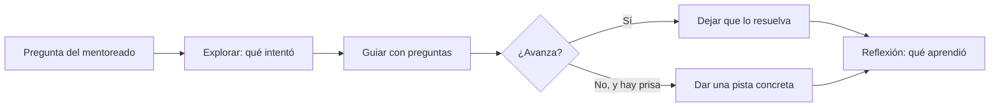

# Mentoría a otros desarrolladores

Parte de: [[14-Carrera-Liderazgo/02 Liderazgo y comunicación/_Índice Liderazgo y comunicación|Liderazgo y comunicación]]

> [!info] Cómo avanzar
> `progreso`: **pendiente** → **viendo** (estudiando) → **visto** (contestaste la autoevaluación sin abrir las respuestas) → **dominado** (hiciste el laboratorio o lo aplicaste de verdad).

## Contenido

### Qué es
La **mentoría** es acompañar el crecimiento de otro desarrollador guiándolo para que **llegue él mismo** a las soluciones y entienda el porqué. Es distinta de resolverle el problema: eso es más rápido hoy, pero no lo hace crecer, y mañana volverá con la misma duda. Para un senior, mentorear es una de las formas más claras de ser multiplicador.

### Cómo funciona
La diferencia entre ayudar y mentorear:

| Resolverlo tú | Mentorear |
|---|---|
| "Pásame tu pantalla, ya lo arreglo." | "¿Qué intentaste? ¿Dónde mirarías primero?" |
| Rápido hoy | Más lento hoy, más rápido el próximo mes |
| La persona depende de ti | La persona gana criterio |

Preguntas que guían sin dar la respuesta:
- "¿Qué intentaste hasta ahora?"
- "¿Qué esperabas que pasara y qué pasó?"
- "¿Dónde mirarías primero: logs, base, red?"
- "¿Qué alternativas ves y cuál elegirías? ¿Por qué?"
- "¿Cómo sabrías que quedó bien?"

Ajusta según la urgencia: si hay un incidente en producción, primero se resuelve y después se convierte en sesión de aprendizaje.

**Formato práctico:**
- Sesión fija de 30–45 minutos cada una o dos semanas, con temas que trae el mentoreado.
- Objetivos acordados (por ejemplo, "en 3 meses entregar un endpoint completo sin correcciones de fondo").
- *Pair programming* ocasional en una tarea real; alterna quién maneja el teclado.
- Revisiones de PR con comentarios que enseñan, no solo que corrigen.

**Hacerla visible para tu evaluación:** registra sesiones, temas y avances observables del mentoreado (PRs más sólidos, tareas más grandes, primera presentación). Es evidencia directa de impacto en el equipo.

### Ejemplo
Un junior te escribe: "El endpoint `GET /clientes/{id}` regresa 500 y no sé por qué."

En lugar de revisar tú:
> "¿Qué dice el log en Application Insights para esa petición?"
> — "Dice `InvalidCastException` en Dapper."
> "¿Qué hace Dapper cuando el tipo de la columna no coincide con la propiedad?"
> — "Mmm... ¿truena al mapear? La columna `FechaAlta` es `datetime2` y en el DTO la puse como `string`."
> "Exacto. ¿Cómo evitarías que vuelva a pasar en otros slices?"
> — "Una prueba de integración que ejecute el procedimiento real."

Diez minutos más que arreglarlo tú, pero aprendió a leer logs, cómo mapea Dapper y por qué existen las [[Pruebas de integración]]. Al final, anotas en tu registro: "Sesión con X: diagnóstico con logs; propuso prueba de integración por su cuenta".

### Cuándo usarlo y cuándo no
Mentorea a juniors y semi seniors del equipo, a quien llega nuevo al proyecto y a quien te lo pida. También puedes buscar tú un mentor para tu [[Plan personal hacia senior]]. No conviertas cada pregunta rápida en sesión socrática: si alguien pregunta dónde está la cadena de conexión de QA, contesta. Y no mentorees sin acuerdo: la persona tiene que querer.

### Errores comunes
1. **Resolverlo siempre tú** por prisa; el equipo no crece y tú te vuelves cuello de botella.
2. **Interrogatorio sin pistas.** Si la persona está bloqueada y frustrada, una pista concreta es mejor que la décima pregunta.
3. **Hablar de ti todo el tiempo** ("cuando yo era junior..."). La sesión es del otro.
4. **No dar seguimiento.** Sin objetivos ni revisión, la mentoría se diluye.
5. **No registrarla.** Pierdes evidencia valiosa de tu impacto.

### Para profundizar
- [Get your work recognized: write a brag document — Julia Evans](https://jvns.ca/blog/brag-documents/)
- [Google Engineering Practices: Code Review](https://google.github.io/eng-practices/review/): revisar como forma de mentoría.
- [Staff archetypes — StaffEng](https://staffeng.com/guides/staff-archetypes/)

## Autoevaluación

Contesta primero en voz alta o en papel; luego despliega la respuesta.

> [!question]- ¿Qué diferencia hay entre mentorear y resolverle el problema al otro?
> Mentorear es guiar con preguntas y dejar que la persona llegue a la solución (y la entienda); resolverlo tú es más rápido hoy pero no la hace crecer.

> [!question]- ¿Qué preguntas usas para guiar?
> "¿Qué intentaste?", "¿Qué esperabas que pasara?", "¿Dónde mirarías primero?", "¿Qué alternativas ves y cuál elegirías?"

> [!question]- ¿Cómo haces visible la mentoría para tu evaluación?
> Registra sesiones, temas y avances observables del mentoreado (PRs más sólidos, tareas más grandes).

