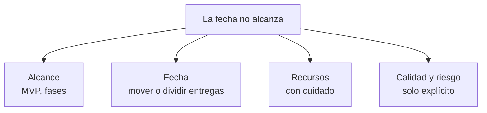

# Negociar alcance y plazos con negocio

Parte de: [[14-Carrera-Liderazgo/02 Liderazgo y comunicación/_Índice Liderazgo y comunicación|Liderazgo y comunicación]]

> [!info] Cómo avanzar
> `progreso`: **pendiente** → **viendo** (estudiando) → **visto** (contestaste la autoevaluación sin abrir las respuestas) → **dominado** (hiciste el laboratorio o lo aplicaste de verdad).

## Contenido

### Qué es
**Negociar alcance y plazos** es llegar a un acuerdo realista con negocio cuando lo que se pide no cabe en el tiempo disponible. No es "pelear la fecha", sino hacer visibles las variables y ayudar a elegir. Un senior que negocia bien protege al equipo y a la vez entrega valor a tiempo.

### Cómo funciona
Cuando la fecha no alcanza, hay cuatro variables:



1. **Alcance.** La más poderosa. Divide en un MVP que entrega valor y fases siguientes. Pregunta qué es imprescindible para el cliente en la primera fecha.
2. **Fecha.** A veces es flexible y nadie lo había preguntado. A veces es fija (regulación, contrato, evento).
3. **Recursos.** Sumar gente tarde suele retrasar más (curva de aprendizaje, coordinación). Solo funciona con trabajo muy separable y gente que ya conoce el sistema.
4. **Calidad y riesgo.** Solo de forma **explícita**: "Si quitamos las pruebas de carga, aceptamos el riesgo de que falle en el pico". Nunca bajes calidad en silencio.

Pasos para la conversación:
1. Llega con tu estimación en rango y desglosada ([[Estimación de tareas]]).
2. Entiende por qué la fecha: ¿qué pasa si no se cumple?
3. Propón opciones concretas, no un "no".
4. Haz que negocio elija; confirma por escrito.
5. Si surgen riesgos después, avisa en cuanto los veas, no el día de la entrega.

### Ejemplo
**Te piden todo el módulo de pedidos para el viernes; tu estimación es de 3 semanas.**

Respuesta modelo:
> "Con el equipo actual, todo el módulo son unas 3 semanas. Para el viernes podemos entregar alta y consulta de pedidos, que es lo que el cliente usará el primer día. Reembolsos entrarían en la semana 2 y los reportes en la semana 3. Si el viernes es fijo, ¿qué de esto es imprescindible para el cliente ese día?"

Y el correo de confirmación después de la reunión:

```text
Asunto: Acuerdo de alcance — Módulo de pedidos

Acordamos:
- Viernes 14: alta y consulta de pedidos (en producción).
- Semana del 17: reembolsos.
- Semana del 24: reportes de pedidos en Excel.
Riesgo conocido: la integración con paquetería depende de credenciales
del proveedor; si no llegan el martes, la fase 2 se mueve.
```

### Cuándo usarlo y cuándo no
Úsalo siempre que una fecha o un alcance no cuadren con tu estimación, idealmente al inicio del proyecto y no a la mitad. Si la fecha es legal (por ejemplo, un cambio fiscal con fecha de entrada en vigor), la negociación es casi solo de alcance. Si la diferencia es pequeña (un día), a veces conviene absorberla sin negociación formal, pero díselo a tu líder. Ver también [[Comunicación con personas no técnicas]] y [[Priorizar y saber decir que no]].

### Errores comunes
1. **Aceptar la fecha para evitar el conflicto** y luego trabajar de noche o entregar tarde sin aviso. Daña la confianza y la salud del equipo.
2. **Bajar calidad en silencio.** El costo aparece después como incidentes y deuda.
3. **Decir solo "no se puede".** Sin opciones, negocio decide sin ti.
4. **Negociar sin estimación desglosada.** Sin detalle, tu número parece arbitrario.
5. **No dejar el acuerdo por escrito.** Dos semanas después cada quien recuerda algo distinto.

### Para profundizar
- [The 2020 Scrum Guide](https://scrumguides.org/scrum-guide.html): cómo el Product Owner ordena el alcance.
- [What is BATNA? — Harvard Program on Negotiation](https://www.pon.harvard.edu/daily/batna/translate-your-batna-to-the-current-deal/)
- [Planning Poker — Mountain Goat Software](https://www.mountaingoatsoftware.com/agile/planning-poker)

## Autoevaluación

Contesta primero en voz alta o en papel; luego despliega la respuesta.

> [!question]- ¿Qué variables puedes negociar cuando la fecha no alcanza?
> Alcance (MVP, fases), fecha, recursos (con cuidado: sumar gente tarde suele retrasar) y calidad aceptable explícita (riesgo). Nunca bajes calidad en silencio.

> [!question]- Reflexión: piden todo para el viernes y estimas 3 semanas. Respuesta modelo.
> "Para el viernes podemos entregar alta y consulta de pedidos, sin reembolsos ni reportes. Reembolsos en la semana 2 y reportes en la 3. Si el viernes es fijo, ¿qué de esto es imprescindible para el cliente?"

> [!question]- Error común.
> Aceptar la fecha para evitar el conflicto y luego trabajar de más o entregar tarde sin aviso. Avisa los riesgos temprano.

