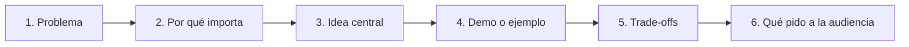

# Presentaciones técnicas

Parte de: [[14-Carrera-Liderazgo/02 Liderazgo y comunicación/_Índice Liderazgo y comunicación|Liderazgo y comunicación]]

> [!info] Cómo avanzar
> `progreso`: **pendiente** → **viendo** (estudiando) → **visto** (contestaste la autoevaluación sin abrir las respuestas) → **dominado** (hiciste el laboratorio o lo aplicaste de verdad).

## Contenido

### Qué es
Una **presentación técnica** es una exposición corta (de 5 a 30 minutos) para explicar una propuesta, una arquitectura, un incidente o una herramienta a tu equipo, a otra área o en un meetup. Para llegar a senior y tech lead es una habilidad necesaria: muchas decisiones se aprueban o se rechazan en una reunión de 20 minutos.

### Cómo funciona
Estructura que funciona para casi cualquier charla corta:

1. **Problema:** en una o dos frases, con un dato si lo hay ("3 cobros duplicados en septiembre").
2. **Por qué importa:** costo para el negocio o para el equipo.
3. **Idea central:** la propuesta en una frase. Si la audiencia solo recuerda una cosa, que sea esta.
4. **Demo o ejemplo:** algo concreto. Un diagrama de secuencia, una prueba que falla y luego pasa, una consulta antes y después.
5. **Trade-offs:** lo que se gana, lo que cuesta y lo que no resuelve. Mencionarlos te da credibilidad.
6. **Qué pides:** aprobar, opinar antes del viernes, probar en un sprint.

Reglas para las diapositivas:
- **Una idea por diapositiva**, con un título que la diga ("El webhook no es idempotente" en vez de "Situación actual").
- **Poco código, grande y resaltado.** Máximo 10–15 líneas, con lo importante marcado. El resto, en el repo.
- **Diagramas** antes que texto: C4 o secuencia ([[Diagramas C4]], [[Mermaid y diagramas como código]]).

**Demo en vivo:** ensáyala de principio a fin, ten los datos preparados (scripts de inserción, usuarios de prueba), desactiva notificaciones, aumenta el tamaño de letra del editor y la terminal, y ten un **plan B**: un video grabado o capturas por si falla la red, el VPN o el ambiente de QA.

### Ejemplo
Charla de 10 minutos para el equipo: "Idempotencia en el webhook de pagos".

| Diapositiva | Contenido | Tiempo |
|---|---|---|
| 1 | "Cobramos doble 3 veces en septiembre" + gráfica de reintentos | 1 min |
| 2 | Diagrama de secuencia: proveedor reenvía, nosotros insertamos dos veces | 1.5 min |
| 3 | Idea: tabla `EventoProcesado` con llave única | 1 min |
| 4 | Demo: prueba de integración que manda el mismo evento dos veces | 3 min |
| 5 | Trade-offs: crecimiento de la tabla, purga a 90 días | 1.5 min |
| 6 | Pedido: revisar el ADR-0007 antes del jueves | 1 min |
| — | Preguntas | 1 min |

Plan B de la demo: video de 2 minutos grabado el día anterior con OBS, más la salida de la prueba como captura.

### Cuándo usarlo y cuándo no
Presenta cuando necesites una decisión de un grupo, cuando quieras compartir un aprendizaje (post-mortem, herramienta nueva) o para ganar visibilidad. Si basta un documento que la gente pueda leer a su ritmo, manda el documento; muchas reuniones podrían ser un design doc con comentarios. Ensaya en voz alta al menos una vez con cronómetro. Si presentas en inglés, revisa [[Inglés técnico - hablar en reuniones y entrevistas]].

### Errores comunes
1. **Diapositivas llenas de texto o de código** que nadie alcanza a leer mientras hablas.
2. **Empezar por la solución** sin explicar el problema; la audiencia no sabe por qué escuchar.
3. **Demo sin ensayar ni plan B.** Pierdes cinco minutos peleando con el VPN.
4. **Pasarte de tiempo.** Ensaya con cronómetro y recorta.
5. **No decir qué pides.** La charla termina y nadie sabe qué sigue.

### Para profundizar
- [Technical Writing courses — Google for Developers](https://developers.google.com/tech-writing): la claridad escrita se traslada a las diapositivas.
- [Design Docs at Google — Malte Ubl](https://www.industrialempathy.com/posts/design-docs-at-google/)
- [Architectural Decision Records (adr.github.io)](https://adr.github.io/)

## Autoevaluación

Contesta primero en voz alta o en papel; luego despliega la respuesta.

> [!question]- ¿Cómo estructuras una presentación técnica corta?
> Problema → por qué importa → idea central → demo o ejemplo → trade-offs → qué se pide a la audiencia. Una idea por diapositiva.

> [!question]- ¿Qué hacer con una demo en vivo?
> Ensayarla, tener datos preparados y un plan B (video o capturas) por si falla.

> [!question]- Error común.
> Diapositivas llenas de texto o código que nadie alcanza a leer; mejor poco código, grande y resaltado.

