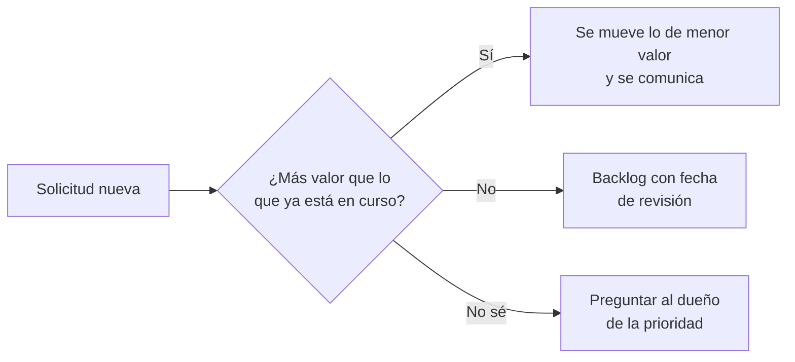

# Priorizar y saber decir que no

Parte de: [[14-Carrera-Liderazgo/02 Liderazgo y comunicación/_Índice Liderazgo y comunicación|Liderazgo y comunicación]]

> [!info] Cómo avanzar
> `progreso`: **pendiente** → **viendo** (estudiando) → **visto** (contestaste la autoevaluación sin abrir las respuestas) → **dominado** (hiciste el laboratorio o lo aplicaste de verdad).

## Contenido

### Qué es
**Priorizar** es decidir en qué orden se hace el trabajo y qué no se hace, según el valor que aporta y lo que cuesta. **Saber decir que no** es la otra cara: cada "sí" a algo nuevo es un "no" implícito a otra cosa. Un senior hace visible ese costo de oportunidad en lugar de aceptar todo y hacerlo a medias.

### Cómo funciona
Marcos útiles (elige el que se ajuste a la decisión):

- **Matriz de Eisenhower:** urgente/importante. Lo importante y no urgente (deuda técnica, pruebas, documentación) es lo que más se descuida.
- **RICE:** *Reach × Impact × Confidence / Effort*. Alcance (usuarios por periodo), impacto (escala, por ejemplo 0.25 mínimo a 3 masivo), confianza (porcentaje) y esfuerzo (persona-semanas).
- **MoSCoW:** *Must, Should, Could, Won't (this time)*. Útil para cerrar el alcance de una entrega.
- **Costo del retraso:** cuánto se pierde por cada semana que algo no está listo.



**Decir que no sin cerrar la puerta:**
- "Ahora no puedo por X, que es la prioridad acordada; puedo en dos semanas."
- "Si lo priorizamos sobre Y, lo muevo. ¿Lo hablamos con el PO?"
- "Puedo darte una versión más simple hoy: el query directo en lugar del reporte completo."

### Ejemplo
**Cálculo RICE de dos funcionalidades para Itzamna.Clio:**

- A: alcance 500 usuarios, impacto 2, confianza 80%, esfuerzo 4 semanas.
- B: alcance 2,000 usuarios, impacto 0.5, confianza 100%, esfuerzo 2 semanas.

```text
RICE(A) = 500 × 2 × 0.8 / 4  = 800 / 4  = 200
RICE(B) = 2000 × 0.5 × 1 / 2 = 1000 / 2 = 500
```

Va primero **B** (500 > 200), aunque su impacto individual sea menor, porque llega a más gente con menos esfuerzo y mayor certeza. RICE no decide por ti, pero hace explícita la conversación: si alguien quiere A primero, tendrá que argumentar por qué su impacto o su confianza deberían ser mayores.

**Situación real:** un gerente de otra área te pide directamente "un reporte rápido" en medio del sprint.

> "Con gusto lo vemos. Ahora estoy en el cierre de reembolsos, que es el objetivo del sprint. Puedo darte el query para que lo saques tú hoy, o lo meto al backlog y el PO decide si entra al siguiente sprint. ¿Cuál te sirve más?"

### Cuándo usarlo y cuándo no
Usa un marco formal cuando haya varias opciones que compiten y desacuerdo; para decisiones pequeñas basta preguntar "¿qué pasa si esto espera una semana?". La prioridad del producto la decide el Product Owner o el líder; tu papel es dar información de costo, riesgo y dependencias técnicas. Di que sí sin discutir a incidentes de producción y temas de seguridad. Ver también [[Pensamiento de producto]].

### Errores comunes
1. **Decir que sí a todo** y entregar todo tarde o a medias.
2. **Priorizar lo técnicamente interesante** sobre lo que aporta valor (reescribir en el framework nuevo en lugar de arreglar el flujo que pierde clientes).
3. **Saltarse al dueño de la prioridad.** Aceptar pedidos directos sin pasar por el PO desordena al equipo.
4. **Usar RICE con números inventados** para justificar lo que ya querías. Si no tienes datos, baja la confianza.
5. **Decir no sin alternativa.** Cierra la relación; con opciones la mantienes.

### Para profundizar
- [RICE: Simple prioritization for product managers — Intercom](https://www.intercom.com/blog/rice-simple-prioritization-for-product-managers/)
- [The 2020 Scrum Guide](https://scrumguides.org/scrum-guide.html): responsabilidad del Product Owner sobre el orden del backlog.
- [The Kanban Guide](https://kanbanguides.org/english/)

## Ejercicios

Resuélvelos en papel o en la herramienta; la solución está plegada.

> [!question]- Calcula RICE y prioriza. A: alcance 500 usuarios, impacto 2, confianza 80%, esfuerzo 4 semanas. B: alcance 2,000, impacto 0.5, confianza 100%, esfuerzo 2.
> A = 500 × 2 × 0.8 / 4 = **200**. B = 2000 × 0.5 × 1.0 / 2 = **500**. B primero (aunque A tenga más impacto por usuario).

## Autoevaluación

Contesta primero en voz alta o en papel; luego despliega la respuesta.

> [!question]- ¿Cómo dices que no sin cerrar la puerta?
> "Ahora no puedo por X (prioridad acordada); puedo en dos semanas, o si lo priorizamos sobre Y, lo muevo." Haces visible el costo de oportunidad.

> [!question]- Menciona dos marcos para priorizar.
> Matriz de Eisenhower (urgente/importante), RICE (*Reach × Impact × Confidence / Effort*), MoSCoW (Must, Should, Could, Won't), costo del retraso.

> [!question]- Error común.
> Decir que sí a todo y hacer todo a medias; o priorizar lo técnicamente interesante sobre lo que da valor.

