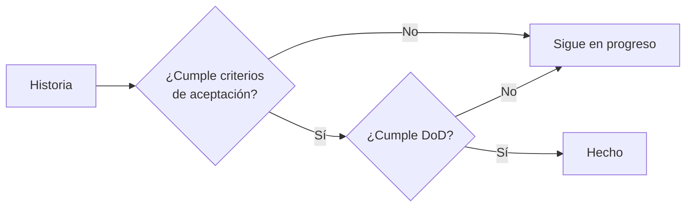

# Definition of done

Parte de: [[14-Carrera-Liderazgo/03 Proceso de trabajo/_Índice Proceso de trabajo|Proceso de trabajo]]

> [!info] Cómo avanzar
> `progreso`: **pendiente** → **viendo** (estudiando) → **visto** (contestaste la autoevaluación sin abrir las respuestas) → **dominado** (hiciste el laboratorio o lo aplicaste de verdad).

## Contenido

### Qué es
La **Definition of Done** (DoD) es la lista **acordada por el equipo** de lo que debe cumplir **todo** incremento para considerarse terminado. En la *Scrum Guide* 2020 es el compromiso asociado al artefacto *Increment*: si algo no cumple la DoD, no se presenta como hecho. Su propósito es que "terminado" signifique lo mismo para todos y que la calidad no dependa de la prisa del día.

### Cómo funciona
**Diferencia con criterios de aceptación:**

| Criterios de aceptación | Definition of Done |
|---|---|
| Específicos de una historia | Comunes a todas las historias |
| Dicen **qué** debe hacer | Dicen **con qué calidad** se entrega |
| "Un proyecto oculto regresa 404 a otros usuarios" | "Tiene pruebas automatizadas y pasó revisión" |
| Los define el PO con el equipo | La define el equipo (y la organización, si tiene estándares) |

Una historia está terminada cuando cumple **sus criterios de aceptación Y la DoD**.



La DoD **evoluciona**: empieza con lo que el equipo puede cumplir de verdad y se vuelve más estricta conforme mejoran la automatización y las prácticas. Se revisa en la retrospectiva.

### Ejemplo
DoD del equipo de Itzamna.Dionisio, guardada en la wiki de Azure DevOps y enlazada en la plantilla de PR:

```markdown
Una historia está terminada cuando:
- [ ] El código está en main mediante PR aprobado por al menos 1 revisor.
- [ ] El pipeline de CI pasa: build, pruebas unitarias y de integración.
- [ ] Los cambios de SQL están en archivos .sql versionados, con script
      de rollback para cambios de esquema.
- [ ] Los errores regresan ProblemDetails con "codigo".
- [ ] No hay secretos en el repo (configuración en Key Vault / variables).
- [ ] Está desplegada en QA y el PO la vio funcionando.
- [ ] Logs y métricas relevantes agregados (si toca un flujo crítico).
- [ ] Documentación actualizada (README, ADR si hubo decisión).
```

Muchos de estos puntos se pueden **automatizar** con políticas de rama en Azure Repos (revisores mínimos, build obligatorio, work item vinculado) y con una plantilla de PR que incluya la lista. Lo automatizado no se olvida.

### Cuándo usarlo y cuándo no
Todo equipo debería tener una DoD escrita, use Scrum o [[Kanban]] (en Kanban suele expresarse como la política de la última columna). Debe ser realista: una DoD que exige 100% de cobertura que nadie cumple se ignora. Para trabajo exploratorio (*spikes*) puede haber una DoD distinta y más ligera, siempre que esté explícita. Complementa a las [[Historias de usuario y criterios de aceptación]]; no las sustituye.

Cómo introducirla en un equipo que no tiene: en la retrospectiva, pregunta "¿qué tiene que pasar para que digamos que algo está terminado?", escribe la lista con lo que el equipo ya hace casi siempre, y agrega solo uno o dos puntos nuevos. Cada cierto tiempo, revisen qué punto se puede automatizar en el pipeline y cuál conviene agregar.

### Errores comunes
1. **Una DoD que nadie revisa** o que se salta "porque hay prisa". Se acumula trabajo oculto que reaparece como deuda técnica y bugs ([[Gestión de deuda técnica]]).
2. **Confundirla con criterios de aceptación** y meter reglas de negocio específicas.
3. **DoD inalcanzable** que el equipo ignora desde el primer día.
4. **No escrita**: cada quien tiene su propia idea de "terminado".
5. **"Hecho" sin desplegar.** Si no está en un ambiente donde se puede probar, no está hecho.

### Para profundizar
- [The 2020 Scrum Guide](https://scrumguides.org/scrum-guide.html)
- [Improve pull request descriptions using templates — Azure DevOps](https://learn.microsoft.com/en-us/azure/devops/repos/git/pull-request-templates)
- [About pull requests — Azure DevOps](https://learn.microsoft.com/en-us/azure/devops/repos/git/about-pull-requests)

## Autoevaluación

Contesta primero en voz alta o en papel; luego despliega la respuesta.

> [!question]- ¿Qué es la Definition of Done?
> La lista acordada por el equipo de lo que debe cumplir **todo** incremento para considerarse terminado (p. ej. revisado, con pruebas, desplegado en QA, documentado).

> [!question]- Diferencia con criterios de aceptación.
> Criterios de aceptación: específicos de una historia (qué debe hacer). DoD: común a todas (con qué calidad se entrega).

> [!question]- Error común.
> Una DoD que nadie revisa o que se salta "porque hay prisa": se acumula trabajo oculto (deuda).

