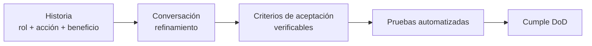

# Historias de usuario y criterios de aceptación

Parte de: [[14-Carrera-Liderazgo/03 Proceso de trabajo/_Índice Proceso de trabajo|Proceso de trabajo]]

> [!info] Cómo avanzar
> `progreso`: **pendiente** → **viendo** (estudiando) → **visto** (contestaste la autoevaluación sin abrir las respuestas) → **dominado** (hiciste el laboratorio o lo aplicaste de verdad).

## Contenido

### Qué es
Una **historia de usuario** es una descripción corta de una necesidad desde el punto de vista de quien la tiene. Su formato clásico es: "Como **rol**, quiero **acción**, para **beneficio**". No es una especificación completa: es una **promesa de conversación** entre negocio y equipo. Los **criterios de aceptación** son las condiciones verificables que dicen cuándo esa historia está cumplida.

### Cómo funciona
**INVEST** es una guía para saber si una historia está bien formada:
- **I**ndependiente: se puede desarrollar sin esperar a otra.
- **N**egociable: el detalle se acuerda en la conversación.
- **V**aliosa: aporta algo al usuario o al negocio.
- **E**stimable: el equipo entiende lo suficiente para estimarla.
- **S**mall (pequeña): cabe en un sprint, idealmente en pocos días.
- **T**estable: se puede verificar.

**Un buen criterio de aceptación** es verificable **sin interpretación**: alguien de QA y alguien de desarrollo llegarían a la misma conclusión. Dos formatos comunes:
- **Dado / Cuando / Entonces** (*Given / When / Then*, el formato de Gherkin y BDD).
- Lista concreta con datos de ejemplo.



Los criterios son **específicos de cada historia** (qué debe hacer); la [[Definition of done]] es **común a todas** (con qué calidad se entrega).

### Ejemplo
**Funcionalidad: "el creador puede ocultar un proyecto de su portafolio"** (en Itzamna.Clio).

Historia:
> Como **creador**, quiero **ocultar un proyecto de mi portafolio público**, para **mostrar solo mis trabajos más relevantes sin borrar los demás**.

Criterios de aceptación:
1. **Dado** que tengo un proyecto visible, **cuando** elijo "Ocultar", **entonces** deja de aparecer en mi portafolio público y en la búsqueda.
2. **Dado** que tengo un proyecto oculto, **cuando** entro a mi panel, **entonces** lo veo con la etiqueta "Oculto" y puedo volver a mostrarlo.
3. **Dado** que otro usuario tiene el enlace directo a un proyecto oculto, **cuando** lo abre, **entonces** recibe 404 (no 403, para no revelar que existe).

Y cómo se vuelve prueba de integración en la API:

```csharp
[Fact]
public async Task Proyecto_oculto_regresa_404_a_otros_usuarios()
{
    // Arrange: el creador oculta su proyecto
    await _creador.PatchAsJsonAsync($"/proyectos/{_id}/visibilidad", new { visible = false });

    // Act: otro usuario intenta verlo
    var respuesta = await _visitante.GetAsync($"/proyectos/{_id}");

    // Assert: no revelamos que existe
    Assert.Equal(HttpStatusCode.NotFound, respuesta.StatusCode);
}
```

### Cuándo usarlo y cuándo no
Úsalas para trabajo con valor visible para un usuario. Para tareas técnicas (actualizar a .NET 10, rotar certificados) no fuerces el formato "Como desarrollador quiero..."; una tarea técnica con su objetivo y criterio de terminado es más honesta. Si una historia no cabe en un sprint, divídela por flujo (primero ocultar, luego mostrar) o por reglas, no por capas (nunca "historia del backend" e "historia del front"). Las historias salen de un buen [[Levantamiento de requisitos]].

### Errores comunes
1. **Criterios vagos** ("debe ser rápido", "debe ser amigable"). Pon números o comportamientos: "responde en menos de 500 ms con 1,000 proyectos".
2. **Historias que son tareas técnicas disfrazadas.** "Como sistema quiero una tabla" no aporta valor por sí sola.
3. **Historias enormes** (épicas) que se arrastran varios sprints.
4. **Olvidar los casos negativos** (permisos, datos inválidos, lo que pasa con otros usuarios).
5. **Tratar la historia como contrato cerrado** y no conversar.

### Para profundizar
- [User stories — Agile Alliance](https://agilealliance.org/agile101/user-stories)
- [INVEST — Agile Alliance](https://agilealliance.org/glossary/invest)

## Ejercicios

Resuélvelos en papel o en la herramienta; la solución está plegada.

> [!question]- Escribe la historia y 3 criterios de aceptación para "el creador puede ocultar un proyecto de su portafolio".
> **Historia:** Como creador, quiero ocultar un proyecto, para mostrar solo mis mejores trabajos sin borrar nada.
>
> **Criterios:**
> 1. Dado un proyecto visible, cuando lo oculto, entonces no aparece en mi portafolio público ni en la búsqueda.
> 2. Dado un proyecto oculto, cuando entro a mi panel, entonces lo veo marcado como "Oculto" y puedo volver a mostrarlo.
> 3. Dado un visitante con el enlace directo de un proyecto oculto, cuando lo abre, entonces recibe 404.

## Autoevaluación

Contesta primero en voz alta o en papel; luego despliega la respuesta.

> [!question]- ¿Qué formato tiene una historia de usuario?
> "Como **rol**, quiero **acción**, para **beneficio**." Es una promesa de conversación, no una especificación completa.

> [!question]- ¿Qué es INVEST?
> Independiente, Negociable, Valiosa, Estimable, Pequeña (*Small*), *Testable* (verificable).

> [!question]- ¿Qué hace bueno a un criterio de aceptación?
> Es verificable sin interpretación: "Dado/Cuando/Entonces" o una lista concreta con datos de ejemplo.

