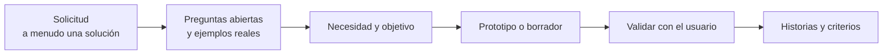

# Levantamiento de requisitos

Parte de: [[14-Carrera-Liderazgo/03 Proceso de trabajo/_Índice Proceso de trabajo|Proceso de trabajo]]

> [!info] Cómo avanzar
> `progreso`: **pendiente** → **viendo** (estudiando) → **visto** (contestaste la autoevaluación sin abrir las respuestas) → **dominado** (hiciste el laboratorio o lo aplicaste de verdad).

## Contenido

### Qué es
El **levantamiento de requisitos** es el proceso de descubrir qué necesitan realmente los usuarios y el negocio antes de construir. El reto es que las personas suelen expresar **soluciones** ("quiero un botón que exporte a Excel") en lugar de **necesidades** ("cada lunes necesito saber qué sucursales vendieron menos"). Un senior sabe hacer las preguntas que llevan de una a la otra.

### Cómo funciona
Técnicas principales:
1. **Entrevistas con preguntas abiertas.** "¿Cómo hacen esto hoy?" en lugar de "¿quieren que sea en Excel?".
2. **Observar al usuario trabajar.** Ver cómo un analista arma un reporte en 2 horas revela pasos que nadie mencionó.
3. **Ejemplos concretos.** "Muéstrame el último caso que te tocó" trae los detalles reales, incluidas las excepciones.
4. **Prototipos rápidos.** Una pantalla en Figma o un mock en React vale más que diez páginas: la gente reacciona mejor a algo que ve.
5. **Event storming** para procesos de negocio: en una sesión se ponen en una línea de tiempo los eventos del dominio ("Pedido creado", "Pago confirmado", "Pedido enviado") y aparecen reglas, actores y huecos.

**Preguntas que no deben faltar:**
- ¿Qué problema resuelve y para quién?
- ¿Cómo lo hacen hoy?
- ¿Qué pasa si no se hace?
- ¿Cómo sabremos que funcionó?
- ¿Qué casos raros o excepciones existen?
- ¿Qué queda **fuera** del alcance?
- ¿Quién más se ve afectado (otras áreas, otros sistemas)?

### Ejemplo
**Solicitud en Ocelotl.Hermes:** "Queremos que el sistema mande SMS cuando un pedido se retrase."

Conversación con la gerente de atención a clientes:
- "¿Qué pasa hoy cuando un pedido se retrasa?" — "El cliente llama enojado y un agente revisa con paquetería."
- "¿Cuántas llamadas de ese tipo reciben?" — "Unas 200 por semana."
- "Muéstrame el último caso." — Descubres que "retraso" significa que la paquetería no actualizó el estatus en 48 horas, no que pasó la fecha prometida.
- "¿Qué queda fuera?" — "No queremos compensaciones automáticas por ahora."
- "¿Cómo sabremos que funcionó?" — "Si bajan las llamadas por retraso."

Resultado: el requisito real es **detectar pedidos sin actualización en 48 horas y avisar proactivamente**; el canal puede ser SMS, correo o WhatsApp. La métrica de éxito: llamadas por retraso. Ahora sí puedes escribir [[Historias de usuario y criterios de aceptación]] y estimar.

Deja un resumen escrito y compártelo para confirmar: "Entendí esto; ¿es correcto?".

### Cuándo usarlo y cuándo no
Haz levantamiento formal al inicio de un proyecto o de una funcionalidad grande, y uno ligero en cada refinamiento. Si el PO ya hizo la investigación con usuarios, tu papel es completar con preguntas técnicas (volumen, integraciones, datos existentes). Para cambios pequeños y claros, no lo conviertas en burocracia. Combínalo con [[Pensamiento de producto]].

### Errores comunes
1. **Tomar la solución del usuario como requisito** sin descubrir la necesidad detrás.
2. **Preguntas cerradas** ("¿lo quieren en PDF?") que solo confirman tus supuestos.
3. **No preguntar qué queda fuera.** El alcance crece sin control.
4. **Hablar solo con el jefe** del área y no con quien usa el sistema todos los días.
5. **No dejar nada por escrito** ni validar el entendimiento.

### Para profundizar
- [EventStorming](https://www.eventstorming.com/)
- [User stories — Agile Alliance](https://agilealliance.org/agile101/user-stories)
- [INVEST — Agile Alliance](https://agilealliance.org/glossary/invest)

## Autoevaluación

Contesta primero en voz alta o en papel; luego despliega la respuesta.

> [!question]- ¿Qué técnicas usas para levantar requisitos?
> Entrevistas con preguntas abiertas, observar al usuario trabajar, ejemplos concretos ("muéstrame el último caso"), prototipos rápidos y *event storming* para procesos.

> [!question]- ¿Qué preguntas no deben faltar?
> ¿Qué problema resuelve y para quién? ¿Cómo lo hacen hoy? ¿Qué pasa si no se hace? ¿Cómo sabremos que funcionó? ¿Qué casos raros existen? ¿Qué queda fuera?

> [!question]- Error común.
> Tomar la solución que propone el usuario como requisito ("quiero un botón que exporte a Excel") sin descubrir la necesidad detrás.

