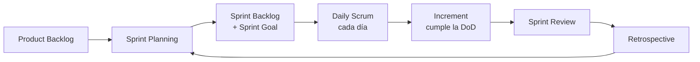

# Scrum en la práctica

Parte de: [[14-Carrera-Liderazgo/03 Proceso de trabajo/_Índice Proceso de trabajo|Proceso de trabajo]]

> [!info] Cómo avanzar
> `progreso`: **pendiente** → **viendo** (estudiando) → **visto** (contestaste la autoevaluación sin abrir las respuestas) → **dominado** (hiciste el laboratorio o lo aplicaste de verdad).

## Contenido

### Qué es
**Scrum** es un marco de trabajo ligero para desarrollar productos en ciclos cortos llamados *sprints*, con entregas frecuentes y mejora continua. La referencia oficial es la *Scrum Guide* (versión 2020), escrita por Ken Schwaber y Jeff Sutherland. "En la práctica" importa porque muchos equipos dicen usar Scrum y solo tienen reuniones con esos nombres.

### Cómo funciona
La guía de 2020 define tres **responsabilidades** (*accountabilities*), cinco **eventos** y tres **artefactos**, cada uno con un compromiso:

| Responsabilidades | Eventos | Artefactos y compromiso |
|---|---|---|
| Product Owner: maximiza el valor y ordena el Product Backlog | Sprint: contenedor de un mes o menos | Product Backlog → Product Goal |
| Scrum Master: efectividad del equipo y de Scrum | Sprint Planning | Sprint Backlog → Sprint Goal |
| Developers: crean el incremento | Daily Scrum (15 minutos) | Increment → Definition of Done |
| | Sprint Review | |
| | Sprint Retrospective | |

**La daily** sirve para que los Developers revisen el avance hacia el **objetivo del sprint** y ajusten el plan del día; ahí salen los bloqueos. La arruinan dos cosas: convertirla en reporte de estatus al jefe (cada uno le habla al líder, no al equipo) y convertirla en discusión técnica larga. Si surge un tema, "lo vemos después" con quienes hagan falta.

**La retrospectiva** es útil cuando sale con **1–2 acciones concretas, con dueño y fecha**, y en la siguiente se revisa si se cumplieron. Una retro que produce diez "deberíamos" y ninguna acción enseña al equipo que no sirve.

### Ejemplo
Sprint de 2 semanas del equipo de Itzamna.Dionisio en Azure Boards:

- **Planning:** el PO trae el objetivo "Los clientes pueden solicitar reembolsos en línea". El equipo elige las historias que lo logran y las divide en tareas.
- **Daily:** "Ayer terminé el procedimiento `usp_Reembolso_Crear`; hoy hago la validación con FluentValidation; estoy bloqueado esperando acceso al sandbox de la pasarela." El Scrum Master toma el bloqueo.
- **Review:** demo funcionando en QA ante el PO y el área de atención a clientes; feedback: falta mostrar el estatus del reembolso. Se agrega al backlog.
- **Retro:** problema detectado: los PRs esperaron en promedio 2 días por revisión. Acción: "Cada quien revisa PRs pendientes antes de la daily. Dueño: Ana. Se revisa en la próxima retro."

### Cuándo usarlo y cuándo no
Scrum encaja con trabajo de producto donde conviene planear en ciclos cortos y mostrar avances frecuentes. Si el trabajo llega de forma continua e impredecible (soporte, operación), suele encajar mejor [[Kanban]]. Muchos equipos combinan ambos. Lo que sí debe estar en cualquier caso: una [[Definition of done]] clara e [[Historias de usuario y criterios de aceptación]] bien escritas.

### Errores comunes
1. **Daily como reporte al jefe.** El equipo deja de coordinarse y solo "rinde cuentas".
2. **Sprints sin objetivo.** Una lista de tickets sueltos no da foco ni permite decidir qué sacrificar.
3. **Retros sin acciones** o con acciones que nadie revisa.
4. **Saltarse la review** o hacerla sin usuarios reales: se pierde el feedback que justifica el ciclo corto.
5. **Cambiar el alcance del sprint todos los días.** Si pasa siempre, el sprint es demasiado largo o el trabajo es más de flujo continuo.

### Para profundizar
- [The 2020 Scrum Guide](https://scrumguides.org/scrum-guide.html)
- [Scrum Guide 2020 (PDF)](https://scrumguides.org/docs/scrumguide/v2020/2020-Scrum-Guide-US.pdf)
- [The Kanban Guide](https://kanbanguides.org/english/)

## Autoevaluación

Contesta primero en voz alta o en papel; luego despliega la respuesta.

> [!question]- ¿Qué eventos y roles tiene Scrum?
> Roles: Product Owner, Scrum Master, Developers. Eventos: Sprint, Sprint Planning, Daily Scrum, Sprint Review, Sprint Retrospective.

> [!question]- ¿Para qué es la daily y qué la arruina?
> Para sincronizar al equipo hacia el objetivo del sprint y detectar bloqueos. La arruina convertirla en reporte de estatus al jefe o en discusión técnica larga.

> [!question]- ¿Qué hace útil a una retrospectiva?
> Salir con 1–2 acciones concretas con dueño, y revisar en la siguiente si se cumplieron.

