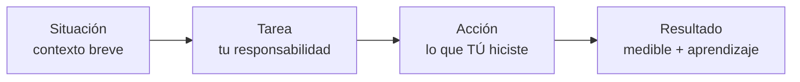

# Entrevistas de comportamiento (método STAR)

Parte de: [[14-Carrera-Liderazgo/04 Búsqueda de trabajo/_Índice Búsqueda de trabajo|Búsqueda de trabajo]]

> [!info] Cómo avanzar
> `progreso`: **pendiente** → **viendo** (estudiando) → **visto** (contestaste la autoevaluación sin abrir las respuestas) → **dominado** (hiciste el laboratorio o lo aplicaste de verdad).

## Contenido

### Qué es
Las **entrevistas de comportamiento** evalúan cómo actuaste en situaciones reales: conflictos, errores, decisiones difíciles, liderazgo. Parten de la idea de que tu comportamiento pasado predice el futuro. El método **STAR** es una estructura para contar esas experiencias de forma clara: **S**ituación, **T**area, **A**cción y **R**esultado. Para puestos senior suelen pesar tanto como la parte técnica.

### Cómo funciona

- **Situación:** dónde, cuándo, qué estaba pasando. Dos o tres frases.
- **Tarea:** qué te tocaba a ti. Distinto de lo que le tocaba al equipo.
- **Acción:** lo que **tú** hiciste, con detalle: qué analizaste, qué decidiste, a quién convenciste, qué alternativas descartaste. Es lo que realmente evalúan.
- **Resultado:** medible si es posible (números, tiempos, incidentes) y qué aprendiste.

**Proporción de tiempo:** Situación y Tarea cortas (~20%), Acción la mayor parte (~60%), Resultado y aprendizaje (~20%). Una respuesta completa dura de 2 a 3 minutos.

**Ejercicio de orden.** Estas frases desordenadas:
1. "Reduje las caídas de 3 por mes a 0 en el trimestre."
2. "El API de pagos fallaba cuando el proveedor tardaba."
3. "Agregué timeouts, reintentos con backoff y circuit breaker, y alertas."
4. "Me asignaron estabilizar la integración."

Quedan así: **S = 2, T = 4, A = 3, R = 1**.

### Ejemplo
**Mejorar una respuesta débil:** "Tuvimos un problema de rendimiento y lo arreglamos con caché."

Le falta todo: contexto, tu papel, el diagnóstico, alternativas y números. Versión STAR:

> **S:** En Wee.Reporteria, el reporte de ventas mensual tardaba 40 segundos y daba *timeout* en cierre de mes, cuando 50 gerentes lo abrían al mismo tiempo.
> **T:** Me pidieron que bajara el tiempo a menos de 5 segundos sin cambiar la funcionalidad.
> **A:** Medí con Application Insights y el plan de ejecución de SQL Server: el 90% del tiempo estaba en una agregación sobre 8 millones de filas que se recalculaba en cada petición. Evalué tres opciones: índice columnstore, tabla de resumen precalculada por un job nocturno y caché en memoria. Elegí la tabla de resumen más [[Cache-aside y estrategias de caché]] de 10 minutos, porque los datos del mes cerrado no cambian. Lo documenté en un ADR y agregué una alerta si el job fallaba.
> **R:** El reporte bajó a 1.2 segundos y no hubo *timeouts* en los siguientes tres cierres. Aprendí a medir antes de optimizar: mi primera hipótesis era la red y estaba equivocado.

**"Cuéntame de un error que cometiste"**, modelo:

> **S:** Migrábamos el esquema de la base de Itzamna.Dionisio en producción.
> **T:** Yo era responsable del script de migración.
> **A:** No lo probé con un volumen real; al correrlo, bloqueó tablas 20 minutos. Lo detuve, restauré, avisé al equipo y a soporte, reescribí la migración por lotes de 5,000 filas, la probé contra una copia de producción y agregué a la DoD una lista de verificación para migraciones.
> **R:** La segunda ejecución corrió sin bajar el servicio, y la lista se sigue usando. Aprendí que una migración se prueba con datos de tamaño real.

Un buen "error" es real, asumes tu parte sin culpar a otros y muestras lo que cambiaste después.

### Cuándo usarlo y cuándo no
Usa STAR para cualquier pregunta que empiece con "Cuéntame de una vez que...", "Dame un ejemplo de..." o "¿Cómo manejaste...?". Prepara 6–8 historias que cubran: conflicto, error, liderazgo sin autoridad, decisión técnica difícil, entrega bajo presión, mentoría y desacuerdo con tu jefe ([[Lab 3 - Preparar historias STAR]]). Una historia bien preparada sirve para varias preguntas. No uses STAR para preguntas técnicas directas ("¿qué es un índice clustered?"): ahí responde directo.

### Errores comunes
1. **Hablar en "nosotros"** todo el tiempo. Evalúan lo que hiciste **tú**; di "yo propuse", "yo medí".
2. **Historias sin resultado** o con "y salió bien". Pon números.
3. **Situación eterna.** Cinco minutos de contexto y treinta segundos de acción.
4. **El error que es una virtud disfrazada** ("trabajo demasiado"). Suena a evasión.
5. **Inventar o exagerar.** Las preguntas de seguimiento lo descubren rápido.

### Para profundizar
- [Get your work recognized: write a brag document — Julia Evans](https://jvns.ca/blog/brag-documents/): tu registro de logros es la materia prima de las historias.
- [Staff archetypes — StaffEng](https://staffeng.com/guides/staff-archetypes/): qué comportamientos se buscan en niveles altos.

## Ejercicios

Resuélvelos en papel o en la herramienta; la solución está plegada.

> [!question]- Ordena estas frases en S-T-A-R: (1) "Reduje las caídas de 3 por mes a 0 en el trimestre". (2) "El API de pagos fallaba cuando el proveedor tardaba". (3) "Agregué timeouts, reintentos con backoff y circuit breaker, y alertas". (4) "Me asignaron estabilizar la integración".
> S = (2), T = (4), A = (3), R = (1).

> [!question]- Mejora esta respuesta: "Tuvimos un problema de rendimiento y lo arreglamos con caché."
> Falta el *yo*, el detalle y la medida. Ejemplo: "El listado de productos tardaba 4 s en p95 (S). Me tocó bajarlo a menos de 500 ms (T). Medí con trazas, vi 30 consultas N+1, las reemplacé por una sola con proyección y agregué caché de 60 s para el catálogo (A). Quedó en 300 ms y bajó 40% el CPU de la base (R)."

## Autoevaluación

Contesta primero en voz alta o en papel; luego despliega la respuesta.

> [!question]- ¿Qué es STAR?
> Una estructura para contar experiencias: **Situación** (contexto breve), **Tarea** (tu responsabilidad), **Acción** (lo que *tú* hiciste, con detalle) y **Resultado** (medible, y qué aprendiste).

> [!question]- ¿Qué proporción de tiempo das a cada parte?
> Situación y Tarea cortas (~20%), Acción la mayor parte (~60%), Resultado y aprendizaje (~20%). La acción es lo que evalúan.

> [!question]- Reflexión: "Cuéntame de un error que cometiste." Respuesta modelo con STAR.
> **S:** Migrábamos la base de un SaaS en producción. **T:** Yo era responsable del script de migración. **A:** No probé con un volumen real; la migración bloqueó tablas 20 min. Lo detuve, restauré, avisé al equipo y a soporte, reescribí la migración por lotes, la probé con una copia de producción y agregué una lista de verificación para migraciones. **R:** La segunda corrió sin bajar el servicio; la lista se volvió estándar del equipo. Aprendí a probar con datos realistas.

> [!question]- Errores comunes.
> Hablar en "nosotros" sin decir qué hiciste tú, historias sin resultado, o elegir un "error" que en realidad es una virtud disfrazada.

## Práctica

- [[Lab 3 - Preparar historias STAR]]

