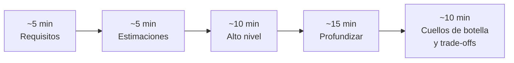

# Entrevistas de diseño de sistemas

Parte de: [[14-Carrera-Liderazgo/04 Búsqueda de trabajo/_Índice Búsqueda de trabajo|Búsqueda de trabajo]]

> [!info] Cómo avanzar
> `progreso`: **pendiente** → **viendo** (estudiando) → **visto** (contestaste la autoevaluación sin abrir las respuestas) → **dominado** (hiciste el laboratorio o lo aplicaste de verdad).

## Contenido

### Qué es
En una **entrevista de diseño de sistemas** te piden diseñar un sistema a alto nivel (un acortador de URLs, un sistema de notificaciones, un servicio de pagos) en unos 45 minutos. No hay una única respuesta correcta. Se evalúa **cómo piensas**: cómo aclaras requisitos, estimas, propones una arquitectura razonable, profundizas en las partes críticas y discutes trade-offs y fallos. Es casi obligatoria para puestos senior. El método técnico completo está en [[Diseño de sistemas - cómo abordarlo]]; aquí el foco es la entrevista.

### Cómo funciona
Reparto de 45 minutos:

1. **Requisitos (~5 min):** funcionales (qué hace) y no funcionales (cuántos usuarios, latencia, disponibilidad, consistencia). Pregunta, no supongas en silencio.
2. **Estimaciones (~5 min):** peticiones por segundo, almacenamiento, ancho de banda. Números redondos bastan; importan para justificar decisiones.
3. **Diseño de alto nivel (~10 min):** cajas y flechas: clientes, API, servicios, base de datos, caché, colas. Recorre un caso de uso de punta a punta.
4. **Profundizar (~15 min):** el entrevistador elige o tú propones las partes críticas: modelo de datos, índices, consistencia, idempotencia, particionamiento.
5. **Cuellos de botella y trade-offs (~10 min):** qué pasa si se cae X, si la carga se multiplica por 10, qué sacrificas y por qué.

Piensa **en voz alta** todo el tiempo y revisa con el entrevistador: "¿Quieres que profundice en la base de datos o en la entrega de notificaciones?".

### Ejemplo
**"Diseña un sistema de notificaciones (correo, SMS, push) para un e-commerce."**

Arranque modelo:
> "Antes de dibujar: ¿cuántas notificaciones por día esperamos? ¿Hay notificaciones críticas, como confirmación de pago, y masivas, como promociones? ¿Se aceptan unos segundos de retraso? ¿Necesitamos que no se dupliquen?"

Supón la respuesta: 10 millones por día, las críticas deben llegar en menos de 30 segundos, se aceptan duplicados ocasionales en promociones pero no en pagos.

Estimación: 10,000,000 / 86,400 ≈ 116 por segundo en promedio; con picos de 10 veces, unos 1,200 por segundo.

Alto nivel: API de notificaciones → cola (Azure Service Bus) con dos colas separadas, críticas y masivas → workers por canal → proveedores externos. Tabla de estado de notificaciones para consulta y reintentos.

Profundizar: idempotencia con una llave por evento ([[Idempotencia]]), [[Circuit breaker y reintentos]] hacia proveedores, cola de mensajes muertos, *rate limiting* por proveedor, preferencias del usuario.

Trade-offs: colas separadas para que una campaña masiva no retrase un pago; consistencia eventual en el estado; costo de proveedores de SMS.

### Cuándo usarlo y cuándo no
Practica con un caso por semana, con cronómetro y en voz alta ([[Lab 4 - Simulacro de entrevista de diseño de sistemas]]). Las mismas habilidades sirven en el trabajo para escribir design docs ([[Design docs y RFCs]]). No memorices "la arquitectura de Twitter": el entrevistador cambiará los requisitos para ver si adaptas. Para puestos semi senior suele ser más ligera o sustituirse por diseño de una API o un modelo de datos.

### Errores comunes
1. **Saltar a tecnologías** ("uso Kafka y Kubernetes") sin justificarlas con requisitos.
2. **Quedarte callado pensando.** El entrevistador no puede evaluar lo que no escucha.
3. **No aclarar requisitos** y diseñar algo distinto a lo que pedían.
4. **Quedarte en las cajas** sin profundizar en nada; parece conocimiento superficial.
5. **No mencionar fallos.** Un senior siempre pregunta qué pasa cuando algo se cae.

### Para profundizar
- [The System Design Primer](https://github.com/donnemartin/system-design-primer)
- [Design Docs at Google — Malte Ubl](https://www.industrialempathy.com/posts/design-docs-at-google/)
- [eShop — aplicación de referencia de .NET](https://github.com/dotnet/eShop): arquitectura de microservicios real para estudiar.

## Autoevaluación

Contesta primero en voz alta o en papel; luego despliega la respuesta.

> [!question]- ¿Qué evalúan en una entrevista de diseño de sistemas?
> Cómo aclaras requisitos, estimas, propones una arquitectura razonable, profundizas en partes críticas, y discutes trade-offs y fallos. No hay una única respuesta correcta.

> [!question]- ¿Cómo repartes 45 minutos?
> ~5 requisitos, ~5 estimaciones, ~10 diseño de alto nivel, ~15 profundizar, ~10 cuellos de botella y trade-offs. Ver [[Diseño de sistemas - cómo abordarlo]].

> [!question]- Error común.
> Saltar a tecnologías ("uso Kafka y Kubernetes") sin justificar con requisitos, o quedarse callado pensando: hay que pensar en voz alta.

## Práctica

- [[Lab 4 - Simulacro de entrevista de diseño de sistemas]]

