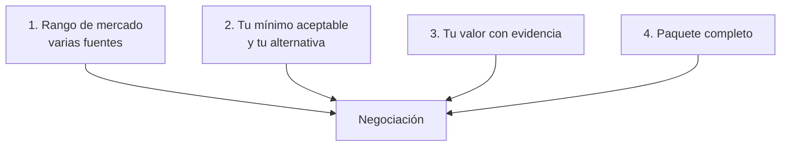

# Negociación salarial

Parte de: [[14-Carrera-Liderazgo/04 Búsqueda de trabajo/_Índice Búsqueda de trabajo|Búsqueda de trabajo]]

> [!info] Cómo avanzar
> `progreso`: **pendiente** → **viendo** (estudiando) → **visto** (contestaste la autoevaluación sin abrir las respuestas) → **dominado** (hiciste el laboratorio o lo aplicaste de verdad).

## Contenido

### Qué es
La **negociación salarial** es la conversación en la que acuerdas tu compensación al recibir una oferta o al pedir un aumento. No es un pleito: es un intercambio de información en el que ambas partes quieren llegar a un acuerdo. Prepararla bien puede cambiar más tu ingreso que un año de trabajo extra.

### Cómo funciona
**Antes de negociar, prepara cuatro cosas:**



1. **Rango de mercado** para el rol, el nivel, la ciudad y la modalidad (presencial, híbrido, remoto para empresa extranjera). Usa varias fuentes: encuestas salariales, sitios de reportes anónimos, colegas de confianza y reclutadores. Una sola fuente engaña. (No se incluyen cifras aquí porque cambian rápido; consulta fuentes actuales.)
2. **Tu mínimo y tu alternativa.** El mínimo es la cifra por debajo de la cual dices que no. Tu alternativa (en negociación se llama BATNA: la mejor alternativa si no hay acuerdo) puede ser quedarte en tu empleo actual u otra oferta. Mientras mejor sea tu alternativa, más tranquilo negocias.
3. **Tu valor con evidencia.** Historias concretas: "Reduje los incidentes de pagos a cero", "lideré la migración a .NET 10".
4. **El paquete completo**, no solo el salario base: bonos, vales, seguro de gastos médicos mayores, fondo de ahorro, días de vacaciones por encima de la ley, presupuesto de aprendizaje, equipo, modalidad remota.

**Mínimos de ley en México (para comparar paquetes en nómina):** desde el 1 de enero de 2023, la Ley Federal del Trabajo da al menos 12 días de vacaciones después del primer año, con prima vacacional mínima del 25%; el aguinaldo mínimo sigue siendo de 15 días de salario (hay iniciativas para aumentarlo que, al momento de escribir esto, no se han publicado como ley). Si te ofrecen un esquema como contratista independiente en lugar de nómina, esas prestaciones no aplican: compara el ingreso neto después de impuestos y de pagar tú mismo seguro y vacaciones, y confirma los detalles fiscales con un contador.

### Ejemplo
**"¿Cuánto quieres ganar?" al inicio del proceso.** Opciones:
- Pedir primero el rango: "Antes de dar una cifra, ¿me compartes el rango presupuestado para el puesto?"
- Dar un rango basado en mercado cuyo **mínimo ya te parezca bien**: "Por lo que he investigado para un senior .NET con Azure, busco entre X y Y, dependiendo del paquete completo."

**Al recibir la oferta:**
> "Muchas gracias, me interesa mucho el puesto. ¿Me pueden mandar la oferta por escrito con el desglose del paquete? Les respondo el jueves."

**Contraoferta por escrito:**

```text
Gracias por la oferta. Estoy muy interesado en el rol y en el equipo.
Considerando mi experiencia liderando la integración de pagos y la
migración a Azure, y el rango de mercado para este nivel, me gustaría
proponer un salario base de [cifra]. Si eso no es posible, estaría
abierto a revisar un bono de firma o 5 días adicionales de vacaciones.
¿Podemos platicarlo?
```

Fíjate en tres cosas: agradeces, justificas con valor y mercado (no con tus gastos), y ofreces alternativas.

### Cuándo usarlo y cuándo no
Negocia siempre que recibas una oferta: casi ninguna empresa retira una oferta porque pediste con respeto. También al pedir aumento: llega con tu registro de logros ([[Diario de aprendizaje]]) y con el nivel que ya demuestras ([[Desarrollador senior - expectativas]]). Si la oferta ya está muy por encima de tu rango y la empresa dice que es fija, puede bastar con negociar algo del paquete. No negocies sin tener claro tu mínimo.

### Errores comunes
1. **Aceptar en el momento** la primera oferta. Pide tiempo y responde por escrito.
2. **Negociar solo el salario base** e ignorar bonos, prestaciones, modalidad y aprendizaje.
3. **Justificar con tus gastos** ("tengo que pagar la renta"). Justifica con valor y mercado.
4. **Mentir sobre otra oferta.** Si te piden pruebas o la comparan, pierdes credibilidad.
5. **Dar una cifra sin investigar** y quedar muy por debajo del rango del puesto.

### Para profundizar
- [What is BATNA? — Harvard Program on Negotiation](https://www.pon.harvard.edu/daily/batna/translate-your-batna-to-the-current-deal/)
- [Ley Federal del Trabajo — Cámara de Diputados](https://www.diputados.gob.mx/LeyesBiblio/pdf/LFT.pdf)
- [Get your work recognized: write a brag document — Julia Evans](https://jvns.ca/blog/brag-documents/)

## Autoevaluación

Contesta primero en voz alta o en papel; luego despliega la respuesta.

> [!question]- ¿Qué preparas antes de negociar?
> Rango de mercado para el rol y la ubicación/modalidad (de varias fuentes), tu mínimo aceptable, tu valor con evidencia y el paquete completo (bonos, prestaciones, remoto, aprendizaje).

> [!question]- ¿Qué responder a "¿cuánto quieres ganar?" al inicio?
> Puedes pedir primero el rango del puesto, o dar un rango basado en mercado cuyo mínimo ya te parezca bien.

> [!question]- Error común.
> Aceptar la primera oferta en el momento, o negociar solo el salario base ignorando el resto del paquete. Pide tiempo y responde por escrito.

