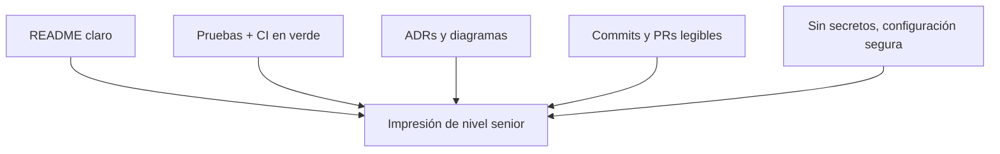

# Portafolio y GitHub

Parte de: [[14-Carrera-Liderazgo/04 Búsqueda de trabajo/_Índice Búsqueda de trabajo|Búsqueda de trabajo]]

> [!info] Cómo avanzar
> `progreso`: **pendiente** → **viendo** (estudiando) → **visto** (contestaste la autoevaluación sin abrir las respuestas) → **dominado** (hiciste el laboratorio o lo aplicaste de verdad).

## Contenido

### Qué es
Tu **portafolio** (normalmente tu perfil de GitHub, más quizá un sitio personal o artículos) es la evidencia pública de cómo trabajas. Para un puesto senior no impresiona la cantidad de repositorios, sino **2–3 proyectos sólidos** que muestren criterio: decisiones explicadas, pruebas, automatización y un README que deja correrlo en minutos.

### Cómo funciona
Lo que hace que un repositorio de portafolio impresione:



1. **README** con: el problema que resuelve, diagrama de arquitectura ([[Diagramas C4]]), cómo correrlo en minutos (por ejemplo, `docker compose up` y `dotnet run`), capturas o GIF, y decisiones principales.
2. **Pruebas** unitarias y de integración, y un **pipeline** (GitHub Actions o Azure Pipelines) con el badge en verde.
3. **Decisiones documentadas**: una carpeta `docs/adr` con 3–5 ADRs muestra criterio mejor que cualquier línea de código ([[Cómo documentar una decisión técnica]]).
4. **Historial legible**: commits con mensajes claros, PRs aunque trabajes solo.
5. **Seguridad básica**: secretos fuera del repo (user-secrets, variables de entorno), `.gitignore` correcto.

**Proyectos que muestran nivel senior** son los que resuelven un problema real con decisiones de diseño explicadas: multi-tenancy, [[Patrón Outbox]], resiliencia con [[Circuit breaker y reintentos]], observabilidad con [[Logging estructurado]], autenticación propia, despliegue automatizado a Azure. Un CRUD más de tareas no diferencia a nadie.

### Ejemplo
Ya tienes material: Xolotl.Hecate (identidad con JWT RS256 y PKCE) es un excelente candidato. Estructura sugerida del README:

```markdown
# Xolotl.Hecate — Servidor de identidad (OAuth 2.0 + PKCE, JWT RS256)

Problema: varias APIs necesitaban autenticación común sin depender
de un proveedor externo.

Arquitectura: diagrama C4 nivel 2 (docs/c4-contenedores.png)

Correr en 5 minutos:
  docker compose up -d sqlserver
  dotnet user-secrets set "Firma:LlavePrivada" "<ruta>"
  dotnet run --project src/Hecate.Api

Decisiones (docs/adr):
  0001 RS256 en lugar de HS256
  0002 PKCE obligatorio para clientes públicos
  0003 Rotación de llaves con JWKS

Pruebas: 84 pruebas (unitarias + integración con Testcontainers)
CI: badge del pipeline
```

Antes de hacerlo público, revisa que no haya secretos en el historial (no basta con borrarlos en el último commit; hay que reescribir el historial o rotar el secreto). Y si un proyecto tiene código de la empresa, no lo publiques.

### Cuándo usarlo y cuándo no
Un portafolio pesa más cuando cambias de empresa, vas a trabajo remoto para el extranjero o no tienes experiencia laboral fácil de verificar. En entrevistas, úsalo como tema: "¿Quieres que te muestre cómo resolví la rotación de llaves?". Si tu experiencia laboral es fuerte pero todo es privado, compensa con artículos ([[Escribir artículos técnicos]]) o contribuciones ([[Contribuir a open source]]). No inviertas meses en el portafolio en lugar de prepararte para las entrevistas ([[Preparación para entrevistas técnicas]]).

### Errores comunes
1. **Secretos en el historial** (cadenas de conexión, llaves). Es una señal roja inmediata para cualquier revisor senior.
2. **Sin README** o con el README por defecto de la plantilla.
3. **Clones de tutoriales** sin nada propio.
4. **Veinte proyectos a medias** en lugar de tres terminados.
5. **No poder correrlo**: dependencias no documentadas, pasos que solo funcionan en tu máquina.

### Para profundizar
- [How to Contribute to Open Source — Open Source Guides](https://opensource.guide/how-to-contribute/)
- [Architectural Decision Records (adr.github.io)](https://adr.github.io/)
- [eShop — aplicación de referencia de .NET](https://github.com/dotnet/eShop): ejemplo de cómo se ve un repositorio bien documentado.

## Autoevaluación

Contesta primero en voz alta o en papel; luego despliega la respuesta.

> [!question]- ¿Qué hace que un repositorio de portafolio impresione?
> README claro (problema, arquitectura, cómo correrlo en minutos, capturas), pruebas, CI en verde, decisiones documentadas (ADRs) y commits legibles. Mejor 2–3 proyectos sólidos que 20 a medias.

> [!question]- ¿Qué proyectos muestran nivel senior?
> Los que resuelven un problema real con decisiones de diseño explicadas: multi-tenancy, outbox, resiliencia, observabilidad, despliegue automatizado.

> [!question]- Error común.
> Repos con secretos en el historial, sin README o clones de tutoriales sin nada propio.

