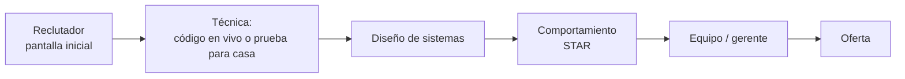

# Preparación para entrevistas técnicas

Parte de: [[14-Carrera-Liderazgo/04 Búsqueda de trabajo/_Índice Búsqueda de trabajo|Búsqueda de trabajo]]

> [!info] Cómo avanzar
> `progreso`: **pendiente** → **viendo** (estudiando) → **visto** (contestaste la autoevaluación sin abrir las respuestas) → **dominado** (hiciste el laboratorio o lo aplicaste de verdad).

## Contenido

### Qué es
Prepararte para entrevistas técnicas es practicar de forma específica los formatos con los que las empresas evalúan a un candidato. Saber programar bien no garantiza pasar: las entrevistas son una habilidad aparte, que se entrena. Para un puesto senior .NET, la preparación incluye código, diseño, comportamiento y tus propias preguntas.

### Cómo funciona
Tipos de entrevista que suelen aparecer (el orden y la cantidad varían por empresa):



1. **Pantalla inicial:** experiencia, expectativas, inglés (si es para el extranjero).
2. **Código en vivo o prueba para casa:** un problema algorítmico o una mini API (por ejemplo, "un endpoint con validación y pruebas").
3. **Preguntas técnicas del stack:** `async/await`, inyección de dependencias y tiempos de vida, EF Core vs Dapper, índices en SQL Server, autenticación con JWT.
4. **Diseño de sistemas:** ver [[Entrevistas de diseño de sistemas]].
5. **Comportamiento:** ver [[Entrevistas de comportamiento (método STAR)]].
6. **Conversación con el equipo o gerente:** encaje y expectativas.

**Cómo prepararte para código en vivo:** practica **en voz alta**, porque el razonamiento cuenta tanto como el resultado:
1. Aclara el problema y los casos borde ("¿la lista puede venir vacía?, ¿hay duplicados?").
2. Propón un enfoque y su complejidad antes de escribir.
3. Escribe código limpio, con nombres claros.
4. Prueba con ejemplos, incluidos los borde.
5. Analiza complejidad y menciona mejoras.

### Ejemplo
Problema típico: "Dada una lista de transacciones, regresa los IDs de clientes con más de 3 transacciones en la misma hora."

Cómo pensar en voz alta:
> "Antes de codificar: ¿las transacciones vienen ordenadas? ¿'misma hora' es la hora de reloj o una ventana de 60 minutos? Voy a asumir hora de reloj. Agrupo por cliente y por hora truncada, y filtro los grupos con más de 3. Es O(n) en tiempo y O(n) en memoria."

```csharp
public record Transaccion(int ClienteId, DateTime Fecha, decimal Monto);

public static IReadOnlyList<int> ClientesSospechosos(IEnumerable<Transaccion> transacciones) =>
    transacciones
        .GroupBy(t => (t.ClienteId, Hora: new DateTime(t.Fecha.Year, t.Fecha.Month, t.Fecha.Day, t.Fecha.Hour, 0, 0)))
        .Where(g => g.Count() > 3)
        .Select(g => g.Key.ClienteId)
        .Distinct()
        .ToList();
```

> "Lo pruebo con: lista vacía, un cliente con 4 transacciones a las 10:05, 10:20, 10:40 y 10:59 (debe salir), y uno con 4 entre 10:50 y 11:10 (no sale con mi supuesto; con ventana móvil sí saldría, eso cambiaría el algoritmo)."

**Preguntas que haces tú al final** (también te evalúan por ellas):
- "¿Cómo se toman las decisiones técnicas en el equipo? ¿Usan design docs o ADRs?"
- "¿Cómo es un día típico en este rol?"
- "¿Cómo miden el éxito de esta posición en los primeros 6 meses?"
- "¿Cuál es el mayor reto técnico del equipo ahora?"
- "¿Cómo funciona la guardia (on-call)?"

### Cuándo usarlo y cuándo no
Empieza a prepararte 4–8 semanas antes de buscar activamente: unos problemas de código por semana, un caso de diseño semanal con cronómetro y tus historias STAR escritas ([[Lab 3 - Preparar historias STAR]]). Si la entrevista es en inglés, practica en inglés ([[Inglés técnico - hablar en reuniones y entrevistas]]). No memorices soluciones: los entrevistadores cambian el problema para ver cómo razonas.

### Errores comunes
1. **Codificar en silencio.** El entrevistador no puede evaluar lo que no escucha.
2. **Empezar a escribir sin aclarar** el problema.
3. **No probar** el código con ejemplos.
4. **No tener preguntas** para el final; parece falta de interés.
5. **Preparar solo algoritmos** y llegar sin historias de comportamiento ni práctica de diseño.

### Para profundizar
- [The System Design Primer](https://github.com/donnemartin/system-design-primer)
- [Google Engineering Practices: Code Review](https://google.github.io/eng-practices/review/): lo que un revisor espera ver en tu código.
- [Gilded Rose — Coding Dojo](https://codingdojo.org/kata/gilded-rose/): kata clásica de refactor, útil para pruebas para casa.

## Autoevaluación

Contesta primero en voz alta o en papel; luego despliega la respuesta.

> [!question]- ¿Qué tipos de entrevistas técnicas suele haber?
> Pantalla inicial, código en vivo o prueba para casa, diseño de sistemas, comportamiento (STAR) y conversación con el equipo/gerente.

> [!question]- ¿Cómo te preparas para código en vivo?
> Practicar en voz alta: aclarar el problema, proponer un enfoque, escribir, probar con ejemplos y analizar complejidad. El razonamiento cuenta tanto como el resultado.

> [!question]- ¿Qué preguntas haces tú al final?
> Cómo se toman decisiones técnicas, cómo es un día típico, cómo miden el éxito del rol, qué retos tiene el equipo, cómo es la guardia/on-call.

## Práctica

- [[Lab 3 - Preparar historias STAR]]
- [[Lab 4 - Simulacro de entrevista de diseño de sistemas]]

