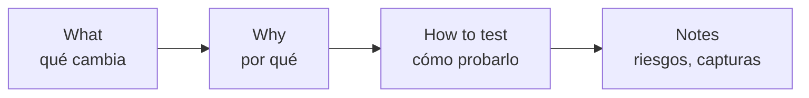

# Inglés técnico - escribir PRs, issues y design docs

Parte de: [[14-Carrera-Liderazgo/05 Inglés técnico/_Índice Inglés técnico|Inglés técnico]]

> [!info] Cómo avanzar
> `progreso`: **pendiente** → **viendo** (estudiando) → **visto** (contestaste la autoevaluación sin abrir las respuestas) → **dominado** (hiciste el laboratorio o lo aplicaste de verdad).

## Contenido

### Qué es
Escribir en inglés técnico es redactar descripciones de PR, issues, bug reports, comentarios de revisión y design docs que otra persona entienda sin preguntarte. Es la habilidad de inglés que más evidencia deja de tu nivel: un PR claro en inglés es parte de tu portafolio y lo primero que ve un equipo internacional de ti. La buena noticia: al ser asíncrono, tienes tiempo de revisar.

### Cómo funciona
**Descripción de PR:** cuatro bloques.



- **Título en imperativo**, como si completara "This PR will...": *Add retry policy to payment client*, *Fix null reference in order cancellation*.
- Frases cortas, voz activa, una idea por oración.

**Bug report:** *Summary*, *Steps to reproduce*, *Expected behavior*, *Actual behavior*, *Environment* (versión, sistema, navegador) y *Logs/Screenshots*.

**Design doc:** *Context*, *Goals / Non-goals*, *Proposal*, *Alternatives considered*, *Trade-offs*, *Open questions* ([[Design docs y RFCs]]).

**Errores típicos de hispanohablantes (calcos):**

| Incorrecto | Correcto | Nota |
|---|---|---|
| *Actually the endpoint fails* (queriendo decir "actualmente") | *Currently the endpoint fails* | *actually* = "en realidad" |
| *I assist to the daily* | *I attend the daily* | *assist* = ayudar |
| *Make a question* | *Ask a question* | |
| *The user don't have* | *The user doesn't have* | tercera persona |
| *Depends of* | *Depends on* | |
| *Explain me* | *Explain to me* | |

### Ejemplo
**PR que agrega idempotencia al webhook de pagos:**

```markdown
Title: Add idempotency to payment webhook

## What
- Add EventoProcesado table with a unique key on the provider event_id.
- Update usp_Pago_Registrar to insert the event in the same transaction
  and return the previous result if the event was already processed.

## Why
The provider retries webhooks when we don't respond within 10 seconds.
We recorded 3 duplicate payments in September. See ADR-0007.

## How to test
1. Run the integration tests: dotnet test --filter Category=Webhooks
2. Send the same event twice to POST /webhooks/pagos.
3. Verify that only one payment row is created and both calls return 200.

## Notes
- Adds a nightly job to purge events older than 90 days.
- No breaking changes to the public API.
```

**Corrección de una frase:**
> Original: *"Actually the endpoint returns 500 when the user don't have permissions. I assist to the daily to explain it."*
> Corregido: *"Currently, the endpoint returns 500 when the user doesn't have permissions. I'll explain it at the daily."*

Y técnicamente, falta de permisos debería ser 403, no 500; vale la pena mencionarlo en el mismo issue.

**Traducción para un design doc:**
> "Se propone usar una cola para desacoplar el envío de correos; como desventaja, aumenta la latencia de entrega."
> → *"We propose using a queue to decouple email sending. As a trade-off, it increases delivery latency."*

Frases útiles en revisiones: *"Nit: ..."*, *"Could we ...?"*, *"What happens if ...?"*, *"I'd suggest ... because ..."*, *"Looks good to me, just one question."*

### Cuándo usarlo y cuándo no
Escribe en inglés en repositorios públicos, en equipos internacionales y, si tu equipo lo acepta, también en el trabajo diario para practicar. Si el equipo es local y prefiere español, respeta la convención del equipo y practica en tus proyectos personales ([[Lab 5 - Escribir un PR y un issue en inglés]]). Usa herramientas de corrección como apoyo, pero revisa que no cambien el significado técnico.

### Errores comunes
1. **Calcos del español** como los de la tabla.
2. **Párrafos largos con muchas subordinadas.** En inglés técnico, frases cortas.
3. **Títulos de PR vagos** (*Changes*, *Fix bug*). Di qué y dónde.
4. **Omitir *How to test*.** El revisor no sabe cómo verificar.
5. **Traducir literal las expresiones** ("dar seguimiento" no es *give follow*; es *follow up*).

### Para profundizar
- [Technical Writing courses — Google for Developers](https://developers.google.com/tech-writing)
- [Improve pull request descriptions using templates — Azure DevOps](https://learn.microsoft.com/en-us/azure/devops/repos/git/pull-request-templates)
- [Conventional Comments](https://conventionalcomments.org/)

## Ejercicios

Resuélvelos en papel o en la herramienta; la solución está plegada.

> [!question]- Escribe en inglés el título y descripción de un PR que agrega idempotencia al webhook de pagos.
> **Title:** Make payment webhook handler idempotent
>
> **What:** Store processed event IDs and skip events that were already handled.
>
> **Why:** The provider retries webhooks, and we were applying some payments twice.
>
> **How to test:** Send the same webhook payload twice to `/webhooks/payments`; only one payment update should be recorded.
>
> **Notes:** Adds a `ProcessedEvents` table (migration included).

> [!question]- Corrige: "Actually the endpoint returns 500 when the user don't have permissions. I assist to the daily to explain it."
> "**Currently**, the endpoint returns 500 when the user **doesn't** have permissions. I'll **attend** the daily (stand-up) to explain it." Además, probablemente debería devolver 403.

> [!question]- Traduce al inglés: "Se propone usar una cola para desacoplar el envío de correos; como desventaja, aumenta la latencia de entrega."
> "We propose using a queue to decouple email sending; as a downside, it increases delivery latency."

## Autoevaluación

Contesta primero en voz alta o en papel; luego despliega la respuesta.

> [!question]- ¿Qué estructura tiene una buena descripción de PR en inglés?
> **What** (qué cambia), **Why** (por qué), **How to test** (cómo probarlo), y notas (riesgos, capturas). Títulos en imperativo: "Add retry policy to payment client".

> [!question]- ¿Qué partes tiene un buen bug report?
> *Summary*, *Steps to reproduce*, *Expected behavior*, *Actual behavior*, *Environment* y logs o capturas.

> [!question]- Error común de hispanohablantes.
> Calcos: "actually" usado como "actualmente" (es "en realidad"; "actualmente" = *currently*); "assist to a meeting" (es *attend*); "make a question" (es *ask a question*).

## Práctica

- [[Lab 5 - Escribir un PR y un issue en inglés]]

