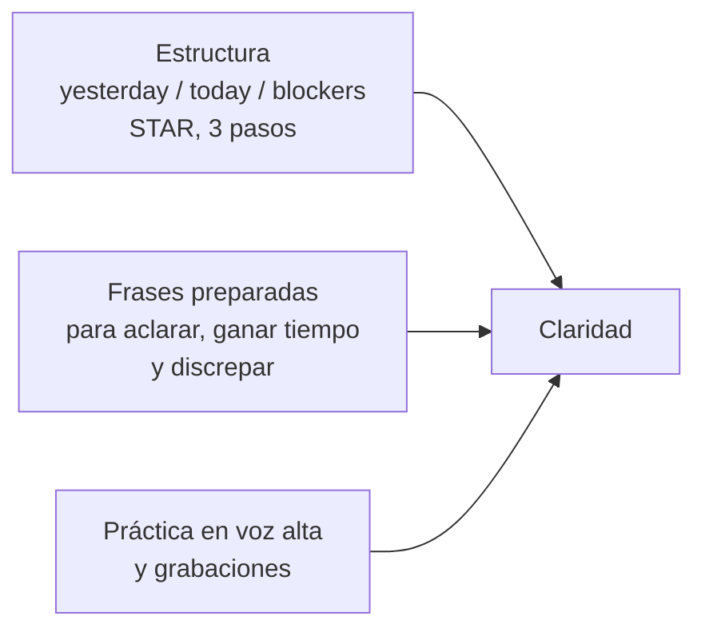

# Inglés técnico - hablar en reuniones y entrevistas

Parte de: [[14-Carrera-Liderazgo/05 Inglés técnico/_Índice Inglés técnico|Inglés técnico]]

> [!info] Cómo avanzar
> `progreso`: **pendiente** → **viendo** (estudiando) → **visto** (contestaste la autoevaluación sin abrir las respuestas) → **dominado** (hiciste el laboratorio o lo aplicaste de verdad).

## Contenido

### Qué es
Hablar en inglés en reuniones (daily, planning, revisiones de diseño) y en entrevistas es la habilidad que más nervios genera y la que más pesa en puestos remotos con empresas extranjeras. No necesitas acento perfecto: necesitas **claridad**, **estructura** y un repertorio de **frases útiles** para pedir aclaraciones, ganar tiempo y expresar desacuerdo con cortesía.

### Cómo funciona
Tres herramientas que funcionan:

1. **Estructura:** si sabes la forma de la respuesta, solo te falta el contenido. Daily: ayer, hoy, bloqueos. Entrevista de comportamiento: STAR ([[Entrevistas de comportamiento (método STAR)]]). Diseño: "I'd approach it in three steps...".
2. **Frases preparadas** (abajo).
3. **Práctica en voz alta**, no solo mental. Grábate y escúchate.

**Pedir que repitan o aclaren:**
- *"Sorry, could you say that again, please?"*
- *"Just to make sure I understood: you mean ...?"*
- *"Could you give me an example?"*
- *"Could you speak a bit slower? The connection is breaking up."*

**Ganar tiempo sin quedarte callado:**
- *"Let me think about that for a second."*
- *"That's a good question. Let me start with the requirements."*
- *"I'd approach it in three steps..."*
- *"If I understand correctly, the main constraint is ..."*

**Expresar desacuerdo con cortesía:**
- *"I see your point, but I'm concerned about ..."*
- *"Have we considered ...?"*
- *"What if we ...?"*
- *"I might be missing something, but ..."*

### Ejemplo
**Update de daily** (ayer terminaste el endpoint de reembolsos, hoy harás las pruebas, estás bloqueado esperando credenciales del sandbox):

> *"Yesterday I finished the refunds endpoint. Today I'm going to write the integration tests for it. I'm blocked on the sandbox credentials from the payment provider; I asked for them on Monday. Could someone help me follow up?"*

**"Tell me about yourself"** en tres frases:

> *"I'm a .NET developer from Mexico with several years of experience building APIs with ASP.NET Core, SQL Server and Azure. Recently I designed an identity server with JWT and PKCE, and I led the integration of a payment provider, including idempotent webhooks and retries. I'm looking for a senior role where I can own the design of backend systems and help the team grow."*

Estructura: quién eres y tu stack → un logro concreto → qué buscas. Ensáyala hasta que salga natural, sin memorizarla palabra por palabra.

**Desacuerdo en una revisión de diseño:**
> *"I see your point about calling the email service directly; it's simpler. I'm concerned about what happens when the provider is down: the order request would fail. What if we put a queue in between? It adds some latency, but orders wouldn't depend on email."*

### Cuándo usarlo y cuándo no
Practica cada día unos minutos (tu daily en inglés en voz alta, aunque tu equipo hable español) y antes de cada entrevista prepara: presentación personal, 6 historias STAR y un caso de diseño en inglés. Si no entiendes algo en una reunión, pregunta: fingir que entendiste es peor que pedir que repitan. Ver el plan general en [[Inglés técnico - plan de estudio]].

### Errores comunes
1. **Quedarte callado** mientras piensas; usa frases para ganar tiempo.
2. **Fingir que entendiste.** Después haces lo equivocado.
3. **Traducir mentalmente** frase por frase; prepara bloques completos.
4. **Disculparte todo el tiempo** por tu inglés. Una vez basta, o ninguna.
5. **Memorizar respuestas palabra por palabra**; suenan robóticas y te pierdes si te interrumpen.

### Para profundizar
- [The CEFR Levels — Council of Europe](https://www.coe.int/en/web/common-european-framework-reference-languages/level-descriptions)
- [The System Design Primer](https://github.com/donnemartin/system-design-primer): material en inglés para practicar casos de diseño en voz alta.

## Ejercicios

Resuélvelos en papel o en la herramienta; la solución está plegada.

> [!question]- Di en inglés (en voz alta) tu update de daily: ayer terminaste el endpoint de reembolsos, hoy harás las pruebas, y estás bloqueado esperando credenciales del sandbox.
> "Yesterday I finished the refunds endpoint. Today I'm going to write the integration tests. I'm blocked waiting for the sandbox credentials; could someone help me with that?"

> [!question]- Responde en inglés: "Tell me about yourself" (versión de 3 frases).
> Modelo: "I'm a backend developer with N years of experience building .NET APIs and SaaS products. Recently I've worked on multi-tenant systems with Clean Architecture, CQRS and reliable messaging using the outbox pattern. I'm looking for a role where I can take ownership of system design and help the team grow."

## Autoevaluación

Contesta primero en voz alta o en papel; luego despliega la respuesta.

> [!question]- Frases útiles para pedir que repitan o aclaren.
> "Could you say that again, please?", "Just to make sure I understood: you mean…?", "Could you give me an example?"

> [!question]- ¿Cómo ganas tiempo para pensar en una entrevista sin quedarte callado?
> "Let me think about that for a second.", "That's a good question; let me start with the requirements.", "I'd approach it in three steps…"

> [!question]- ¿Cómo expresas desacuerdo con cortesía?
> "I see your point, but I'm concerned about…", "Have we considered…?", "What if we…?"

