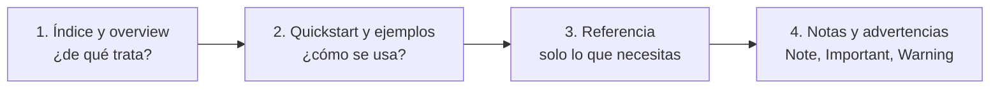

# Inglés técnico - leer documentación y RFCs

Parte de: [[14-Carrera-Liderazgo/05 Inglés técnico/_Índice Inglés técnico|Inglés técnico]]

> [!info] Cómo avanzar
> `progreso`: **pendiente** → **viendo** (estudiando) → **visto** (contestaste la autoevaluación sin abrir las respuestas) → **dominado** (hiciste el laboratorio o lo aplicaste de verdad).

## Contenido

### Qué es
Leer documentación técnica en inglés (Microsoft Learn, READMEs, issues de GitHub, RFCs de la IETF) es la habilidad de inglés que más usas como desarrollador. La documentación en inglés suele estar más actualizada que las traducciones automáticas, y en temas como HTTP, OAuth o JWT la fuente definitiva es un RFC. Aprender a leerla bien te ahorra horas y te evita errores por interpretar mal una palabra clave.

### Cómo funciona
**Estrategia para documentación larga** (no se lee de principio a fin):



1. **Índice y *overview*:** te da el mapa y el vocabulario.
2. ***Quickstart* y ejemplos:** el código muestra el uso real más rápido que la prosa.
3. **Referencia:** busca solo el método o la opción que necesitas.
4. **Avisos:** las cajas *Note*, *Important* y *Warning* suelen tener lo que causa bugs.

**Palabras clave de los RFC (RFC 2119, aclarado por RFC 8174):** solo tienen este significado especial cuando aparecen **en mayúsculas**.

| Palabra | Significado |
|---|---|
| MUST / REQUIRED / SHALL | Obligatorio |
| MUST NOT / SHALL NOT | Prohibido |
| SHOULD / RECOMMENDED | Recomendado; puede haber razones válidas para no hacerlo, pero hay que entender las consecuencias |
| SHOULD NOT / NOT RECOMMENDED | Desaconsejado, con la misma salvedad |
| MAY / OPTIONAL | Opcional |

**Términos que aparecen todo el tiempo:**
- ***Idempotent***: repetir la operación da el mismo resultado ([[Idempotencia]]).
- ***Backward compatible***: lo nuevo sigue funcionando con clientes o datos viejos.
- ***Breaking change***: un cambio que rompe a quien ya usaba la versión anterior.
- ***Deprecated***: aún funciona, pero se desaconseja y se eliminará en el futuro. ***Obsolete*** en .NET se marca con el atributo `[Obsolete]` y genera advertencia (o error). ***Removed***: ya no existe.

### Ejemplo
**Traducciones de práctica:**

> "The server MUST NOT send a response body for a 204 status code."
> → "El servidor **no debe** (prohibido) enviar un cuerpo de respuesta con un código de estado 204."

> "This API is deprecated and will be removed in a future release. Use `GetAsync` instead."
> → "Esta API está obsoleta (desaconsejada) y se eliminará en una versión futura. Usa `GetAsync` en su lugar."

Cómo se ve en código .NET:

```csharp
public class ClienteHttp
{
    [Obsolete("Usa GetAsync. Este método se eliminará en la versión 3.0.")]
    public string Get(string url) => GetAsync(url).GetAwaiter().GetResult();

    public Task<string> GetAsync(string url) => _http.GetStringAsync(url);

    private readonly HttpClient _http = new();
}
```

**Leer un issue de GitHub** para decidir si un bug te afecta: busca la versión afectada (*affected versions*), la solución temporal (*workaround*) y si ya hay un *fix* en una versión publicada (*released in*).

### Cuándo usarlo y cuándo no
Lee en inglés siempre que la fuente original esté en inglés: documentación de .NET, Azure, librerías y RFCs. Para un concepto que no entiendes, está bien leer primero una explicación en español y luego volver al original. Usa traductor como apoyo puntual (una frase compleja), no para traducir páginas completas: pierdes la precisión de términos como *SHOULD* o *deprecated*.

### Errores comunes
1. **Leer todo de principio a fin** y perderte antes de llegar a lo útil.
2. **Ignorar las mayúsculas** en RFCs: *should* en minúscula es lenguaje normal; *SHOULD* es un nivel de requisito.
3. **Confundir *deprecated* con *removed*** y entrar en pánico o, al revés, seguir usando algo que ya va a desaparecer.
4. **Usar la página traducida automáticamente**, que puede estar desactualizada o mal traducida.
5. **Saltarse las advertencias** (*Warning*, *Important*).

### Para profundizar
- [RFC 2119: Key words for use in RFCs to Indicate Requirement Levels](https://www.rfc-editor.org/rfc/rfc2119)
- [RFC 8174: Ambiguity of Uppercase vs Lowercase in RFC 2119 Key Words](https://www.rfc-editor.org/rfc/rfc8174)
- [Technical Writing courses — Google for Developers](https://developers.google.com/tech-writing)

## Ejercicios

Resuélvelos en papel o en la herramienta; la solución está plegada.

> [!question]- Traduce: "The server MUST NOT send a response body for a 204 status code."
> "El servidor **no debe** (obligatorio) enviar cuerpo de respuesta con el código 204."

> [!question]- Traduce: "This API is deprecated and will be removed in a future release. Use `GetAsync` instead."
> "Esta API está obsoleta (desaconsejada) y se eliminará en una versión futura. Usa `GetAsync` en su lugar."

> [!question]- ¿Qué significa "idempotent", "backward compatible" y "breaking change"?
> *Idempotent*: repetirlo no cambia el resultado. *Backward compatible*: lo nuevo funciona con clientes viejos. *Breaking change*: cambio que rompe a quien ya lo usa.

## Autoevaluación

Contesta primero en voz alta o en papel; luego despliega la respuesta.

> [!question]- ¿Qué significan MUST, SHOULD y MAY en un RFC?
> Según RFC 2119: **MUST** = obligatorio; **SHOULD** = recomendado, salvo razones válidas; **MAY** = opcional. Sus negaciones: MUST NOT, SHOULD NOT.

> [!question]- ¿Qué estrategia usas para leer documentación larga?
> Primero el índice y el *overview*, luego los ejemplos (*quickstart*), y solo después la referencia de lo que necesitas.

> [!question]- Diferencia entre *deprecated* y *obsolete/removed*.
> *Deprecated*: aún funciona pero se desaconseja y se eliminará. *Removed*: ya no existe.

