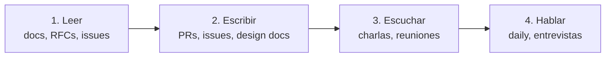

# Inglés técnico - plan de estudio

Parte de: [[14-Carrera-Liderazgo/05 Inglés técnico/_Índice Inglés técnico|Inglés técnico]]

> [!info] Cómo avanzar
> `progreso`: **pendiente** → **viendo** (estudiando) → **visto** (contestaste la autoevaluación sin abrir las respuestas) → **dominado** (hiciste el laboratorio o lo aplicaste de verdad).

## Contenido

### Qué es
Un **plan de estudio de inglés técnico** es una rutina enfocada en el inglés que realmente usas como desarrollador: leer documentación, escribir PRs e issues, participar en reuniones y pasar entrevistas. Para un desarrollador .NET en México, el inglés abre puestos remotos con empresas extranjeras, equipos internacionales y la documentación más actual, que casi siempre sale primero en inglés.

### Cómo funciona
**Orden de prioridad** (de lo que más usas a lo que más cuesta):

1. **Leer** primero, porque es diario y se mejora rápido. Ver [[Inglés técnico - leer documentación y RFCs]].
2. **Escribir**, porque es asíncrono (tienes tiempo de revisar) y deja evidencia. Ver [[Inglés técnico - escribir PRs, issues y design docs]].
3. **Escuchar**, para acostumbrar el oído a acentos distintos.
4. **Hablar**, que es lo que más cuesta y lo que más pesa en entrevistas. Ver [[Inglés técnico - hablar en reuniones y entrevistas]].

**Práctica diaria con poco tiempo** (unos 20–30 minutos repartidos):
- Lee la documentación oficial **en inglés** (Microsoft Learn en `en-us`, no la traducción).
- Escribe tus **commits y PRs en inglés**, aunque el equipo sea mexicano (si el equipo lo acepta).
- **15 minutos al día hablando en voz alta**: explica lo que hiciste hoy como si fuera tu daily en inglés. Grábate con el celular.
- **Una charla técnica a la semana** con subtítulos en inglés (no en español): conferencias de .NET, Azure o arquitectura.
- Un cuaderno o nota de **vocabulario** con frases completas, no palabras sueltas ([[Vocabulario técnico en inglés]]).

**Medir el avance:**
- Grábate explicando el mismo tema técnico cada mes y compara fluidez, pausas y vocabulario.
- Cuenta cuántas veces necesitaste traductor al leer documentación en una semana.
- Feedback en PRs en inglés: ¿te piden aclarar menos?
- Como referencia externa, el Marco Común Europeo (MCER/CEFR) describe niveles de A1 a C2; muchas vacantes remotas piden B2 o más (Pendiente de confirmar según la vacante).

### Ejemplo
Plan semanal para alguien con nivel intermedio y 30 minutos al día:

| Día | Actividad (≈30 min) |
|---|---|
| Lunes | Leer un artículo de Microsoft Learn de lo que estés usando; anotar 5 frases útiles |
| Martes | Escribir en inglés la descripción de tu PR del día |
| Miércoles | Ver 20 min de una charla técnica con subtítulos en inglés; resumir en voz alta 3 ideas |
| Jueves | Grabarte 3 minutos: "Tell me about a project you're proud of" |
| Viernes | Escribir un issue o un mini design doc en inglés de algo real |
| Fin de semana | Revisar la nota de vocabulario; repetir en voz alta las frases |

Una vez al mes: simulacro de entrevista con alguien (un colega, un intercambio de idiomas) o grabándote con preguntas típicas.

### Cuándo usarlo y cuándo no
Empieza ya, aunque no busques trabajo: el inglés tarda meses en mejorar y conviene llegar preparado. Si tu objetivo es una entrevista en fecha cercana, prioriza hablar (historias STAR y presentación personal en inglés). Las clases formales ayudan con la gramática, pero no sustituyen la práctica con tu contenido técnico real. Si ya tienes nivel avanzado, enfócate en precisión al escribir y en fluidez en discusiones técnicas.

### Errores comunes
1. **Estudiar inglés general** (viajes, restaurantes) cuando necesitas inglés técnico.
2. **Solo leer** y nunca hablar; llegas a la entrevista entendiendo todo y sin poder responder.
3. **Esperar a "estar listo"** para usarlo en el trabajo.
4. **Traducir mentalmente palabra por palabra.** Aprende frases completas.
5. **No medir.** Sin grabaciones ni registro, no ves el avance y abandonas.

### Para profundizar
- [The CEFR Levels — Council of Europe](https://www.coe.int/en/web/common-european-framework-reference-languages/level-descriptions)
- [Technical Writing courses — Google for Developers](https://developers.google.com/tech-writing)
- [Google Engineering Practices: Code Review](https://google.github.io/eng-practices/review/): buen material para leer inglés técnico real.

## Autoevaluación

Contesta primero en voz alta o en papel; luego despliega la respuesta.

> [!question]- ¿Qué habilidades del inglés técnico priorizas para tu trabajo?
> Leer (documentación, RFCs, issues) primero, luego escribir (PRs, issues, design docs), luego escuchar y hablar (reuniones, entrevistas).

> [!question]- ¿Cómo practicas a diario con poco tiempo?
> Documentación oficial en inglés, escribir commits y PRs en inglés, una charla técnica con subtítulos en inglés por semana, y 15 min diarios de hablar en voz alta explicando lo que hiciste.

> [!question]- ¿Cómo mides tu avance?
> Grabarte explicando un tema cada mes y comparar; contar cuántas veces necesitaste traductor al leer docs; feedback en PRs.

